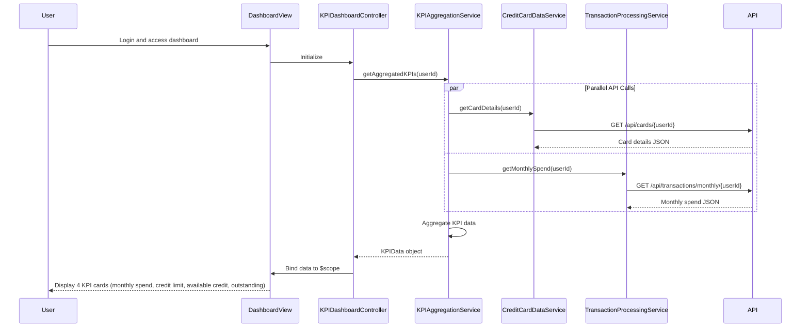

# Low-Level Design: Dashboard KPIs and Credit Card Overview
**Epic ID:** QE-8562  
**Feature:** Consolidated dashboard displaying key performance indicators for credit card portfolio

---

## a. Architecture Mapping

**AngularJS Artifacts:**
- **Module:** `kpiDashboardModule` - Main module for KPI dashboard functionality
- **Controller:** `KPIDashboardController` - Manages KPI data display and real-time refresh
- **Service:** `KPIAggregationService` - Aggregates KPI data from multiple sources
- **Service:** `CreditCardDataService` - Retrieves card details, balances, and credit limits
- **Service:** `TransactionProcessingService` - Calculates monthly spend and outstanding amounts
- **Directive:** `kpiMetricDirective` - Reusable component for displaying individual KPI metric card
- **Factory:** `RealTimeDataRefreshFactory` - Manages polling or WebSocket for real-time updates

**Folder Structure:**
```
app/
├── modules/
│   └── kpi-dashboard/
│       ├── controllers/
│       │   └── KPIDashboardController.js
│       ├── services/
│       │   ├── KPIAggregationService.js
│       │   ├── CreditCardDataService.js
│       │   └── TransactionProcessingService.js
│       ├── directives/
│       │   └── kpiMetricDirective.js
│       ├── factories/
│       │   └── RealTimeDataRefreshFactory.js
│       ├── views/
│       │   └── kpi-dashboard.html
│       └── kpi-dashboard.module.js
```

---

## b. Component Specifications

| Component Name | Artifact Type | Responsibility | Key Dependencies |
|----------------|---------------|----------------|------------------|
| KPIDashboardController | Controller | Binds aggregated KPI data to view, manages refresh cycle | KPIAggregationService, RealTimeDataRefreshFactory, $scope |
| KPIAggregationService | Service | Aggregates multi-card KPI data, orchestrates parallel API calls | CreditCardDataService, TransactionProcessingService, $q |
| CreditCardDataService | Service | Fetches card details, balances, and credit limits via REST API | $http, $q |
| TransactionProcessingService | Service | Retrieves and calculates monthly spend and outstanding amounts | $http, $q |
| kpiMetricDirective | Directive | Renders individual KPI metric with icon, value, and label in responsive card | None |
| RealTimeDataRefreshFactory | Factory | Implements polling (30s interval) or WebSocket for real-time KPI updates | $interval, $rootScope |

---

## c. Data Model

**KPIData (JavaScript Object):**
```javascript
{
  userId: String,
  monthlySpend: Number,
  totalCreditLimit: Number,
  availableCredit: Number,
  outstandingAmount: Number,
  cards: Array<CreditCardSummary>,
  lastRefreshed: Date
}
```

**CreditCardSummary (JavaScript Object):**
```javascript
{
  cardId: String,
  cardNumber: String (masked),
  cardType: String,
  creditLimit: Number,
  availableCredit: Number,
  outstandingBalance: Number
}
```

---

## d. Data Flow

User logs in and accesses dashboard → KPIDashboardController initializes and calls KPIAggregationService.getAggregatedKPIs(userId) → Service makes parallel API calls using $q.all() to CreditCardDataService.getCardDetails() and TransactionProcessingService.getMonthlySpend() → Both services return promises with JSON data → KPIAggregationService aggregates data (sums credit limits, calculates total available credit, aggregates outstanding amounts) → Service returns KPIData object → Controller binds to $scope → View renders 4 KPI cards (monthly spend, total credit limit, available credit, outstanding amount) using kpiMetricDirective with Bootstrap responsive grid → RealTimeDataRefreshFactory polls every 30 seconds, triggering KPIAggregationService refresh and UI update.

---

## e. Primary Sequence Diagram



---

## f. Implementation Notes

- Use AngularJS `$q.all()` in KPIAggregationService for parallel API calls to minimize latency; cache results for 30 seconds to reduce API load
- Implement RealTimeDataRefreshFactory using `$interval` for polling; ensure interval is cancelled on scope destruction to prevent memory leaks
- Use Bootstrap grid classes (col-xs-12, col-sm-6, col-md-3) in kpiMetricDirective template for responsive layout across devices
- Apply ES6 const/let and arrow functions in service implementations; use AngularJS DI pattern for all components
- Format currency values using AngularJS currency filter or custom filter for locale-specific formatting

---

## g. Error Handling

HTTP interceptor captures API errors; display user-friendly error notifications via toastr; retry failed requests once before showing error.

---

## h. Security Notes

Requires token-based authentication via existing SSO; include JWT token in Authorization header for all API requests; validate user-card associations server-side.