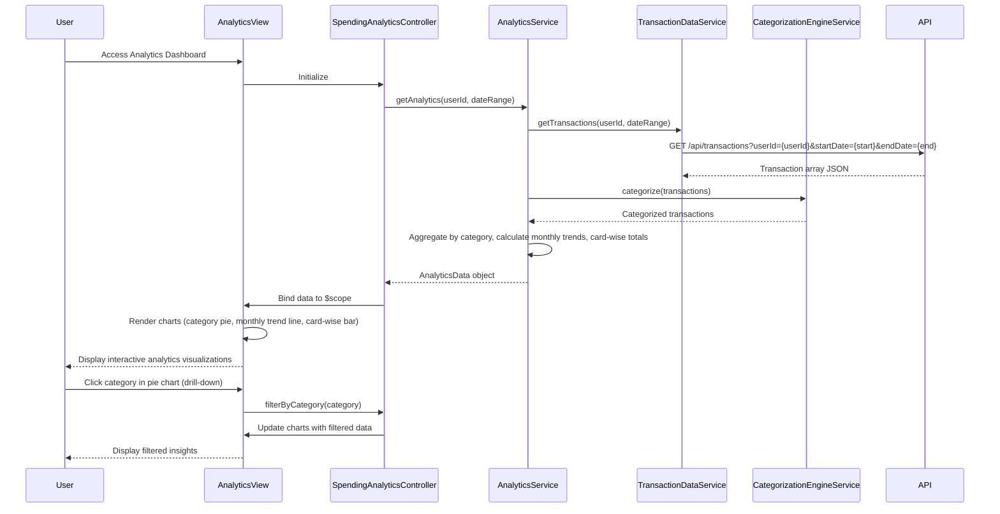

# Low-Level Design: Spending Analytics and Insights
**Epic ID:** QE-8563  
**Feature:** Comprehensive spending analytics with interactive visualizations across 9 predefined categories

---

## a. Architecture Mapping

**AngularJS Artifacts:**
- **Module:** `analyticsInsightsModule` - Main module for spending analytics functionality
- **Controller:** `SpendingAnalyticsController` - Manages analytics view, user interactions, and filter application
- **Service:** `AnalyticsService` - Orchestrates analytics calculations and data retrieval
- **Service:** `TransactionDataService` - Fetches transaction history from REST API
- **Service:** `CategorizationEngineService` - Maps transactions to 9 predefined spending categories
- **Directive:** `categoryPieChartDirective` - Renders category-wise spending pie chart using Chart.js
- **Directive:** `monthlyTrendChartDirective` - Renders monthly spend trend line chart
- **Directive:** `cardWiseBarChartDirective` - Renders card-wise spend breakdown bar chart
- **Component:** `dataVisualizationComponent` - Wrapper component for chart rendering and interaction handling

**Folder Structure:**
```
app/
├── modules/
│   └── analytics-insights/
│       ├── controllers/
│       │   └── SpendingAnalyticsController.js
│       ├── services/
│       │   ├── AnalyticsService.js
│       │   ├── TransactionDataService.js
│       │   └── CategorizationEngineService.js
│       ├── directives/
│       │   ├── categoryPieChartDirective.js
│       │   ├── monthlyTrendChartDirective.js
│       │   └── cardWiseBarChartDirective.js
│       ├── components/
│       │   └── dataVisualizationComponent.js
│       ├── views/
│       │   └── spending-analytics.html
│       └── analytics-insights.module.js
```

---

## b. Component Specifications

| Component Name | Artifact Type | Responsibility | Key Dependencies |
|----------------|---------------|----------------|------------------|
| SpendingAnalyticsController | Controller | Manages analytics view, handles drill-down, applies date/card filters | AnalyticsService, $scope, $filter |
| AnalyticsService | Service | Calculates category-wise spending, monthly trends, card-wise breakdowns | TransactionDataService, CategorizationEngineService, $q |
| TransactionDataService | Service | Fetches transaction history with date range filtering via REST API | $http, $q |
| CategorizationEngineService | Service | Maps transactions to 9 categories (Food & Dining, Fuel, Shopping, Travel, Entertainment, Utilities, Healthcare, Education, Miscellaneous) using rule-based logic | None |
| categoryPieChartDirective | Directive | Renders interactive pie chart for category-wise spending using Chart.js | Chart.js |
| monthlyTrendChartDirective | Directive | Renders line chart showing monthly spend trends over 12 months | Chart.js |
| cardWiseBarChartDirective | Directive | Renders bar chart for card-wise spend comparison | Chart.js |
| dataVisualizationComponent | Component | Wraps chart directives, handles chart interactions and data updates | Chart.js |

---

## c. Data Model

**AnalyticsData (JavaScript Object):**
```javascript
{
  userId: String,
  dateRange: { startDate: Date, endDate: Date },
  categorySpending: Array<CategorySpending>,
  monthlyTrends: Array<MonthlyTrend>,
  cardWiseSpending: Array<CardSpending>
}
```

**CategorySpending (JavaScript Object):**
```javascript
{
  category: String, // One of 9 predefined categories
  amount: Number,
  transactionCount: Number,
  percentage: Number
}
```

**MonthlyTrend (JavaScript Object):**
```javascript
{
  month: String, // Format: YYYY-MM
  totalSpend: Number
}
```

**CardSpending (JavaScript Object):**
```javascript
{
  cardId: String,
  cardNumber: String (masked),
  totalSpend: Number
}
```

---

## d. Data Flow

User accesses analytics dashboard → SpendingAnalyticsController initializes and calls AnalyticsService.getAnalytics(userId, dateRange) → AnalyticsService calls TransactionDataService.getTransactions(userId, dateRange) → API returns transaction array → CategorizationEngineService.categorize(transactions) maps each transaction to one of 9 categories → AnalyticsService aggregates spending by category, calculates monthly trends (last 12 months), and computes card-wise totals → Service returns AnalyticsData object → Controller binds to $scope → categoryPieChartDirective, monthlyTrendChartDirective, and cardWiseBarChartDirective render interactive Chart.js visualizations → User clicks chart segment for drill-down → Controller filters data and updates charts with filtered subset.

---

## e. Primary Sequence Diagram



---

## f. Implementation Notes

- Use Chart.js library wrapped in AngularJS directives for interactive visualizations; configure responsive options for mobile/tablet/desktop
- Implement CategorizationEngineService with rule-based mapping using merchant name patterns or MCC codes to assign 9 categories
- Pre-aggregate monthly trends server-side if possible; fetch via dedicated analytics endpoint (e.g., /api/analytics/trends) for performance
- Use AngularJS `$filter` for client-side date range filtering during drill-down; apply Bootstrap responsive grid for chart containers
- Handle chart click events using Chart.js event handlers; update $scope and trigger digest with `$scope.$apply()` for data binding

---

## g. Error Handling

HTTP interceptor-based error handling; display user-friendly messages if analytics data fails to load; gracefully degrade to empty charts with informative text.

---

## h. Security Notes

Requires token-based auth via existing SSO; validate user access to transaction data server-side; ensure category mappings do not expose sensitive information.