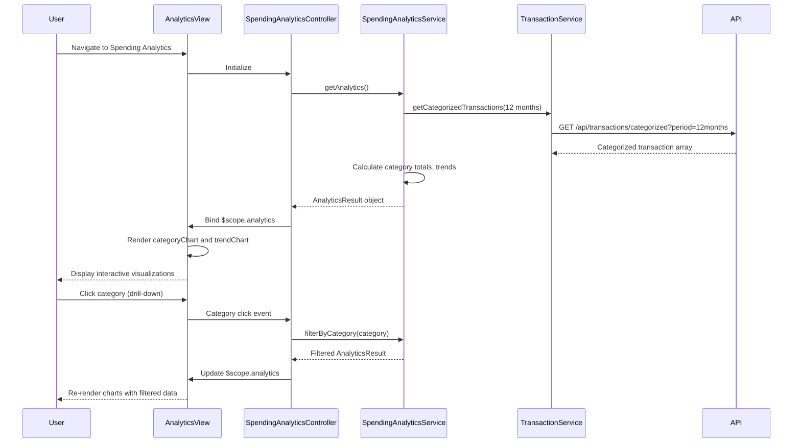

# Low-Level Design: QE-8563 - Spending Analytics and Insights

## a. Architecture Mapping

- **App Module**: `creditCardApp` - Root module with analytics feature routing
- **Analytics Controller**: `SpendingAnalyticsController` - Manages analytics view, user interactions, chart updates
- **Analytics Service**: `SpendingAnalyticsService` (Factory) - Processes transaction data, calculates category and trend analytics
- **Transaction Service**: `TransactionService` (Factory) - Fetches categorized transaction history via REST
- **Visualization Directive**: `categoryChart` - Renders category-wise spending charts using Chart.js
- **Trend Directive**: `trendChart` - Renders monthly spend trend line charts

**Recommended Folder Structure:**
```
app/
├── modules/
│   └── analytics/
│       ├── controllers/
│       │   └── spending-analytics.controller.js
│       ├── services/
│       │   ├── spending-analytics.service.js
│       │   └── transaction.service.js
│       ├── directives/
│       │   ├── category-chart.directive.js
│       │   └── trend-chart.directive.js
│       └── views/
│           └── spending-analytics.html
├── shared/
└── app.module.js
```

## b. Component Specifications

| Component Name | Artifact Type | Responsibility | Key Dependencies |
|----------------|---------------|----------------|------------------|
| SpendingAnalyticsController | Controller | Bind analytics data, handle drill-down and filter events | SpendingAnalyticsService, $scope |
| SpendingAnalyticsService | Factory | Calculate category totals, monthly trends, time-based comparisons | TransactionService, $q |
| TransactionService | Factory | Fetch categorized transaction history (12+ months) via REST | $http, API_ENDPOINTS |
| categoryChart | Directive | Render interactive bar/pie chart for 9 spending categories | Chart.js |
| trendChart | Directive | Render line chart for monthly spend trends over time | Chart.js |

## c. Data Model

**CategorySpending Model:**
```javascript
{
  category: String,
  totalAmount: Number,
  transactionCount: Number,
  percentage: Number
}
```

**MonthlyTrend Model:**
```javascript
{
  month: String,
  year: Number,
  totalSpend: Number,
  categoryBreakdown: Array<{category: String, amount: Number}>
}
```

**AnalyticsResult Model:**
```javascript
{
  categorySpending: Array<CategorySpending>,
  monthlyTrends: Array<MonthlyTrend>,
  totalSpend: Number,
  averageMonthlySpend: Number
}
```

## d. Data Flow

User navigates to spending analytics → SpendingAnalyticsController initializes → calls SpendingAnalyticsService.getAnalytics() → service fetches 12 months of categorized transactions via TransactionService.getCategorizedTransactions(startDate, endDate) → processes data to calculate category-wise totals (group by 9 predefined categories, sum amounts, calculate percentages), monthly trends (group by month, aggregate totals), and time-based comparisons (compare current vs. previous periods) → returns AnalyticsResult object → controller binds to $scope → categoryChart directive renders bar chart for category spending, trendChart directive renders line chart for monthly trends → user clicks category in chart to drill down → controller filters data by selected category → service recalculates filtered analytics → charts update with filtered data.

## e. Primary Sequence Diagram



## f. Implementation Notes

- Use Chart.js wrapped in AngularJS directives for declarative, data-bound chart rendering
- Leverage ES6 Array.reduce() and Map for efficient transaction aggregation by category and month
- Implement chart interactivity by binding click events in directives to controller callback functions
- Use $q.defer() in TransactionService for promise-based async handling of large transaction datasets
- Apply lazy loading for historical data beyond 12 months to optimize initial load performance

## g. Error Handling

HTTP interceptor handles API failures; SpendingAnalyticsService returns rejected promises; controller displays error notification and renders empty state with retry option.

## h. Security Notes

Standard input validation and secure API calls assumed; JWT authentication enforced via HTTP interceptor for all transaction data requests.