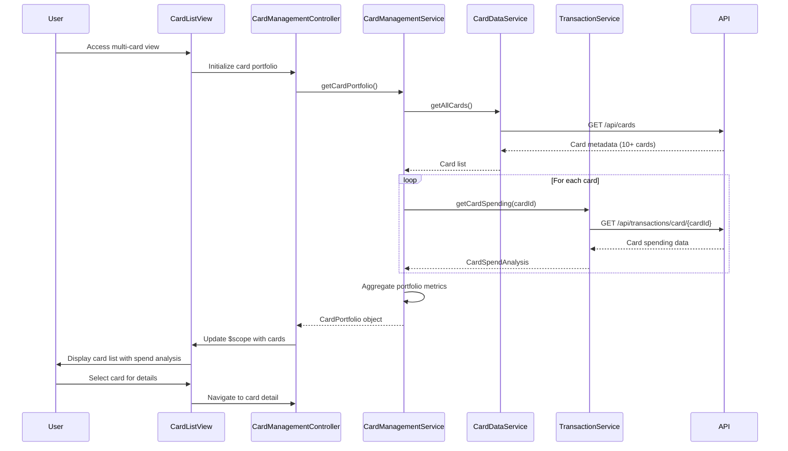

# Low-Level Design: QE-8564 - Multi-Card Management and Monitoring

## a. Architecture Mapping

- **AngularJS Module**: `multiCardManagement` - Main module for multi-card feature
- **Controller**: `CardManagementController` - Manages card list view and user interactions
- **Controller**: `CardDetailController` - Handles individual card detail view
- **Service**: `CardManagementService` - Orchestrates card data retrieval and spend analysis
- **Service**: `CardDataService` - Fetches card metadata from repository
- **Service**: `TransactionService` - Retrieves card-wise spending data
- **Directive**: `cardListItem` - Renders individual card in list view with summary
- **Directive**: `cardComparison` - Provides side-by-side card comparison UI
- **Filter**: `cardFilter` - Enables filtering cards by type, status, or issuer

**Folder Structure:**
```
/app
  /modules
    /multi-card
      /controllers
        card-management.controller.js
        card-detail.controller.js
      /services
        card-management.service.js
        card-data.service.js
        transaction.service.js
      /directives
        card-list-item.directive.js
        card-comparison.directive.js
      /filters
        card-filter.filter.js
      /views
        card-list.html
        card-detail.html
      multi-card.module.js
```

## b. Component Specifications

| Name | Artifact Type | Responsibility | Key Dependencies |
|------|---------------|----------------|------------------|
| multiCardManagement | Module | Root module for multi-card management feature | ngRoute, ngResource |
| CardManagementController | Controller | Manages card portfolio view, filtering, and comparison | CardManagementService, cardFilter, $scope |
| CardDetailController | Controller | Displays detailed metrics and spend analysis for a single card | CardManagementService, $routeParams, $scope |
| CardManagementService | Service | Aggregates card data and spending metrics for portfolio view | CardDataService, TransactionService, $http, $q |
| CardDataService | Service | Fetches card metadata from credit card data repository | $http, $q |
| TransactionService | Service | Retrieves card-wise transaction data and spending totals | $http, $q |
| cardListItem | Directive | Renders card summary with key metrics in list view | $filter |
| cardComparison | Directive | Displays side-by-side comparison of selected cards | $scope |
| cardFilter | Filter | Filters card array by type, status, issuer, or custom criteria | None |

## c. Data Model

**CreditCard Model:**
```javascript
{
  cardId: Number,
  cardNumber: String,
  cardType: String, // e.g., "Visa", "MasterCard", "Amex"
  issuer: String,
  creditLimit: Number,
  currentBalance: Number,
  availableCredit: Number,
  status: String, // e.g., "Active", "Blocked", "Expired"
  expiryDate: Date
}
```

**CardSpendAnalysis Model:**
```javascript
{
  cardId: Number,
  monthlySpend: Number,
  yearlySpend: Number,
  topCategories: Array<{categoryName: String, amount: Number}>,
  transactionCount: Number,
  averageTransactionAmount: Number
}
```

**CardPortfolio Model:**
```javascript
{
  cards: Array<CreditCard>,
  totalCreditLimit: Number,
  totalAvailableCredit: Number,
  totalOutstanding: Number,
  cardCount: Number
}
```

## d. Data Flow

User accesses multi-card management view → CardManagementController calls CardManagementService.getCardPortfolio() → Service invokes CardDataService.getAllCards() to fetch card metadata from GET /api/cards endpoint → For each card, service calls TransactionService.getCardSpending(cardId) to retrieve spending data from GET /api/transactions/card/{cardId} endpoint → CardManagementService aggregates card details with spending analysis → Enriched card portfolio returned to controller → Controller updates $scope with card array → cardListItem directives render each card with summary metrics → User applies cardFilter to narrow down list or selects cards for comparison → cardComparison directive displays selected cards side-by-side → User clicks on a card to navigate to CardDetailController for drill-down view.

## e. Primary Sequence Diagram



## f. Implementation Notes

- Use AngularJS $q.all() to parallelize card spending API calls for sub-second response time with 10+ cards
- Implement cardFilter as custom AngularJS filter with multiple criteria support; use filter in ng-repeat for real-time filtering
- Use ngRoute with route parameters for card detail navigation; CardDetailController reads cardId from $routeParams
- Apply ES6 array methods (map, filter, reduce) in service layer for data aggregation and transformation
- Implement client-side sorting in controller using orderBy filter; allow users to sort by spend, limit, or available credit

## g. Error Handling

HTTP interceptor captures API errors; service returns rejected promises; controller displays error state in view with retry action.

## h. Security Notes

Data encrypted in transit via HTTPS; token-based auth via existing SSO; card numbers masked in UI (show last 4 digits only).