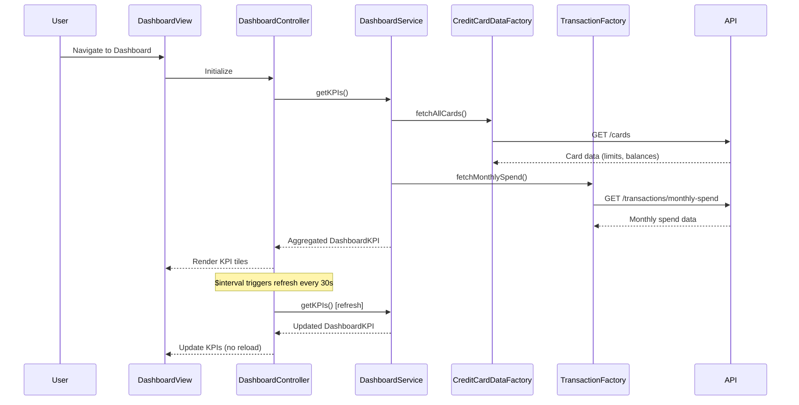

# Low-Level Design: Dashboard and KPIs
**Epic ID:** QE-8565  
**Feature:** CreditCardNew20261109190012-Dashboard and KPIs

---

## a. Architecture Mapping

- **Dashboard UI Component** → AngularJS Module (`creditCard.dashboard`) + Controller (`DashboardController`) + View Templates
- **Dashboard Service** → AngularJS Service (`DashboardService`) for KPI aggregation and state management
- **Credit Card Data Service Integration** → AngularJS Factory (`CreditCardDataFactory`) for card details, limits, balances
- **Transaction Service Integration** → AngularJS Factory (`TransactionFactory`) for monthly spend calculations

**Recommended Folder Structure:**
```
/app
  /modules
    /dashboard
      /controllers (DashboardController.js)
      /services (DashboardService.js)
      /factories (CreditCardDataFactory.js, TransactionFactory.js)
      /directives (kpiTile.directive.js)
      /views (dashboard.html)
      dashboard.module.js
```

---

## b. Component Specifications

| Component Name | Artifact Type | Responsibility | Key Dependencies |
|---|---|---|---|
| `creditCard.dashboard` | Module | Root module for dashboard and KPIs feature | `ngRoute` |
| `DashboardController` | Controller | Manages dashboard view state and KPI display | `DashboardService`, `$scope`, `$interval` |
| `DashboardService` | Service | Aggregates KPI data from multiple sources | `CreditCardDataFactory`, `TransactionFactory` |
| `CreditCardDataFactory` | Factory | REST API calls to Credit Card Data Service | `$http`, `API_CONFIG` |
| `TransactionFactory` | Factory | REST API calls to Transaction Service | `$http`, `API_CONFIG` |
| `kpiTile` | Directive | Reusable KPI display tile with icon and value | None |

---

## c. Data Model

**DashboardKPI Model:**
```javascript
{
  monthlySpend: Number,
  totalCreditLimit: Number,
  availableCredit: Number,
  outstandingAmount: Number,
  lastUpdated: Date
}
```

---

## d. Data Flow

User accesses dashboard; `DashboardController` invokes `DashboardService.getKPIs()`, which calls `CreditCardDataFactory.fetchAllCards()` to retrieve card details, limits, and balances, and `TransactionFactory.fetchMonthlySpend()` to compute current month's spending via REST APIs. `DashboardService` aggregates data into `DashboardKPI` model (summing credit limits, available credit, outstanding amounts across all cards) and returns to controller. Controller renders KPIs using `kpiTile` directives. `$interval` triggers periodic refresh every 30 seconds to meet real-time data refresh NFR, updating KPIs without page reload.

---

## e. Primary Sequence Diagram



---

## f. Implementation Notes

- Use AngularJS DI for all services, factories, and controllers; configure API base URLs in module's `.constant()` block.
- Implement `$interval` in `DashboardController` for 30-second periodic refresh to meet real-time data NFR; cancel interval on `$scope.$on('$destroy')`.
- Use `$http` interceptors for global error handling and loading indicators during initial load.
- Leverage Bootstrap grid and `kpiTile` directive for responsive KPI layout across desktop and mobile.
- Cache aggregated KPI data in `DashboardService` with timestamp to avoid redundant API calls within refresh window.

---

## g. Error Handling

HTTP interceptor-based error handling with user notification via Bootstrap toasts for API failures; try/catch in service for aggregation logic.

---

## h. Security Notes

Requires token-based auth via existing SSO; all API calls include auth token in headers via HTTP interceptor.

---