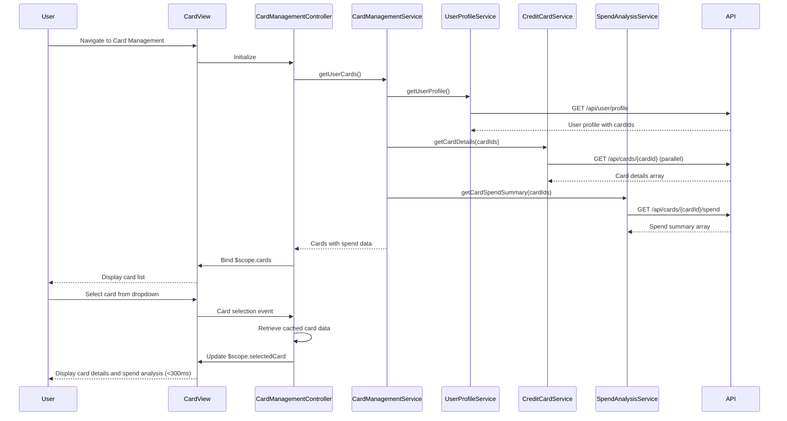

# Low-Level Design: QE-8566 - Multiple Credit Card Management

## a. Architecture Mapping

- **App Module**: `creditCardApp` - Root AngularJS module with card management routing
- **Card Management Controller**: `CardManagementController` - Manages multi-card view, card switching, spend analysis display
- **Card Management Service**: `CardManagementService` (Factory) - Orchestrates card data retrieval and card-wise analytics
- **Credit Card Service**: `CreditCardService` (Factory) - REST API wrapper for card details, balances, limits
- **User Profile Service**: `UserProfileService` (Factory) - Fetches user-card associations
- **Spend Analysis Service**: `SpendAnalysisService` (Factory) - Calculates card-wise spending summaries
- **Card Selector Directive**: `cardSelector` - Dropdown/carousel for card selection with <300ms switching

**Recommended Folder Structure:**
```
app/
├── modules/
│   └── card-management/
│       ├── controllers/
│       │   └── card-management.controller.js
│       ├── services/
│       │   ├── card-management.service.js
│       │   ├── creditCard.service.js
│       │   ├── userProfile.service.js
│       │   └── spend-analysis.service.js
│       ├── directives/
│       │   └── card-selector.directive.js
│       └── views/
│           ├── card-list.html
│           └── card-detail.html
├── shared/
└── app.module.js
```

## b. Component Specifications

| Component Name | Artifact Type | Responsibility | Key Dependencies |
|----------------|---------------|----------------|------------------|
| CardManagementController | Controller | Bind card list, handle card selection, display card-specific data | CardManagementService, $scope |
| CardManagementService | Factory | Fetch user's cards, orchestrate card-wise spend analysis | CreditCardService, UserProfileService, SpendAnalysisService, $q |
| CreditCardService | Factory | Fetch card details, balances, limits via REST | $http, $cacheFactory, API_ENDPOINTS |
| UserProfileService | Factory | Fetch user-card associations from user profile | $http, API_ENDPOINTS |
| SpendAnalysisService | Factory | Calculate card-wise spending summaries from transaction data | $http, API_ENDPOINTS |
| cardSelector | Directive | Render card selection UI with instant switching (<300ms) | None |

## c. Data Model

**CreditCard Model:**
```javascript
{
  cardId: String,
  cardNumber: String (masked),
  cardType: String,
  bankName: String,
  creditLimit: Number,
  availableCredit: Number,
  outstandingAmount: Number,
  status: String
}
```

**CardSpendSummary Model:**
```javascript
{
  cardId: String,
  monthlySpend: Number,
  yearlySpend: Number,
  topCategories: Array<{category: String, amount: Number}>,
  transactionCount: Number
}
```

## d. Data Flow

User navigates to card management → CardManagementController initializes → calls CardManagementService.getUserCards() → service fetches user-card associations via UserProfileService.getUserProfile() to get list of cardIds → uses $q.all() to concurrently fetch detailed card info for each cardId via CreditCardService.getCardDetails() → caches card data using $cacheFactory for fast switching → fetches card-wise spend summaries via SpendAnalysisService.getCardSpendSummary() for each card → returns array of cards with spend data → controller binds to $scope.cards → view renders card list using cardSelector directive → user selects card from dropdown → controller retrieves cached card data (ensuring <300ms latency) → updates $scope.selectedCard → view displays card-specific details and spend analysis.

## e. Primary Sequence Diagram



## f. Implementation Notes

- Use $cacheFactory to cache card details for instant switching, ensuring <300ms latency requirement
- Leverage $q.all() for parallel fetching of multiple card details to optimize initial load time
- Implement cardSelector directive with ng-options and track by cardId for efficient rendering
- Use AngularJS $watch on selectedCard to trigger card-specific data updates without re-fetching
- Apply ES6 Promises and async/await patterns in services for cleaner asynchronous code

## g. Error Handling

HTTP interceptor captures API errors; CardManagementService returns rejected promises; controller displays error notification and renders fallback UI for failed card loads.

## h. Security Notes

Standard input validation and secure API calls assumed; per-user data isolation enforced at API level; JWT token authentication via HTTP interceptor.