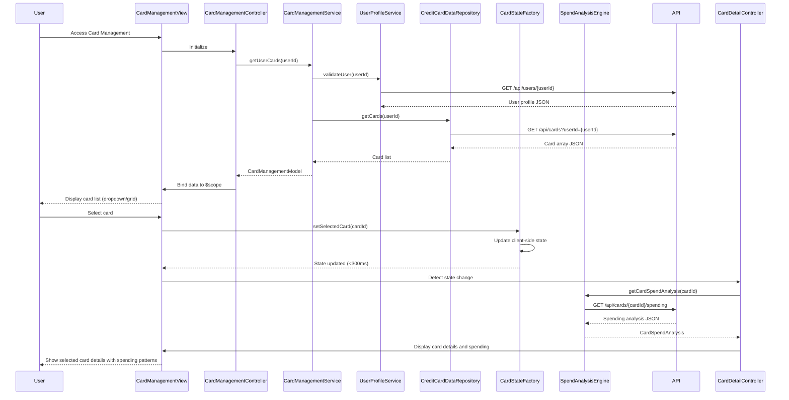

# Low-Level Design: Multiple Credit Card Management
**Epic ID:** QE-8566  
**Feature:** Unified interface for managing and viewing multiple credit cards with card-wise spend analysis

---

## a. Architecture Mapping

**AngularJS Artifacts:**
- **Module:** `multiCardManagementModule` - Main module for multi-card management functionality
- **Controller:** `CardManagementController` - Manages card list display, selection, and switching
- **Controller:** `CardDetailController` - Displays detailed view of selected card
- **Service:** `CardManagementService` - Orchestrates card data retrieval and user-card association validation
- **Service:** `CreditCardDataRepository` - Fetches card information, balances, and details via REST API
- **Service:** `UserProfileService` - Validates user-card associations and retrieves user profile
- **Service:** `SpendAnalysisEngine` - Calculates card-specific spending patterns and trends
- **Directive:** `cardSelectorDirective` - Renders card selection dropdown/list with card switching
- **Directive:** `cardDetailCardDirective` - Displays individual card details in card layout
- **Factory:** `CardStateFactory` - Manages client-side state for selected card (instant switching)

**Folder Structure:**
```
app/
├── modules/
│   └── multi-card-management/
│       ├── controllers/
│       │   ├── CardManagementController.js
│       │   └── CardDetailController.js
│       ├── services/
│       │   ├── CardManagementService.js
│       │   ├── CreditCardDataRepository.js
│       │   ├── UserProfileService.js
│       │   └── SpendAnalysisEngine.js
│       ├── directives/
│       │   ├── cardSelectorDirective.js
│       │   └── cardDetailCardDirective.js
│       ├── factories/
│       │   └── CardStateFactory.js
│       ├── views/
│       │   ├── card-management.html
│       │   └── card-detail.html
│       └── multi-card-management.module.js
```

---

## b. Component Specifications

| Component Name | Artifact Type | Responsibility | Key Dependencies |
|----------------|---------------|----------------|------------------|
| CardManagementController | Controller | Manages card list display, handles card selection and switching | CardManagementService, CardStateFactory, $scope |
| CardDetailController | Controller | Displays detailed view of selected card with spending analysis | CardManagementService, SpendAnalysisEngine, CardStateFactory, $scope |
| CardManagementService | Service | Orchestrates card data retrieval, validates user-card associations | CreditCardDataRepository, UserProfileService, $q |
| CreditCardDataRepository | Service | Fetches card information, balances, and details via REST API | $http, $q |
| UserProfileService | Service | Validates user-card associations and retrieves user profile data | $http, $q |
| SpendAnalysisEngine | Service | Calculates card-specific spending patterns, trends, and balances | $http, $q |
| cardSelectorDirective | Directive | Renders card selection UI (dropdown or card grid) with instant switching | CardStateFactory |
| cardDetailCardDirective | Directive | Displays individual card details in responsive card layout | None |
| CardStateFactory | Factory | Manages client-side state for currently selected card (instant response <300ms) | $rootScope |

---

## c. Data Model

**CardManagementModel (JavaScript Object):**
```javascript
{
  userId: String,
  cards: Array<CreditCard>,
  selectedCardId: String,
  lastUpdated: Date
}
```

**CreditCard (JavaScript Object):**
```javascript
{
  cardId: String,
  cardNumber: String (masked),
  cardType: String,
  cardholderName: String,
  expiryDate: String,
  creditLimit: Number,
  availableCredit: Number,
  outstandingBalance: Number,
  monthlySpend: Number,
  status: String
}
```

**CardSpendAnalysis (JavaScript Object):**
```javascript
{
  cardId: String,
  totalSpend: Number,
  categoryBreakdown: Array<{ category: String, amount: Number }>,
  monthlyTrend: Array<{ month: String, spend: Number }>
}
```

---

## d. Data Flow

User accesses card management interface → CardManagementController initializes and calls CardManagementService.getUserCards(userId) → Service calls UserProfileService.validateUser(userId) to verify user → Service calls CreditCardDataRepository.getCards(userId) to fetch all associated cards → API returns card array with details → CardManagementService returns CardManagementModel → Controller binds to $scope and displays card list via cardSelectorDirective → User selects a card from dropdown/grid → CardStateFactory updates selectedCardId in client-side state (instant <300ms) → CardDetailController detects state change and calls SpendAnalysisEngine.getCardSpendAnalysis(cardId) → Service retrieves card-specific spending data → CardDetailController displays card details and spending patterns via cardDetailCardDirective.

---

## e. Primary Sequence Diagram



---

## f. Implementation Notes

- Use CardStateFactory with `$rootScope` to broadcast card selection changes; ensures instant switching (<300ms) via client-side state management
- Implement cardSelectorDirective with ng-repeat for card list; use ng-click for card selection triggering CardStateFactory.setSelectedCard()
- Use AngularJS `$watch` in CardDetailController to listen for selectedCardId changes and trigger SpendAnalysisEngine data fetch
- Support at least 10 cards per user; optimize card list rendering with track by cardId for performance
- Apply Bootstrap responsive grid for card display; use card layout (Bootstrap cards) for visual consistency across devices

---

## g. Error Handling

HTTP interceptor-based error handling; display user-friendly notifications if card data fails to load; validate user-card associations server-side and handle unauthorized access gracefully.

---

## h. Security Notes

Requires token-based auth via existing SSO; validate user-card associations server-side; ensure secure per-user data isolation; mask sensitive card numbers in API responses and UI.