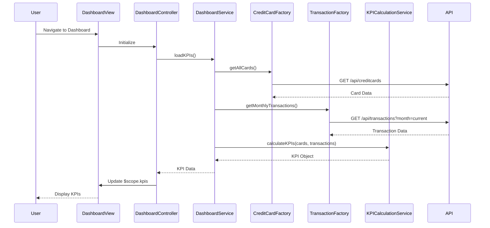

# Low-Level Design: Dashboard KPIs and Credit Card Overview
**Epic ID:** QE-8567  
**Technology Stack:** AngularJS 1.x, JavaScript ES6, HTML5, CSS3, Bootstrap, REST APIs, MVC Architecture

---

## a. Architecture Mapping

- **User Interface - Dashboard** → AngularJS Module (`app.dashboard`) + Controller (`DashboardController`) + View Template (`dashboard.html`)
- **Dashboard Service** → AngularJS Service (`DashboardService`) for orchestrating KPI data retrieval
- **Credit Card Data Service** → AngularJS Factory (`CreditCardFactory`) for REST API calls to fetch card details
- **Transaction Processing Service** → AngularJS Factory (`TransactionFactory`) for REST API calls to fetch transaction data
- **KPI Calculation Engine** → AngularJS Service (`KPICalculationService`) for client-side aggregation and calculation logic

**Recommended Folder Structure:**
```
/app
  /modules
    /dashboard
      dashboard.module.js
      dashboard.controller.js
      dashboard.html
  /services
    dashboard.service.js
    kpi-calculation.service.js
  /factories
    credit-card.factory.js
    transaction.factory.js
  /models
    credit-card.model.js
    kpi.model.js
```

---

## b. Component Specifications

| Component Name | Artifact Type | Responsibility | Key Dependencies |
|----------------|---------------|----------------|------------------|
| `app.dashboard` | Module | Defines the dashboard feature module and routing | `ngRoute`, `app.services`, `app.factories` |
| `DashboardController` | Controller | Manages dashboard view state, triggers KPI load, binds data to view | `DashboardService`, `$scope` |
| `DashboardService` | Service | Orchestrates data retrieval from multiple sources and coordinates KPI calculation | `CreditCardFactory`, `TransactionFactory`, `KPICalculationService` |
| `CreditCardFactory` | Factory | Handles REST API calls to fetch credit card details and balances | `$http`, `API_CONFIG` |
| `TransactionFactory` | Factory | Handles REST API calls to fetch transaction data for monthly spend and outstanding amounts | `$http`, `API_CONFIG` |
| `KPICalculationService` | Service | Performs client-side calculations for monthly spend, total credit limit, available credit, outstanding amount | None |
| `dashboard.html` | View Template | Renders KPI cards with responsive Bootstrap layout | Bootstrap CSS, AngularJS directives |

---

## c. Data Model

**CreditCard Model:**
```javascript
{
  cardId: String,
  cardNumber: String (masked),
  cardType: String,
  creditLimit: Number,
  availableCredit: Number,
  outstandingAmount: Number,
  cardHolderName: String
}
```

**KPI Model:**
```javascript
{
  monthlySpend: Number,
  totalCreditLimit: Number,
  totalAvailableCredit: Number,
  totalOutstanding: Number,
  lastUpdated: Date
}
```

---

## d. Data Flow

User navigates to the dashboard view, triggering `DashboardController` initialization. The controller invokes `DashboardService.loadKPIs()`, which concurrently calls `CreditCardFactory.getAllCards()` and `TransactionFactory.getMonthlyTransactions()` via REST APIs. Upon receiving responses, `KPICalculationService` aggregates card data (summing credit limits, available credit, outstanding amounts) and transaction data (calculating monthly spend). The calculated KPI object is returned to the controller, which updates `$scope.kpis`, triggering Angular's data binding to refresh the dashboard view with updated KPI cards.

---

## e. Primary Sequence Diagram



---

## f. Implementation Notes

- Use AngularJS Dependency Injection to inject services and factories into controllers and services for testability and modularity.
- Implement Factory pattern for REST API interactions using `$http` service with promise-based async handling.
- Apply ES6 features (arrow functions, const/let, template literals) in service and factory implementations.
- Use Bootstrap grid system (col-md-3, col-sm-6, col-xs-12) for responsive KPI card layout across devices.
- Cache KPI calculation results in `DashboardService` with timestamp-based invalidation to meet sub-2-second load time requirement.

---

## g. Error Handling

HTTP interceptor-based error handling with user-friendly notifications via `$http` interceptor and toast/alert service for API failures.

---

## h. Security Notes

Standard input validation and secure API calls assumed; token-based authentication via existing SSO for API requests.

---