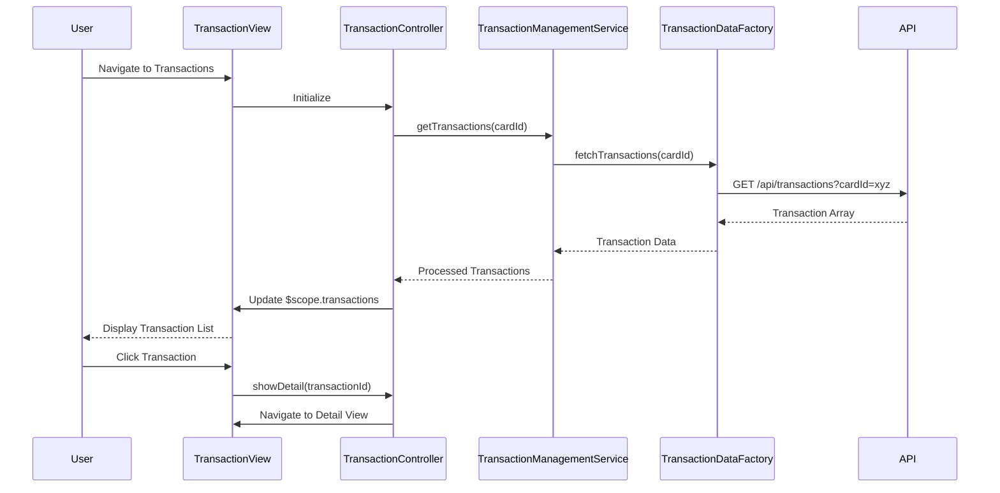

# Low-Level Design: Transaction Management and Tracking
**Epic ID:** QE-8568  
**Technology Stack:** AngularJS 1.x, JavaScript ES6, HTML5, CSS3, Bootstrap, REST APIs, MVC Architecture

---

## a. Architecture Mapping

- **User Interface - Transaction View** → AngularJS Module (`app.transactions`) + Controller (`TransactionController`) + View Template (`transactions.html`)
- **Transaction Management Service** → AngularJS Service (`TransactionManagementService`) for orchestrating transaction data operations
- **Credit Card Transaction Data Service** → AngularJS Factory (`TransactionDataFactory`) for REST API calls to fetch transaction records
- **Dashboard KPI Service** → Integration point via shared `DashboardService` for monthly spend sync
- **Analytics Service** → Integration point via shared `AnalyticsService` for category data sync

**Recommended Folder Structure:**
```
/app
  /modules
    /transactions
      transactions.module.js
      transaction.controller.js
      transactions.html
      transaction-detail.html
  /services
    transaction-management.service.js
  /factories
    transaction-data.factory.js
  /models
    transaction.model.js
```

---

## b. Component Specifications

| Component Name | Artifact Type | Responsibility | Key Dependencies |
|----------------|---------------|----------------|------------------|
| `app.transactions` | Module | Defines the transaction feature module and routing | `ngRoute`, `app.services`, `app.factories` |
| `TransactionController` | Controller | Manages transaction list view, filters, pagination, and detail navigation | `TransactionManagementService`, `$scope`, `$routeParams` |
| `TransactionManagementService` | Service | Orchestrates transaction data retrieval, filtering, and synchronization with dashboard/analytics | `TransactionDataFactory`, `DashboardService`, `AnalyticsService` |
| `TransactionDataFactory` | Factory | Handles REST API calls to fetch transaction history for single or multiple cards | `$http`, `API_CONFIG` |
| `transactions.html` | View Template | Renders transaction list with filters, search, and pagination using Bootstrap table | Bootstrap CSS, AngularJS directives |
| `transaction-detail.html` | View Template | Displays detailed view of a single transaction | Bootstrap CSS, AngularJS directives |

---

## c. Data Model

**Transaction Model:**
```javascript
{
  transactionId: String,
  cardId: String,
  transactionDate: Date,
  description: String,
  category: String,
  amount: Number,
  merchantName: String,
  transactionType: String, // 'debit' or 'credit'
  status: String // 'posted', 'pending'
}
```

---

## d. Data Flow

User navigates to the transactions view, triggering `TransactionController` initialization. The controller invokes `TransactionManagementService.getTransactions(cardId)` (or all cards if no filter), which calls `TransactionDataFactory.fetchTransactions()` via REST API. The factory returns a promise resolving to an array of transaction objects. The service processes the data, updates shared state with `DashboardService` and `AnalyticsService` for synchronization, and returns the transaction list to the controller. The controller binds the data to `$scope.transactions`, updating the view with the transaction table. User interactions (filter, search, detail view) trigger controller methods that re-query or filter local data.

---

## e. Primary Sequence Diagram



---

## f. Implementation Notes

- Use AngularJS `$routeProvider` for routing between transaction list and detail views with URL parameters for transaction ID.
- Implement client-side filtering and search using AngularJS filters (`filter`, `orderBy`) for responsive user experience.
- Use `$http` service with promise chaining for API calls; implement response caching in factory to meet sub-500ms requirement.
- Apply Bootstrap responsive table classes (`table-responsive`) and pagination component for mobile-friendly transaction list.
- Leverage ES6 array methods (map, filter, reduce) for transaction data processing in service layer.

---

## g. Error Handling

HTTP interceptor captures API errors; controller displays user-friendly error messages via Bootstrap alert component and retry mechanism.

---

## h. Security Notes

Requires token-based auth via existing SSO; API endpoints validate user access to requested card transactions.

---