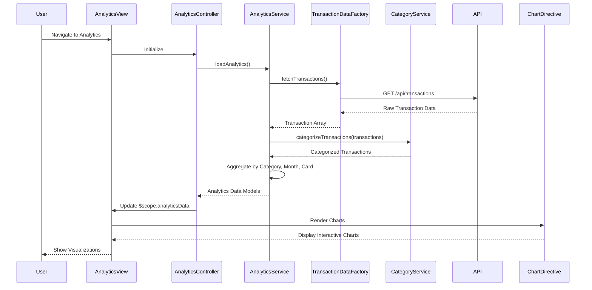

# Low-Level Design: Spending Analytics and Insights
**Epic ID:** QE-8569  
**Technology Stack:** AngularJS 1.x, JavaScript ES6, HTML5, CSS3, Bootstrap, REST APIs, MVC Architecture

---

## a. Architecture Mapping

- **User Interface - Analytics Dashboard** → AngularJS Module (`app.analytics`) + Controller (`AnalyticsController`) + View Template (`analytics.html`)
- **Analytics Service** → AngularJS Service (`AnalyticsService`) for orchestrating analytics data retrieval and processing
- **Transaction Data Service** → AngularJS Factory (`TransactionDataFactory`) for REST API calls to fetch raw transaction data
- **Category Classification Service** → AngularJS Service (`CategoryService`) for categorizing transactions
- **Dashboard Service** → Integration point via shared `DashboardService` for consolidated spend metrics
- **Visualization Engine** → AngularJS Directive (`chartDirective`) wrapping Chart.js or similar library for rendering charts

**Recommended Folder Structure:**
```
/app
  /modules
    /analytics
      analytics.module.js
      analytics.controller.js
      analytics.html
  /services
    analytics.service.js
    category.service.js
  /factories
    transaction-data.factory.js
  /directives
    chart.directive.js
  /models
    analytics.model.js
```

---

## b. Component Specifications

| Component Name | Artifact Type | Responsibility | Key Dependencies |
|----------------|---------------|----------------|------------------|
| `app.analytics` | Module | Defines the analytics feature module and routing | `ngRoute`, `app.services`, `app.directives` |
| `AnalyticsController` | Controller | Manages analytics view state, triggers data load, handles user interactions (filters, drill-down) | `AnalyticsService`, `$scope` |
| `AnalyticsService` | Service | Orchestrates data retrieval, aggregation, and preparation of analytics data for visualization | `TransactionDataFactory`, `CategoryService`, `DashboardService` |
| `CategoryService` | Service | Provides category classification logic and category metadata | None |
| `TransactionDataFactory` | Factory | Handles REST API calls to fetch raw transaction data | `$http`, `API_CONFIG` |
| `chartDirective` | Directive | Wraps Chart.js library to render responsive, interactive charts (bar, pie, line) | Chart.js library |
| `analytics.html` | View Template | Renders analytics dashboard with multiple chart containers and filter controls | Bootstrap CSS, `chartDirective` |

---

## c. Data Model

**CategorySpend Model:**
```javascript
{
  category: String, // 'Food & Dining', 'Fuel', 'Shopping', etc.
  totalSpend: Number,
  transactionCount: Number,
  percentageOfTotal: Number
}
```

**MonthlyTrend Model:**
```javascript
{
  month: String, // 'Jan 2024', 'Feb 2024', etc.
  totalSpend: Number,
  categoryBreakdown: Array<CategorySpend>
}
```

**CardWiseSpend Model:**
```javascript
{
  cardId: String,
  cardName: String,
  totalSpend: Number,
  categoryBreakdown: Array<CategorySpend>
}
```

---

## d. Data Flow

User navigates to the analytics view, triggering `AnalyticsController` initialization. The controller invokes `AnalyticsService.loadAnalytics()`, which calls `TransactionDataFactory.fetchTransactions()` to retrieve raw transaction data via REST API. The service then invokes `CategoryService.categorizeTransactions()` to classify each transaction into predefined categories. `AnalyticsService` aggregates data into category-wise spend, monthly trends, and card-wise spend models using ES6 array methods. The processed analytics data is returned to the controller, which updates `$scope.analyticsData`. The view renders multiple `chartDirective` instances, each receiving specific data subsets, which trigger Chart.js rendering of interactive visualizations.

---

## e. Primary Sequence Diagram



---

## f. Implementation Notes

- Use AngularJS custom directive pattern to encapsulate Chart.js integration for reusable, responsive chart components.
- Implement Chart.js with responsive configuration and interaction callbacks for drill-down functionality.
- Use ES6 `reduce`, `map`, and `filter` methods in `AnalyticsService` for efficient data aggregation and transformation.
- Apply Bootstrap grid layout for multi-chart dashboard with responsive breakpoints (col-lg-6, col-md-12).
- Cache aggregated analytics data in `AnalyticsService` with configurable TTL to meet sub-1-second rendering requirement.

---

## g. Error Handling

HTTP interceptor-based error handling with graceful degradation; display placeholder message if analytics data unavailable.

---

## h. Security Notes

Standard input validation and secure API calls assumed; token-based authentication via existing SSO for API requests.

---