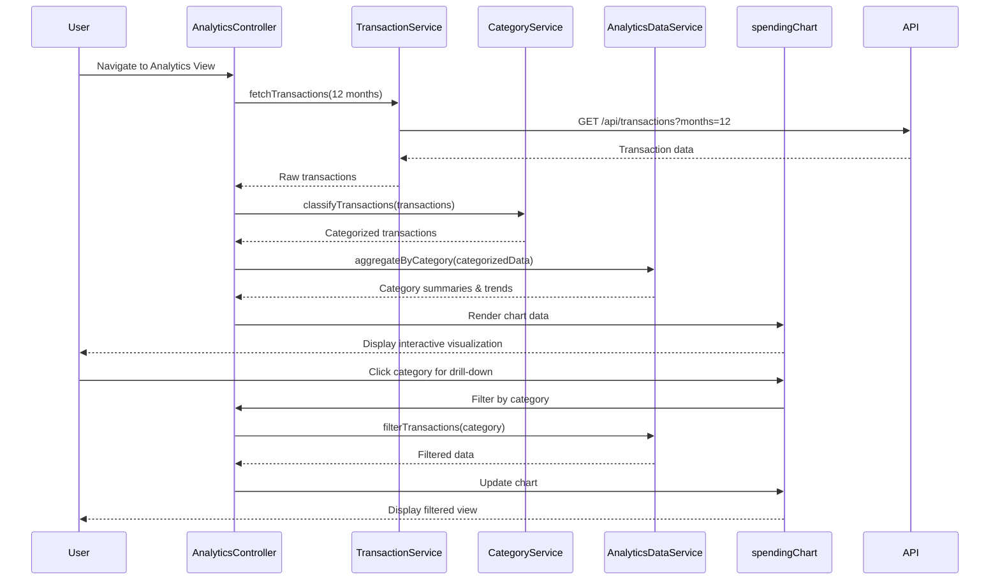

# Low-Level Design: QE-8570 - Spending Analytics and Insights

## a. Architecture Mapping

- **AngularJS Module**: `creditCard.analytics` - Root module for spending analytics feature
- **Controller**: `AnalyticsController` - Manages analytics view state and user interactions
- **Service**: `TransactionService` - Fetches and processes transaction data via REST API
- **Service**: `CategoryService` - Handles category classification and aggregation logic
- **Service**: `AnalyticsDataService` - Computes monthly trends and statistical insights
- **Directive**: `spendingChart` - Renders interactive category-wise spending visualizations
- **Directive**: `trendGraph` - Displays monthly spend trend line charts
- **Factory**: `ChartConfigFactory` - Provides reusable chart configuration objects

**Folder Structure:**
```
/app
  /modules
    /analytics
      analytics.module.js
      analytics.controller.js
      analytics.html
      /services
        transaction.service.js
        category.service.js
        analytics-data.service.js
      /directives
        spending-chart.directive.js
        trend-graph.directive.js
      /factories
        chart-config.factory.js
```

## b. Component Specifications

| Name | Artifact Type | Responsibility | Key Dependencies |
|------|---------------|----------------|------------------|
| AnalyticsController | Controller | Orchestrates analytics view, handles user filter selections, coordinates data fetch and visualization updates | TransactionService, CategoryService, AnalyticsDataService, $scope |
| TransactionService | Service | Fetches transaction history from REST API, caches results, handles pagination for 12+ months data | $http, $q, API_CONFIG |
| CategoryService | Service | Classifies transactions into 9 categories, provides category metadata and color schemes | TransactionService |
| AnalyticsDataService | Service | Aggregates transactions by category and month, calculates trends, generates spending insights | CategoryService, $filter |
| spendingChart | Directive | Renders interactive pie/bar charts for category-wise breakdown with drill-down capability | ChartConfigFactory, D3/Chart.js library |
| trendGraph | Directive | Displays line chart for monthly spend trends with interactive hover tooltips | ChartConfigFactory, D3/Chart.js library |
| ChartConfigFactory | Factory | Provides standardized chart configurations (colors, legends, responsive settings) | None |

## c. Data Model

**Transaction Object:**
```javascript
{
  id: String,
  cardId: String,
  amount: Number,
  date: Date,
  merchant: String,
  category: String, // One of: Food & Dining, Fuel, Shopping, Travel, Entertainment, Utilities, Healthcare, Education, Miscellaneous
  description: String
}
```

**CategorySummary Object:**
```javascript
{
  categoryName: String,
  totalAmount: Number,
  transactionCount: Number,
  percentage: Number
}
```

**MonthlyTrend Object:**
```javascript
{
  month: String, // YYYY-MM format
  totalSpend: Number,
  categoryBreakdown: Array<CategorySummary>
}
```

## d. Data Flow

User navigates to analytics view → AnalyticsController initializes and calls TransactionService to fetch 12 months of transaction history via REST API → CategoryService classifies transactions into 9 predefined categories → AnalyticsDataService aggregates data by category and month, calculates trends and percentages → Controller updates $scope with processed analytics data → spendingChart and trendGraph directives render interactive visualizations → User interacts with charts (filter, drill-down) → Controller updates filters and re-triggers data aggregation → Updated visualizations reflect filtered view.

## e. Primary Sequence Diagram



## f. Implementation Notes

- Use AngularJS Dependency Injection for all services, controllers, and directives to enable testability and modularity
- Implement REST API calls using $http service with promise-based error handling; cache transaction data using $cacheFactory for 5-minute TTL to meet 3-second rendering requirement
- Leverage D3.js or Chart.js for visualization rendering with responsive configuration; bind chart updates to $scope.$watch for reactive UI
- Apply ES6 arrow functions and const/let for cleaner service implementations; use Array.reduce() for category aggregation
- Implement lazy loading for transaction data using pagination (fetch 3 months initially, load more on scroll) to optimize initial load time

## g. Error Handling

HTTP interceptor captures API errors and displays user-friendly notifications via toastr; try/catch blocks in data aggregation services prevent UI crashes on malformed data.

## h. Security Notes

Standard input validation and secure API calls assumed; token-based authentication via existing SSO for API access.