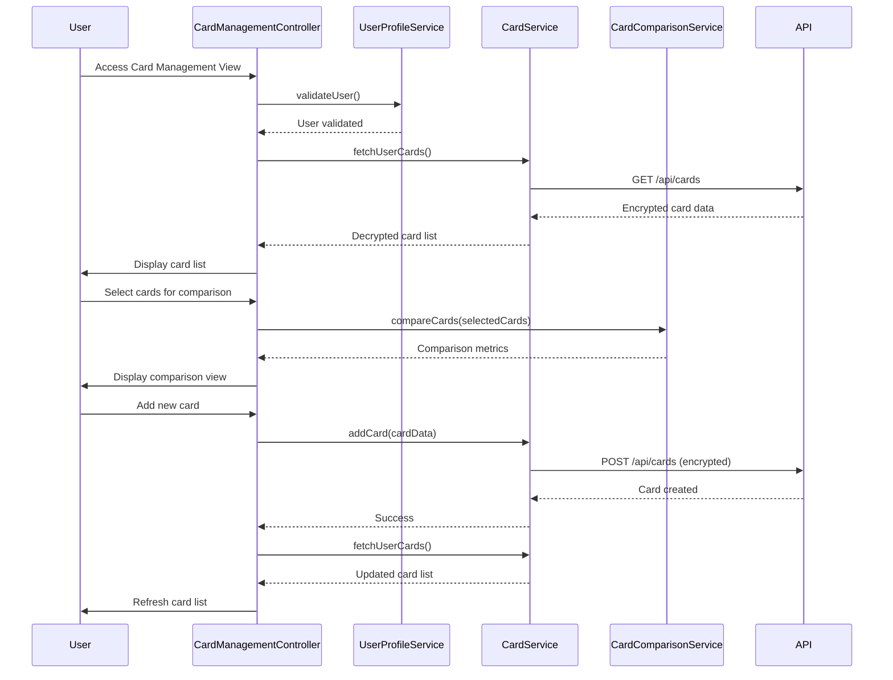

# Low-Level Design: QE-8571 - Multiple Credit Card Management

## a. Architecture Mapping

- **AngularJS Module**: `creditCard.management` - Root module for multi-card management
- **Controller**: `CardManagementController` - Manages card list view and user interactions
- **Controller**: `CardDetailsController` - Handles individual card detail view
- **Service**: `CardService` - Fetches and manages credit card data via REST API
- **Service**: `UserProfileService` - Validates card ownership and user permissions
- **Service**: `CardComparisonService` - Computes comparative metrics across multiple cards
- **Directive**: `cardList` - Renders scrollable list of user's credit cards
- **Directive**: `cardComparisonView` - Displays side-by-side card comparison table
- **Factory**: `CardValidatorFactory` - Validates card input during add/edit operations

**Folder Structure:**
```
/app
  /modules
    /card-management
      card-management.module.js
      card-management.controller.js
      card-details.controller.js
      card-management.html
      card-details.html
      /services
        card.service.js
        user-profile.service.js
        card-comparison.service.js
      /directives
        card-list.directive.js
        card-comparison-view.directive.js
      /factories
        card-validator.factory.js
```

## b. Component Specifications

| Name | Artifact Type | Responsibility | Key Dependencies |
|------|---------------|----------------|------------------|
| CardManagementController | Controller | Orchestrates multi-card view, handles add/remove card operations, initiates card comparison | CardService, UserProfileService, CardComparisonService, $scope |
| CardDetailsController | Controller | Manages individual card detail view, displays card-specific spending and limits | CardService, $routeParams, $scope |
| CardService | Service | CRUD operations for credit cards via REST API, manages card data cache, handles encryption/decryption | $http, $q, CryptoService, API_CONFIG |
| UserProfileService | Service | Validates card ownership, retrieves user profile, manages user-card associations | $http, AuthService |
| CardComparisonService | Service | Aggregates metrics across multiple cards, calculates comparative statistics (utilization %, spend ranking) | CardService, $filter |
| cardList | Directive | Renders responsive card list with individual card summaries, supports swipe gestures on mobile | CardService |
| cardComparisonView | Directive | Displays interactive comparison table with sortable columns and highlight differences | CardComparisonService |
| CardValidatorFactory | Factory | Validates card number format, expiry date, and required fields during add/edit | None |

## c. Data Model

**CreditCard Object:**
```javascript
{
  id: String,
  userId: String,
  cardNumber: String, // Last 4 digits only, encrypted in storage
  cardHolderName: String,
  bankName: String,
  cardType: String, // Visa, MasterCard, Amex, etc.
  creditLimit: Number,
  availableCredit: Number,
  outstandingBalance: Number,
  monthlySpend: Number,
  expiryDate: String, // MM/YY format
  isActive: Boolean
}
```

**CardComparison Object:**
```javascript
{
  cards: Array<CreditCard>,
  metrics: {
    totalCreditLimit: Number,
    totalAvailableCredit: Number,
    totalOutstanding: Number,
    averageUtilization: Number
  }
}
```

## d. Data Flow

User accesses card management view → CardManagementController calls UserProfileService to validate user session → Controller invokes CardService to fetch all user cards via REST API → CardService decrypts sensitive card data and returns card list → cardList directive renders cards in responsive grid → User selects "Compare Cards" → Controller calls CardComparisonService to aggregate metrics across selected cards → cardComparisonView directive displays comparison table → User adds new card → CardValidatorFactory validates input → CardService encrypts and POSTs card data to API → UserProfileService updates user-card associations → Card list refreshes with new card.

## e. Primary Sequence Diagram



## f. Implementation Notes

- Use AngularJS $routeProvider for navigation between card list and card detail views; implement lazy loading for card details on demand
- Encrypt sensitive card data (full card number, CVV if stored) using CryptoJS before sending to API; store only last 4 digits in client-side cache
- Implement $http interceptor for automatic token injection and error handling; use $q.all() for parallel card data fetching to optimize performance with 10+ cards
- Apply ES6 template literals for dynamic card display; use Array.filter() and Array.sort() for card comparison logic
- Leverage Bootstrap grid system for responsive card layout; implement CSS transitions for smooth add/remove animations

## g. Error Handling

HTTP interceptor handles API failures with retry logic (3 attempts); validation errors display inline field-level messages; critical errors (ownership validation failure) redirect to error page.

## h. Security Notes

Requires token-based auth via existing SSO; all card data encrypted at rest and in transit using AES-256; client-side validation prevents XSS via input sanitization.