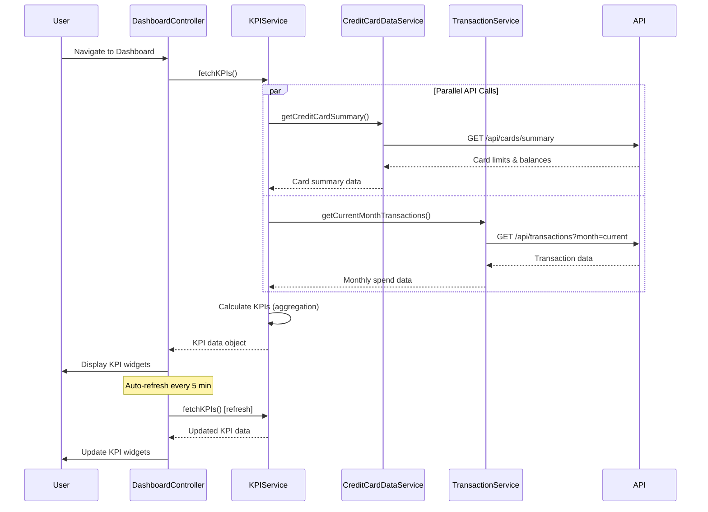

# Low-Level Design: QE-8572 - Dashboard KPIs and Financial Overview

## a. Architecture Mapping

- **AngularJS Module**: `creditCard.dashboard` - Root module for dashboard feature
- **Controller**: `DashboardController` - Manages dashboard state and KPI display
- **Service**: `KPIService` - Fetches and calculates key performance indicators via REST API
- **Service**: `CreditCardDataService` - Retrieves credit card details (limits, balances)
- **Service**: `TransactionService` - Fetches transaction data for monthly spend calculation
- **Directive**: `kpiWidget` - Reusable widget for displaying individual KPI metrics
- **Directive**: `financialSummary` - Displays consolidated financial overview panel
- **Factory**: `DashboardRefreshFactory` - Manages auto-refresh logic for real-time updates

**Folder Structure:**
```
/app
  /modules
    /dashboard
      dashboard.module.js
      dashboard.controller.js
      dashboard.html
      /services
        kpi.service.js
        credit-card-data.service.js
        transaction.service.js
      /directives
        kpi-widget.directive.js
        financial-summary.directive.js
      /factories
        dashboard-refresh.factory.js
```

## b. Component Specifications

| Name | Artifact Type | Responsibility | Key Dependencies |
|------|---------------|----------------|------------------|
| DashboardController | Controller | Orchestrates dashboard view, coordinates KPI data fetch, manages auto-refresh timer | KPIService, CreditCardDataService, TransactionService, DashboardRefreshFactory, $scope, $interval |
| KPIService | Service | Aggregates and calculates KPIs (monthly spend, total credit limit, available credit, outstanding), caches results | CreditCardDataService, TransactionService, $http, $q |
| CreditCardDataService | Service | Fetches credit card details (limits, balances) from REST API, manages card data cache | $http, API_CONFIG |
| TransactionService | Service | Retrieves current month transactions for spend calculation, handles date range filtering | $http, $filter |
| kpiWidget | Directive | Renders individual KPI tile with value, label, icon, and trend indicator | None |
| financialSummary | Directive | Displays consolidated panel with all KPIs and quick action buttons | KPIService |
| DashboardRefreshFactory | Factory | Provides configurable auto-refresh mechanism (default 5-minute interval) for real-time sync | $interval |

## c. Data Model

**KPIData Object:**
```javascript
{
  monthlySpend: Number,
  totalCreditLimit: Number,
  availableCredit: Number,
  outstandingAmount: Number,
  creditUtilization: Number, // Calculated as (outstandingAmount / totalCreditLimit) * 100
  lastUpdated: Date
}
```

**CreditCardSummary Object:**
```javascript
{
  totalCards: Number,
  totalCreditLimit: Number,
  totalAvailableCredit: Number,
  totalOutstanding: Number
}
```

## d. Data Flow

User navigates to dashboard → DashboardController initializes and calls KPIService to fetch aggregated metrics → KPIService concurrently calls CreditCardDataService for card limits/balances and TransactionService for current month transactions via REST APIs → Services return data, KPIService calculates KPIs (monthly spend, total credit limit, available credit, outstanding amount) → Controller updates $scope with KPI data → kpiWidget directives render individual KPI tiles and financialSummary displays consolidated view → DashboardRefreshFactory triggers auto-refresh every 5 minutes → KPIService re-fetches data and updates dashboard without full page reload.

## e. Primary Sequence Diagram



## f. Implementation Notes

- Use AngularJS $interval service for auto-refresh mechanism; cancel interval on $scope.$destroy to prevent memory leaks
- Implement parallel API calls using $q.all() to fetch card data and transactions simultaneously, reducing total load time to meet 2-second requirement
- Cache KPI data using $cacheFactory with 5-minute TTL; invalidate cache on user-initiated refresh or card/transaction updates
- Apply ES6 destructuring for cleaner data extraction from API responses; use const for immutable KPI calculations
- Leverage Bootstrap responsive utilities for mobile/desktop layout adaptation; implement CSS animations for smooth KPI value transitions

## g. Error Handling

HTTP interceptor captures API errors and displays dashboard-level error banner; partial data failures (e.g., transaction service down) show available KPIs with warning indicator.

## h. Security Notes

Requires token-based auth via existing SSO for API access; all API calls include authentication headers; no sensitive data cached in localStorage.