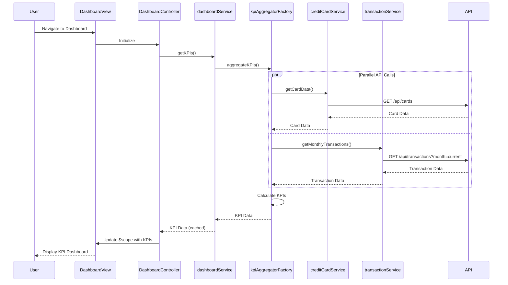

# Low-Level Design: Dashboard and KPI Management
**Epic ID:** QE-8573  
**Application:** Credit Card Analysis Dashboard  
**Tech Stack:** AngularJS 1.x, JavaScript ES6, HTML5, CSS3, Bootstrap, REST APIs, MVC Architecture

---

## a. Architecture Mapping

- **Dashboard Service** → AngularJS Service (handles KPI data aggregation and caching)
- **KPI Aggregation Module** → AngularJS Factory (aggregates data from Credit Card and Transaction services)
- **User Interface** → AngularJS Controller + HTML5 View with Bootstrap grid (responsive dashboard layout)
- **Credit Card Data Service Integration** → AngularJS Service with $http (fetches card balances and limits via REST API)
- **Transaction Service Integration** → AngularJS Service with $http (fetches monthly spend data via REST API)

**Recommended Folder Structure:**
```
app/
├── modules/dashboard/
│   ├── controllers/dashboardController.js
│   ├── services/dashboardService.js
│   ├── factories/kpiAggregatorFactory.js
│   ├── views/dashboard.html
│   └── dashboard.module.js
├── shared/services/
│   ├── creditCardService.js
│   └── transactionService.js
└── assets/css/dashboard.css
```

---

## b. Component Specifications

| Component Name | Artifact Type | Responsibility | Key Dependencies |
|---|---|---|---|
| dashboardModule | Module | Root module for dashboard feature | angular, ngRoute |
| DashboardController | Controller | Manages dashboard view state and user interactions | dashboardService, $scope |
| dashboardService | Service | Orchestrates KPI data retrieval and caching | kpiAggregatorFactory, $q |
| kpiAggregatorFactory | Factory | Aggregates data from multiple backend services | creditCardService, transactionService, $http |
| creditCardService | Service | Fetches credit card balances and limits from REST API | $http, API_ENDPOINTS |
| transactionService | Service | Fetches monthly transaction data from REST API | $http, API_ENDPOINTS |

---

## c. Data Model

**KPIDashboard Model:**
```javascript
{
  monthlySpend: Number,
  totalCreditLimit: Number,
  availableCredit: Number,
  outstandingAmount: Number,
  lastUpdated: Date
}
```

**CreditCard Model:**
```javascript
{
  cardId: String,
  cardNumber: String,
  creditLimit: Number,
  currentBalance: Number,
  availableCredit: Number
}
```

**Transaction Model:**
```javascript
{
  transactionId: String,
  cardId: String,
  amount: Number,
  date: Date,
  category: String
}
```

---

## d. Data Flow

User loads the dashboard → DashboardController initializes and calls dashboardService.getKPIs() → dashboardService invokes kpiAggregatorFactory which makes parallel REST API calls via creditCardService and transactionService → Backend APIs return card data and transaction data → kpiAggregatorFactory computes KPIs (monthly spend, total credit limit, available credit, outstanding amount) → Results are cached and returned to DashboardController → Controller binds KPI data to $scope → View updates with Bootstrap-styled KPI cards displaying real-time metrics.

---

## e. Primary Sequence Diagram



---

## f. Implementation Notes

- Use AngularJS Dependency Injection to inject services and factories into controllers
- Implement client-side caching in dashboardService using $cacheFactory to meet 2-second load time requirement
- Use $q.all() for parallel API calls to minimize latency when fetching card and transaction data
- Apply Bootstrap grid system (col-md-3) for responsive KPI card layout across mobile and desktop
- Use ES6 arrow functions and const/let in service implementations for cleaner code

---

## g. Error Handling

HTTP interceptor-based error handling with user-friendly notifications via Bootstrap alerts for API failures.

---

## h. Security Notes

Standard input validation and secure API calls assumed; token-based authentication via existing SSO required for API access.

---

**End of LLD**