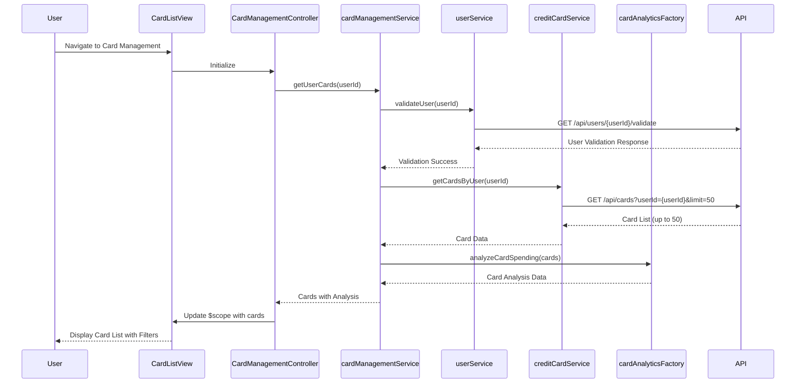

# Low-Level Design: Multiple Credit Card Management
**Epic ID:** QE-8574  
**Application:** Credit Card Analysis Dashboard  
**Tech Stack:** AngularJS 1.x, JavaScript ES6, HTML5, CSS3, Bootstrap, REST APIs, MVC Architecture

---

## a. Architecture Mapping

- **Card Management Service** → AngularJS Service (orchestrates card retrieval, filtering, and comparison logic)
- **User Service Integration** → AngularJS Service with $http (handles authentication and card ownership validation via REST API)
- **Credit Card Data Service Integration** → AngularJS Service with $http (fetches card information and balances via REST API)
- **Card Analytics Module** → AngularJS Factory (performs card-wise spend analysis and comparison calculations)
- **User Interface** → AngularJS Controller + HTML5 View with Bootstrap cards and filters (card listing, filtering, comparison)

**Recommended Folder Structure:**
```
app/
├── modules/cards/
│   ├── controllers/cardManagementController.js
│   ├── services/cardManagementService.js
│   ├── factories/cardAnalyticsFactory.js
│   ├── views/cardList.html
│   ├── views/cardDetails.html
│   └── cards.module.js
├── shared/services/
│   ├── userService.js
│   └── creditCardService.js
└── assets/css/cards.css
```

---

## b. Component Specifications

| Component Name | Artifact Type | Responsibility | Key Dependencies |
|---|---|---|---|
| cardsModule | Module | Root module for card management feature | angular, ngRoute |
| CardManagementController | Controller | Manages card list view, filtering, and selection | cardManagementService, $scope, $filter |
| cardManagementService | Service | Orchestrates card data retrieval and ownership validation | creditCardService, userService, $q |
| cardAnalyticsFactory | Factory | Performs card-wise spend analysis and comparison logic | transactionService |
| userService | Service | Handles user authentication and card ownership validation via REST API | $http, API_ENDPOINTS |
| creditCardService | Service | Fetches card information and balances from REST API | $http, API_ENDPOINTS |

---

## c. Data Model

**CreditCard Model:**
```javascript
{
  cardId: String,
  userId: String,
  cardNumber: String,
  cardType: String,
  bankName: String,
  creditLimit: Number,
  currentBalance: Number,
  availableCredit: Number,
  outstandingAmount: Number,
  expiryDate: Date
}
```

**CardSpendAnalysis Model:**
```javascript
{
  cardId: String,
  monthlySpend: Number,
  categoryBreakdown: Object,
  utilizationRate: Number
}
```

**User Model:**
```javascript
{
  userId: String,
  ownedCardIds: Array<String>
}
```

---

## d. Data Flow

User navigates to card management page → CardManagementController initializes and calls cardManagementService.getUserCards() → cardManagementService first validates user ownership via userService.validateUser() → Upon successful validation, creditCardService.getCardsByUser() fetches all cards (up to 50) via REST API with pagination → cardAnalyticsFactory computes card-wise spend analysis for each card → Results are returned to CardManagementController → Controller binds card data to $scope with filtering and sorting options → View renders card list using Bootstrap card components with filter controls.

---

## e. Primary Sequence Diagram



---

## f. Implementation Notes

- Use AngularJS $filter service for client-side card filtering and sorting by card type, bank, or spend
- Implement lazy loading or pagination in creditCardService to handle up to 50 cards within 300ms latency requirement
- Use ng-repeat with track by cardId for efficient DOM rendering of card list
- Apply Bootstrap card components with responsive grid (col-md-4) for card display
- Use ES6 Promises ($q) for chaining user validation and card data retrieval

---

## g. Error Handling

HTTP interceptor captures API errors; user-friendly error messages displayed via Bootstrap modals for validation or data retrieval failures.

---

## h. Security Notes

Requires token-based auth via existing SSO; card ownership validation enforced on every request to ensure data isolation.

---

**End of LLD**