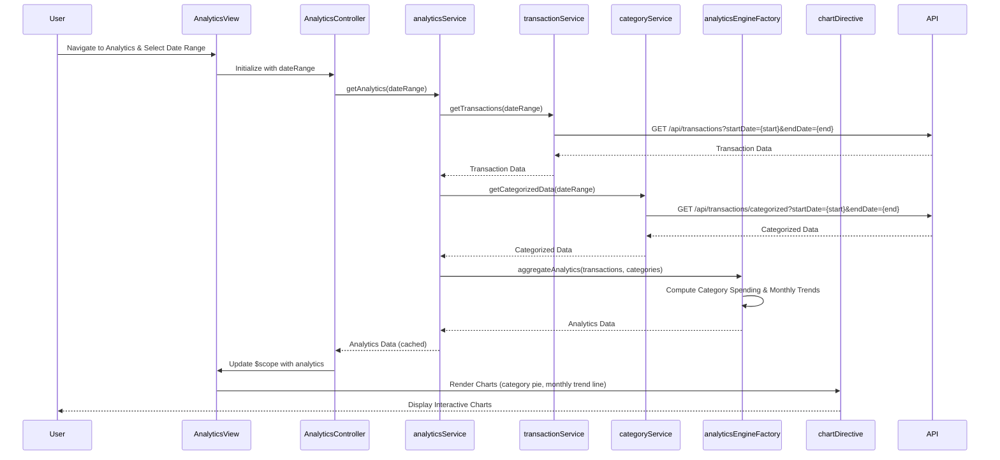

# Low-Level Design: Analytics and Spending Insights
**Epic ID:** QE-8575  
**Application:** Credit Card Analysis Dashboard  
**Tech Stack:** AngularJS 1.x, JavaScript ES6, HTML5, CSS3, Bootstrap, REST APIs, MVC Architecture

---

## a. Architecture Mapping

- **Analytics Service** → AngularJS Service (orchestrates analytics data retrieval and caching)
- **Transaction Service Integration** → AngularJS Service with $http (fetches transaction data via REST API)
- **Category Classification Service Integration** → AngularJS Service with $http (fetches pre-categorized transaction data via REST API)
- **Analytics Engine** → AngularJS Factory (performs data aggregation and trend calculations)
- **Visualization Module** → AngularJS Directive (renders interactive charts using Chart.js or D3.js)
- **User Interface** → AngularJS Controller + HTML5 View with Bootstrap layout (analytics dashboard with category breakdown and trends)

**Recommended Folder Structure:**
```
app/
├── modules/analytics/
│   ├── controllers/analyticsController.js
│   ├── services/analyticsService.js
│   ├── factories/analyticsEngineFactory.js
│   ├── directives/chartDirective.js
│   ├── views/analytics.html
│   └── analytics.module.js
├── shared/services/
│   ├── transactionService.js
│   └── categoryService.js
└── assets/css/analytics.css
```

---

## b. Component Specifications

| Component Name | Artifact Type | Responsibility | Key Dependencies |
|---|---|---|---|
| analyticsModule | Module | Root module for analytics and insights feature | angular, ngRoute, chart.js |
| AnalyticsController | Controller | Manages analytics view state and user interactions | analyticsService, $scope, $filter |
| analyticsService | Service | Orchestrates analytics data retrieval and caching | analyticsEngineFactory, transactionService, categoryService, $q |
| analyticsEngineFactory | Factory | Aggregates transaction data and computes category-wise spending and trends | $filter |
| transactionService | Service | Fetches transaction data from REST API | $http, API_ENDPOINTS |
| categoryService | Service | Fetches categorized transaction data from REST API | $http, API_ENDPOINTS |
| chartDirective | Directive | Renders interactive charts (pie, bar, line) using Chart.js | Chart.js library |

---

## c. Data Model

**Transaction Model:**
```javascript
{
  transactionId: String,
  cardId: String,
  amount: Number,
  date: Date,
  category: String,
  merchantName: String
}
```

**CategorySpending Model:**
```javascript
{
  category: String,
  totalSpend: Number,
  transactionCount: Number,
  percentage: Number
}
```

**MonthlyTrend Model:**
```javascript
{
  month: String,
  totalSpend: Number,
  categoryBreakdown: Array<CategorySpending>
}
```

**AnalyticsData Model:**
```javascript
{
  categorySpending: Array<CategorySpending>,
  monthlyTrends: Array<MonthlyTrend>,
  totalSpend: Number,
  dateRange: { start: Date, end: Date }
}
```

---

## d. Data Flow

User navigates to analytics page and selects date range → AnalyticsController calls analyticsService.getAnalytics(dateRange) → analyticsService fetches transaction data via transactionService and pre-categorized data via categoryService from REST APIs → analyticsEngineFactory aggregates transactions by category (Food & Dining, Fuel, Shopping, Travel, Entertainment, Utilities, Healthcare, Education, Miscellaneous) and computes monthly trends over 12 months → Aggregated data is cached and returned to AnalyticsController → Controller binds analytics data to $scope → chartDirective renders interactive pie chart for category breakdown and line chart for monthly trends → User interacts with charts to drill down into specific categories or time periods.

---

## e. Primary Sequence Diagram



---

## f. Implementation Notes

- Use AngularJS custom directive (chartDirective) to encapsulate Chart.js integration for reusable chart components
- Implement client-side caching in analyticsService using $cacheFactory to meet 1-second query execution requirement for repeated requests
- Use $filter('date') and $filter('currency') for formatting dates and amounts in views
- Apply Bootstrap grid layout for responsive analytics dashboard with chart containers
- Use ES6 array methods (map, reduce, filter) in analyticsEngineFactory for efficient data aggregation

---

## g. Error Handling

HTTP interceptor-based error handling with try/catch blocks in analyticsEngineFactory; user notifications via Bootstrap alerts for API or computation failures.

---

## h. Security Notes

Standard input validation and secure API calls assumed; token-based authentication via existing SSO required for transaction data access.

---

**End of LLD**