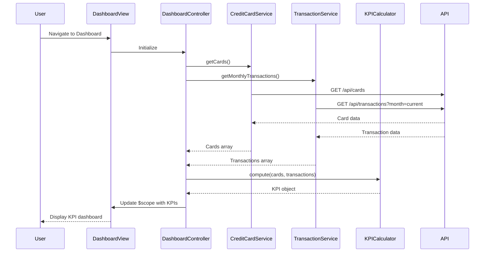

# Low-Level Design: QE-8576 - Dashboard and KPI Management

## a. Architecture Mapping

- **Dashboard Module** (`app.dashboard`) → AngularJS Module containing all dashboard-related artifacts
- **DashboardController** → AngularJS Controller managing dashboard state and KPI display logic
- **CreditCardService** → AngularJS Service/Factory for Credit Card Data Service API calls
- **TransactionService** → AngularJS Service/Factory for Transaction Service API calls
- **KPICalculator** → AngularJS Service for client-side KPI aggregation and formatting
- **dashboardView directive** → Custom directive for responsive KPI card rendering

**Recommended Folder Structure:**
```
/app
  /dashboard
    dashboard.module.js
    dashboard.controller.js
    dashboard.html
  /services
    credit-card.service.js
    transaction.service.js
    kpi-calculator.service.js
  /directives
    dashboard-view.directive.js
```

## b. Component Specifications

| Component Name | Artifact Type | Responsibility | Key Dependencies |
|----------------|---------------|----------------|------------------|
| DashboardController | Controller | Orchestrates KPI data fetching and view binding | CreditCardService, TransactionService, KPICalculator, $scope |
| CreditCardService | Service | Fetches card balances, limits, and available credit via REST API | $http, $q |
| TransactionService | Service | Retrieves monthly spend and outstanding amounts via REST API | $http, $q |
| KPICalculator | Service | Aggregates raw data into KPIs (monthly spend, total limit, available credit, outstanding) | None |
| dashboardView | Directive | Renders responsive KPI cards with real-time data binding | None |

## c. Data Model

```javascript
// KPI Dashboard Model
const DashboardKPI = {
  monthlySpend: Number,        // Current month total spend
  totalCreditLimit: Number,    // Sum of all card limits
  availableCredit: Number,     // Sum of available credit across cards
  outstandingAmount: Number,   // Total unpaid balance
  lastUpdated: Date            // Timestamp of last data refresh
};

// Card Summary Model (used for aggregation)
const CardSummary = {
  cardId: String,
  creditLimit: Number,
  availableCredit: Number,
  currentBalance: Number
};
```

## d. Data Flow

User navigates to dashboard → DashboardController initializes and calls CreditCardService.getCards() and TransactionService.getMonthlyTransactions() in parallel → Services return promises with card and transaction data → KPICalculator.compute() aggregates data into KPIs (summing limits, available credit, calculating outstanding) → Controller binds KPIs to $scope → dashboardView directive renders responsive KPI cards with Bootstrap grid → Auto-refresh timer triggers periodic data fetch every 30 seconds to maintain near-real-time updates.

## e. Primary Sequence Diagram



## f. Implementation Notes

- Use AngularJS Dependency Injection to inject services into DashboardController for testability and modularity
- Implement $http interceptors for centralized API error handling and loading state management
- Use $q.all() to parallelize CreditCardService and TransactionService API calls for faster dashboard load (<2s)
- Apply Bootstrap responsive grid (col-xs/sm/md/lg) in dashboard.html for mobile/tablet/desktop compatibility
- Implement $interval service for 30-second auto-refresh to maintain near-real-time data without full page reload

## g. Error Handling

HTTP interceptor captures API errors; user-friendly notifications displayed via toast/alert service; failed KPI calculations default to zero with warning indicator.

## h. Security Notes

Standard input validation and secure API calls assumed; token-based authentication via existing SSO expected for all API endpoints.