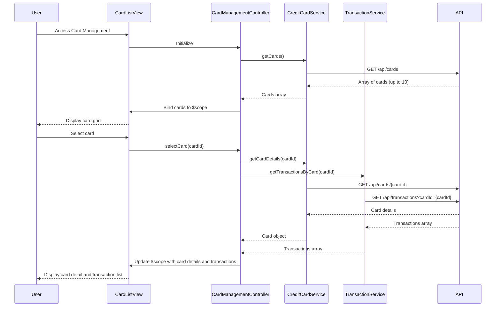

# Low-Level Design: QE-8577 - Multiple Credit Card Management

## a. Architecture Mapping

- **Card Management Module** (`app.cardManagement`) → AngularJS Module for card portfolio features
- **CardManagementController** → AngularJS Controller managing card list and detail views
- **CreditCardService** → AngularJS Service for Credit Card Data Service API integration
- **TransactionService** → AngularJS Service for card-specific transaction retrieval
- **cardList directive** → Custom directive for rendering card portfolio grid
- **cardDetail directive** → Custom directive for individual card details and transaction list

**Recommended Folder Structure:**
```
/app
  /card-management
    card-management.module.js
    card-management.controller.js
    card-list.html
    card-detail.html
  /services
    credit-card.service.js
    transaction.service.js
  /directives
    card-list.directive.js
    card-detail.directive.js
```

## b. Component Specifications

| Component Name | Artifact Type | Responsibility | Key Dependencies |
|----------------|---------------|----------------|------------------|
| CardManagementController | Controller | Manages card selection, filtering, and detail view state | CreditCardService, TransactionService, $scope, $routeParams |
| CreditCardService | Service | Fetches all user cards and individual card details via REST API | $http, $q |
| TransactionService | Service | Retrieves card-specific transaction history with pagination support | $http, $q |
| cardList | Directive | Renders grid of cards with summary info (limit, balance, available credit) | None |
| cardDetail | Directive | Displays selected card details and transaction list with filter/sort controls | None |

## c. Data Model

```javascript
// Credit Card Model
const CreditCard = {
  cardId: String,              // Unique card identifier
  cardNumber: String,          // Masked card number (e.g., ****1234)
  cardType: String,            // Visa, MasterCard, Amex, etc.
  creditLimit: Number,
  availableCredit: Number,
  currentBalance: Number,
  cardHolderName: String,
  expiryDate: String           // MM/YY format
};

// Transaction Model
const Transaction = {
  transactionId: String,
  cardId: String,              // Links to CreditCard
  amount: Number,
  category: String,
  merchant: String,
  transactionDate: Date,
  description: String
};
```

## d. Data Flow

User accesses card management page → CardManagementController calls CreditCardService.getCards() → Service fetches all cards (up to 10) via GET /api/cards → cardList directive renders card grid with summary → User clicks a card → Controller captures cardId and calls CreditCardService.getCardDetails(cardId) and TransactionService.getTransactionsByCard(cardId) → Services return card details and transaction array (up to 1000) → cardDetail directive renders card info and transaction table with client-side filter/sort → User applies filters (date range, category) handled by controller logic updating view.

## e. Primary Sequence Diagram



## f. Implementation Notes

- Use AngularJS $routeParams or ui-router state params to handle card selection and deep linking to specific card details
- Implement client-side filtering and sorting using AngularJS filters (orderBy, filter) for transaction list to avoid server round-trips
- Apply lazy loading or pagination for transaction lists exceeding 100 items to maintain performance with 1000+ transactions
- Use ng-repeat with track by transactionId for efficient DOM rendering in transaction tables
- Cache card list in CreditCardService using $cacheFactory to reduce redundant API calls during session

## g. Error Handling

HTTP interceptor-based error handling with user notifications; transaction fetch failures show partial data with retry option.

## h. Security Notes

Requires token-based auth via existing SSO; card numbers displayed in masked format; no sensitive card data stored client-side.