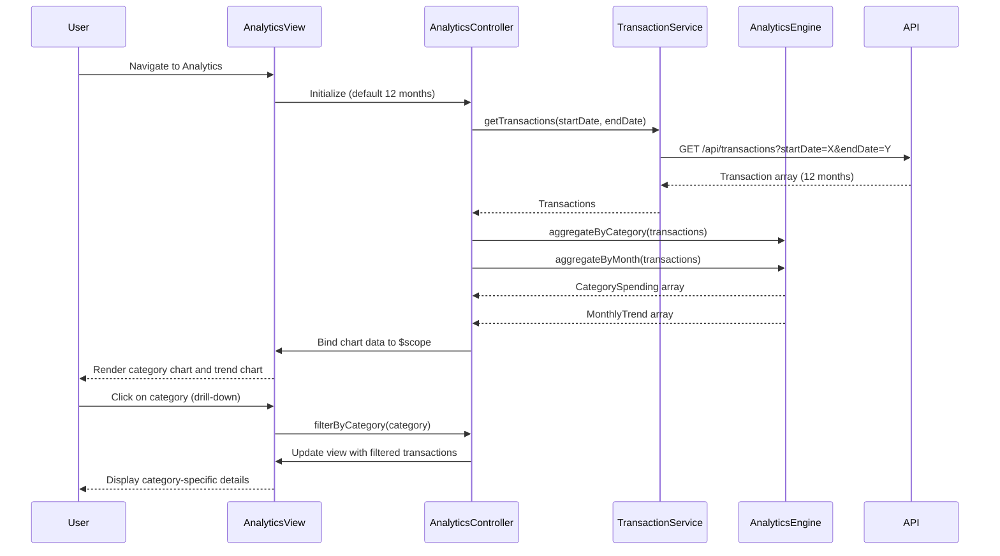

# Low-Level Design: QE-8578 - Analytics and Spending Insights

## a. Architecture Mapping

- **Analytics Module** (`app.analytics`) → AngularJS Module for spending insights and visualizations
- **AnalyticsController** → AngularJS Controller managing analytics view state and data aggregation
- **TransactionService** → AngularJS Service for transaction data retrieval
- **AnalyticsEngine** → AngularJS Service for client-side data aggregation by category and time period
- **spendingChart directive** → Custom directive wrapping Chart.js for category-wise spending visualization
- **trendChart directive** → Custom directive for monthly spend trend line chart

**Recommended Folder Structure:**
```
/app
  /analytics
    analytics.module.js
    analytics.controller.js
    analytics.html
  /services
    transaction.service.js
    analytics-engine.service.js
  /directives
    spending-chart.directive.js
    trend-chart.directive.js
```

## b. Component Specifications

| Component Name | Artifact Type | Responsibility | Key Dependencies |
|----------------|---------------|----------------|------------------|
| AnalyticsController | Controller | Manages analytics view, date range selection, and chart data binding | TransactionService, AnalyticsEngine, $scope, $filter |
| TransactionService | Service | Fetches transaction data for specified date range via REST API | $http, $q |
| AnalyticsEngine | Service | Aggregates transactions by category and month; computes spending totals | None |
| spendingChart | Directive | Renders interactive pie/bar chart for category-wise spending using Chart.js | Chart.js library |
| trendChart | Directive | Renders line chart showing monthly spend trends over 12 months | Chart.js library |

## c. Data Model

```javascript
// Transaction Model (for analytics)
const Transaction = {
  transactionId: String,
  amount: Number,
  category: String,           // One of 9 predefined categories
  transactionDate: Date,
  merchant: String
};

// Category Spending Model
const CategorySpending = {
  category: String,           // Food & Dining, Fuel, Shopping, Travel, Entertainment, Utilities, Healthcare, Education, Miscellaneous
  totalAmount: Number,
  transactionCount: Number,
  percentage: Number          // % of total spend
};

// Monthly Trend Model
const MonthlyTrend = {
  month: String,              // YYYY-MM format
  totalSpend: Number,
  categoryBreakdown: Array    // Array of CategorySpending for that month
};
```

## d. Data Flow

User navigates to analytics dashboard → AnalyticsController initializes with default 12-month date range → Controller calls TransactionService.getTransactions(startDate, endDate) → Service fetches transaction data via GET /api/transactions?startDate=X&endDate=Y → AnalyticsEngine.aggregateByCategory() processes transactions into CategorySpending array and AnalyticsEngine.aggregateByMonth() generates MonthlyTrend array → Controller binds aggregated data to $scope → spendingChart directive renders category pie/bar chart and trendChart directive renders monthly line chart using Chart.js → User interacts with chart (drill-down on category) → Controller filters transactions by selected category and updates view with filtered data.

## e. Primary Sequence Diagram



## f. Implementation Notes

- Integrate Chart.js library via Bower/NPM and wrap in AngularJS directives for two-way data binding and lifecycle management
- Use AngularJS $filter service to format currency and date values in charts and tables
- Implement client-side caching of transaction data in AnalyticsEngine to avoid re-fetching on date range changes within cached period
- Apply responsive chart configuration (Chart.js responsive: true) to ensure charts adapt to mobile/tablet/desktop viewports
- Use $timeout for chart rendering to ensure DOM is ready and avoid digest cycle conflicts with Chart.js updates

## g. Error Handling

HTTP interceptor handles API failures; analytics view shows "No data available" message with retry button on empty or failed data fetch.

## h. Security Notes

Standard input validation and secure API calls assumed; transaction data filtered server-side by authenticated user context.