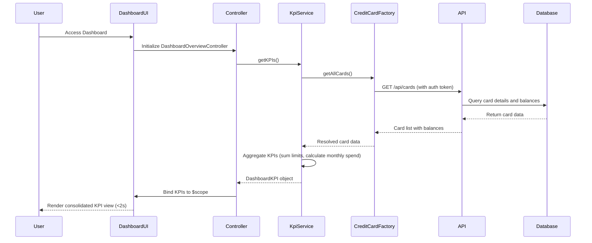

# Low-Level Design: Dashboard KPIs and Credit Card Overview
**Epic ID:** QE-8579

## a. Architecture Mapping

- **Dashboard Overview UI** → AngularJS Module: `app.dashboard`, Controller: `DashboardOverviewController`, View: `dashboard-overview.html`
- **KPI Service** → AngularJS Service: `KpiService` (handles KPI aggregation and calculation logic)
- **Credit Card Data Service** → AngularJS Factory: `CreditCardDataFactory` (REST API integration for card data)
- **User Authentication Service** → AngularJS Service: `AuthService` (manages authentication state and tokens)

**Recommended Folder Structure:**
```
app/
├── modules/
│   └── dashboard/
│       ├── controllers/
│       │   └── dashboard-overview.controller.js
│       ├── services/
│       │   ├── kpi.service.js
│       │   └── credit-card-data.factory.js
│       ├── views/
│       │   └── dashboard-overview.html
│       └── dashboard.module.js
├── shared/
│   └── services/
│       └── auth.service.js
└── app.js
```

## b. Component Specifications

| Component Name | Artifact Type | Responsibility | Key Dependencies |
|----------------|---------------|----------------|------------------|
| DashboardOverviewController | Controller | Orchestrates dashboard view, fetches KPIs, handles user interactions | KpiService, CreditCardDataFactory, $scope |
| KpiService | Service | Aggregates and calculates KPIs (monthly spend, total credit limit, available credit, outstanding amounts) | CreditCardDataFactory, $http, $q |
| CreditCardDataFactory | Factory | Provides REST API integration for retrieving card details and balances | $http, $q, AuthService |
| AuthService | Service | Manages user authentication, token storage, and session validation | $http, $window.localStorage |
| dashboardOverviewDirective | Directive | Encapsulates KPI display widgets with real-time refresh capability | KpiService |

## c. Data Model

**CreditCard Model:**
```javascript
{
  cardId: String,
  cardNumber: String (masked),
  cardType: String,
  creditLimit: Number,
  availableCredit: Number,
  outstandingAmount: Number,
  lastUpdated: Date
}
```

**DashboardKPI Model:**
```javascript
{
  monthlySpend: Number,
  totalCreditLimit: Number,
  totalAvailableCredit: Number,
  totalOutstanding: Number,
  cardCount: Number,
  lastRefreshed: Date
}
```

## d. Data Flow

User authenticates and navigates to dashboard → DashboardOverviewController initializes and calls KpiService.getKPIs() → KpiService requests card data via CreditCardDataFactory.getAllCards() → Factory makes REST API call to /api/cards with auth token → API returns card list with balances → KpiService aggregates metrics (sum credit limits, available credit, outstanding amounts, calculate monthly spend) → Controller receives DashboardKPI object and binds to $scope → View renders KPI widgets using Angular data binding with real-time refresh via $interval.

## e. Primary Sequence Diagram



## f. Implementation Notes

- Use AngularJS Dependency Injection for all services and controllers; register modules using `angular.module('app.dashboard', [])`.
- Implement REST API calls using $http service with promise-based error handling; use $q.all() for parallel KPI data fetching.
- Apply Bootstrap grid system (col-md-3, col-sm-6, col-xs-12) for responsive KPI card layout across devices.
- Use $interval service for real-time dashboard refresh (every 30 seconds) with automatic cleanup on $scope.$destroy.
- Implement lazy loading for dashboard module using ocLazyLoad or ui-router resolve to optimize initial page load under 2 seconds.

## g. Error Handling

HTTP interceptor-based error handling with global error service; display user-friendly notifications via Angular Toastr for API failures.

## h. Security Notes

Requires token-based auth via existing SSO; all API calls include Authorization header with JWT token validated by AuthService.