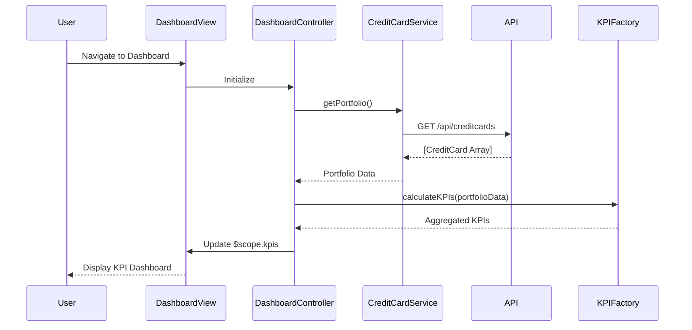

# Low-Level Design: Dashboard KPIs and Credit Card Overview
**Epic ID:** QE-8579  
**Tech Stack:** AngularJS 1.x, JavaScript ES6, HTML5, CSS3, Bootstrap, REST APIs, MVC Architecture

---

## a. Architecture Mapping

- **Dashboard Module** → AngularJS Module (`app.dashboard`)
- **Dashboard Controller** → AngularJS Controller (`DashboardController`)
- **Credit Card Service** → AngularJS Service (`CreditCardService`)
- **KPI Service** → AngularJS Factory (`KPIFactory`)
- **Auth Interceptor** → AngularJS HTTP Interceptor (`AuthInterceptor`)

**Folder Structure:**
```
/app
  /modules
    /dashboard
      dashboard.module.js
      dashboard.controller.js
      dashboard.html
  /services
    creditcard.service.js
    kpi.factory.js
  /interceptors
    auth.interceptor.js
  /models
    creditcard.model.js
```

---

## b. Component Specifications

| Name | Artifact Type | Responsibility | Key Dependencies |
|------|---------------|----------------|------------------|
| DashboardModule | Module | Register dashboard feature module and configure routing | angular, ui-router |
| DashboardController | Controller | Manage dashboard state, fetch KPIs, handle refresh | CreditCardService, KPIFactory, $scope |
| CreditCardService | Service | Retrieve credit card portfolio data via REST API | $http, AuthInterceptor |
| KPIFactory | Factory | Calculate aggregated KPIs (total limit, available credit, outstanding, monthly spend) | CreditCardService |
| AuthInterceptor | HTTP Interceptor | Inject authentication token into all outgoing API requests | $q, $window |
| DashboardView | HTML Template | Render KPI cards with Bootstrap responsive grid | Bootstrap CSS, AngularJS directives |

---

## c. Data Model

**CreditCard Model:**
```javascript
{
  cardId: String,
  cardNumber: String (masked),
  cardType: String,
  creditLimit: Number,
  availableCredit: Number,
  outstandingAmount: Number,
  monthlySpend: Number,
  lastUpdated: Date
}
```

**KPI Model:**
```javascript
{
  totalCreditLimit: Number,
  totalAvailableCredit: Number,
  totalOutstanding: Number,
  currentMonthSpend: Number,
  cardCount: Number
}
```

---

## d. Data Flow

User navigates to dashboard → DashboardController initializes and calls CreditCardService.getPortfolio() → Service makes authenticated GET request to `/api/creditcards` → Backend returns array of credit card objects → KPIFactory.calculateKPIs() aggregates metrics across all cards → Controller updates $scope with KPI data → View renders KPI cards using Bootstrap grid with real-time values → User can trigger manual refresh via refresh button invoking the same flow.

---

## e. Primary Sequence Diagram



---

## f. Implementation Notes

- Use AngularJS Dependency Injection for all controllers, services, and factories
- Implement ES6 classes for service layer with arrow functions for API calls
- Apply Bootstrap 4 grid system with responsive breakpoints (col-xs, col-md, col-lg) for KPI cards
- Use $http service with promise chaining for API integration; cache portfolio data for 30 seconds to meet sub-2-second load requirement
- Implement manual refresh using $scope.$apply() to trigger digest cycle after API response

---

## g. Error Handling

HTTP interceptor captures API errors and displays user-friendly notifications via Bootstrap alert components; try/catch in controllers for local exceptions.

---

## h. Security Notes

Requires token-based auth via existing SSO; AuthInterceptor injects JWT token in Authorization header for all API calls.