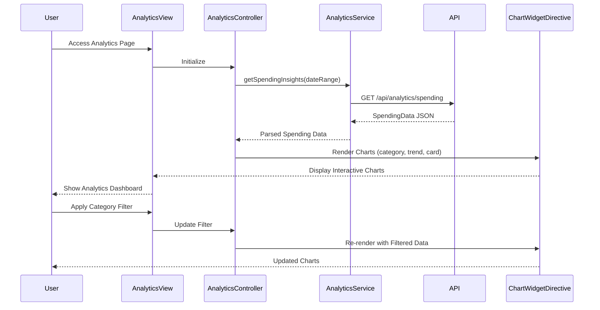

# Low-Level Design: Spending Analytics and Insights
**Epic ID:** QE-8580  
**Tech Stack:** AngularJS 1.x, JavaScript ES6, HTML5, CSS3, Bootstrap, REST APIs, MVC Architecture

---

## a. Architecture Mapping

- **Analytics Module** → AngularJS Module (`app.analytics`)
- **Analytics Controller** → AngularJS Controller (`AnalyticsController`)
- **Analytics Service** → AngularJS Service (`AnalyticsService`)
- **Chart Directive** → AngularJS Directive (`chartWidget`)
- **Category Filter** → AngularJS Filter (`categoryFilter`)

**Folder Structure:**
```
/app
  /modules
    /analytics
      analytics.module.js
      analytics.controller.js
      analytics.html
  /services
    analytics.service.js
  /directives
    chart-widget.directive.js
  /filters
    category.filter.js
  /models
    spending.model.js
```

---

## b. Component Specifications

| Name | Artifact Type | Responsibility | Key Dependencies |
|------|---------------|----------------|------------------|
| AnalyticsModule | Module | Register analytics feature module and configure routing | angular, ui-router, chart.js |
| AnalyticsController | Controller | Manage analytics state, fetch spending data, handle filter interactions | AnalyticsService, $scope, $filter |
| AnalyticsService | Service | Retrieve categorized spending data and trends via REST API | $http, AuthInterceptor |
| ChartWidgetDirective | Directive | Render interactive charts (pie, bar, line) using Chart.js library | chart.js, $timeout |
| CategoryFilter | Filter | Filter spending data by selected categories | None |
| AnalyticsView | HTML Template | Display category breakdown, monthly trends, and card-wise charts | Bootstrap, chartWidget directive |

---

## c. Data Model

**SpendingData Model:**
```javascript
{
  userId: String,
  month: String (YYYY-MM),
  categories: [
    {
      categoryName: String,
      amount: Number,
      transactionCount: Number
    }
  ],
  cardWiseSpend: [
    {
      cardId: String,
      cardType: String,
      totalSpend: Number
    }
  ],
  monthlyTrend: [
    {
      month: String,
      totalSpend: Number
    }
  ]
}
```

---

## d. Data Flow

User accesses analytics page → AnalyticsController calls AnalyticsService.getSpendingInsights() → Service makes GET request to `/api/analytics/spending` with date range parameters → Backend returns pre-aggregated spending data by category, card, and month → Controller processes data and passes to ChartWidgetDirective → Directive renders three charts (category pie chart, monthly trend line chart, card-wise bar chart) using Chart.js → User applies category filter → CategoryFilter updates chart data dynamically → View re-renders filtered charts.

---

## e. Primary Sequence Diagram



---

## f. Implementation Notes

- Use Chart.js library integrated via AngularJS directive for rendering responsive charts
- Implement ES6 arrow functions and destructuring in AnalyticsService for clean API response handling
- Apply AngularJS two-way data binding for filter interactions with ng-model on category checkboxes
- Pre-aggregate data on backend to ensure sub-3-second load time; use $timeout in directive to defer chart rendering after DOM ready
- Implement drill-down using Chart.js onClick event handlers that update controller scope

---

## g. Error Handling

HTTP interceptor-based error handling with user notification via Bootstrap toast; chart rendering failures caught in directive with fallback message display.

---

## h. Security Notes

Standard input validation and secure API calls assumed; token-based authentication via existing SSO.