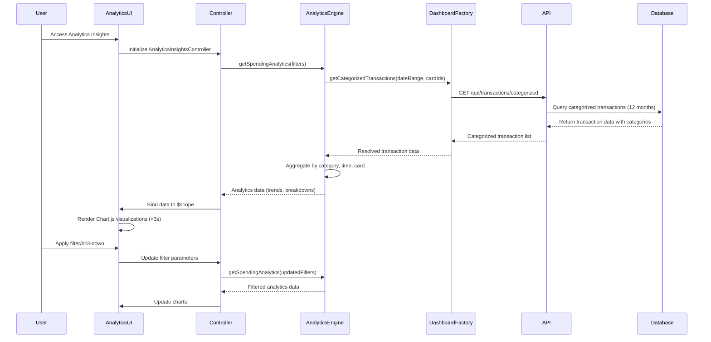

# Low-Level Design: Spending Analytics and Insights
**Epic ID:** QE-8580

## a. Architecture Mapping

- **Analytics Insights UI** → AngularJS Module: `app.analytics`, Controller: `AnalyticsInsightsController`, View: `analytics-insights.html`
- **Analytics Engine** → AngularJS Service: `AnalyticsEngineService` (handles data aggregation and trend calculation)
- **Transaction Categorization Service** → AngularJS Service: `TransactionCategorizationService` (manages category assignment logic)
- **Dashboard Service** → AngularJS Factory: `DashboardFactory` (REST API integration for visualization data)
- **Chart Rendering** → AngularJS Directive: `spendingChartDirective` (encapsulates Chart.js integration)

**Recommended Folder Structure:**
```
app/
├── modules/
│   └── analytics/
│       ├── controllers/
│       │   └── analytics-insights.controller.js
│       ├── services/
│       │   ├── analytics-engine.service.js
│       │   ├── transaction-categorization.service.js
│       │   └── dashboard.factory.js
│       ├── directives/
│       │   └── spending-chart.directive.js
│       ├── views/
│       │   └── analytics-insights.html
│       └── analytics.module.js
└── app.js
```

## b. Component Specifications

| Component Name | Artifact Type | Responsibility | Key Dependencies |
|----------------|---------------|----------------|------------------|
| AnalyticsInsightsController | Controller | Manages analytics view, handles filter interactions, coordinates data fetching | AnalyticsEngineService, DashboardFactory, $scope |
| AnalyticsEngineService | Service | Aggregates transaction data by category, time period, and card; calculates trends | TransactionCategorizationService, $http, $q |
| TransactionCategorizationService | Service | Assigns transactions to 9 predefined categories; provides category metadata | $http |
| DashboardFactory | Factory | Provides REST API integration for fetching categorized transaction data | $http, $q |
| spendingChartDirective | Directive | Renders interactive charts using Chart.js with drill-down and filtering capabilities | Chart.js library, $timeout |

## c. Data Model

**SpendingCategory Model:**
```javascript
{
  categoryId: String,
  categoryName: String, // Food & Dining, Fuel, Shopping, Travel, Entertainment, Utilities, Healthcare, Education, Miscellaneous
  totalAmount: Number,
  transactionCount: Number,
  percentageOfTotal: Number
}
```

**MonthlyTrend Model:**
```javascript
{
  month: String, // YYYY-MM format
  totalSpend: Number,
  categoryBreakdown: Array<SpendingCategory>
}
```

**CardWiseSpend Model:**
```javascript
{
  cardId: String,
  cardName: String,
  totalSpend: Number,
  categoryBreakdown: Array<SpendingCategory>
}
```

## d. Data Flow

User navigates to analytics insights view → AnalyticsInsightsController initializes and calls AnalyticsEngineService.getSpendingAnalytics(filters) → AnalyticsEngineService requests categorized transaction data via DashboardFactory.getCategorizedTransactions() → Factory makes REST API call to /api/transactions/categorized with date range and card filters → TransactionCategorizationService ensures category consistency → API returns categorized transaction data → AnalyticsEngineService aggregates by category, time period, and card → Controller receives analytics data and binds to $scope → spendingChartDirective renders interactive Chart.js visualizations with filtering and drill-down capabilities within 3-second load time.

## e. Primary Sequence Diagram



## f. Implementation Notes

- Use AngularJS Dependency Injection for all components; register analytics module using `angular.module('app.analytics', ['chart.js'])`.
- Integrate Chart.js via angular-chart.js wrapper for responsive pie, bar, and line charts with drill-down using chart click events.
- Implement filter panel using ng-model for date range pickers and card selection dropdowns; trigger analytics refresh on filter change.
- Use $q.all() to fetch category-wise, monthly trend, and card-wise data in parallel for optimal performance under 3-second load time.
- Cache analytics data in service using simple object cache with TTL to reduce redundant API calls during filter interactions.

## g. Error Handling

HTTP interceptor-based error handling with fallback to cached data if available; display user-friendly error messages via Angular Toastr.

## h. Security Notes

Standard input validation and secure API calls assumed; all API requests include authentication token via HTTP interceptor.