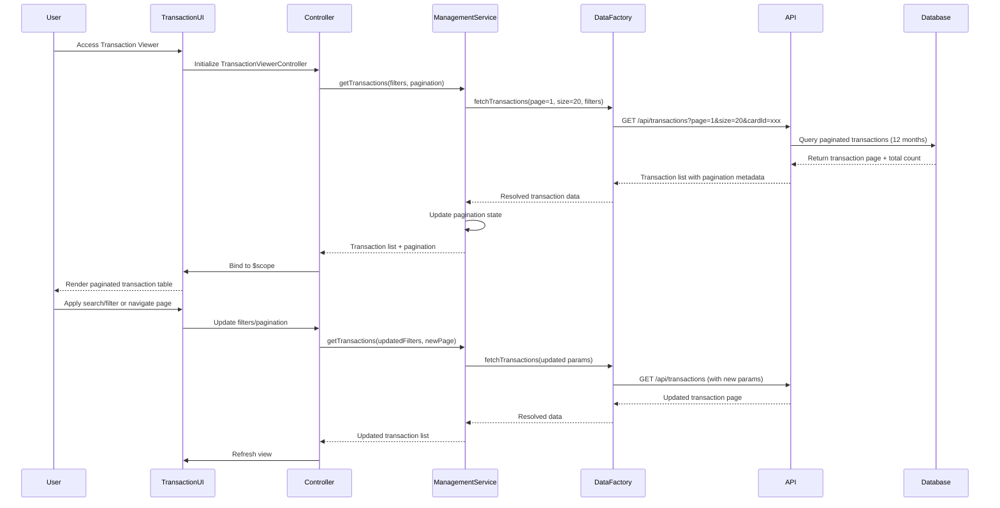

# Low-Level Design: Transaction Management and Viewing
**Epic ID:** QE-8581

## a. Architecture Mapping

- **Transaction Viewer UI** → AngularJS Module: `app.transactions`, Controller: `TransactionViewerController`, View: `transaction-viewer.html`
- **Transaction Management Service** → AngularJS Service: `TransactionManagementService` (orchestrates transaction retrieval and filtering)
- **Transaction Data Service** → AngularJS Factory: `TransactionDataFactory` (REST API integration for transaction records)
- **Credit Card Service** → AngularJS Service: `CreditCardService` (provides card-specific filtering context)
- **Transaction List Directive** → AngularJS Directive: `transactionListDirective` (renders paginated transaction list)

**Recommended Folder Structure:**
```
app/
├── modules/
│   └── transactions/
│       ├── controllers/
│       │   └── transaction-viewer.controller.js
│       ├── services/
│       │   ├── transaction-management.service.js
│       │   ├── transaction-data.factory.js
│       │   └── credit-card.service.js
│       ├── directives/
│       │   └── transaction-list.directive.js
│       ├── views/
│       │   └── transaction-viewer.html
│       └── transactions.module.js
└── app.js
```

## b. Component Specifications

| Component Name | Artifact Type | Responsibility | Key Dependencies |
|----------------|---------------|----------------|------------------|
| TransactionViewerController | Controller | Manages transaction view, handles search/filter interactions, pagination control | TransactionManagementService, CreditCardService, $scope |
| TransactionManagementService | Service | Orchestrates transaction retrieval, applies filters, manages pagination state | TransactionDataFactory, $q |
| TransactionDataFactory | Factory | Provides REST API integration for fetching paginated transaction records | $http, $q |
| CreditCardService | Service | Provides card list for filtering, validates card-specific access | $http |
| transactionListDirective | Directive | Renders paginated transaction table with search/filter UI and responsive layout | TransactionManagementService |

## c. Data Model

**Transaction Model:**
```javascript
{
  transactionId: String,
  cardId: String,
  cardName: String,
  merchantName: String,
  amount: Number,
  currency: String,
  category: String,
  transactionDate: Date,
  status: String, // Posted, Pending
  description: String
}
```

**TransactionFilter Model:**
```javascript
{
  cardIds: Array<String>,
  dateFrom: Date,
  dateTo: Date,
  searchTerm: String,
  categories: Array<String>,
  minAmount: Number,
  maxAmount: Number
}
```

**PaginationState Model:**
```javascript
{
  currentPage: Number,
  pageSize: Number,
  totalRecords: Number,
  totalPages: Number
}
```

## d. Data Flow

User navigates to transaction viewer → TransactionViewerController initializes and calls TransactionManagementService.getTransactions(filters, pagination) → Service requests transaction data via TransactionDataFactory.fetchTransactions() with pagination parameters → Factory makes REST API call to /api/transactions?page=1&size=20&cardId=xxx&dateFrom=yyy → API queries database for paginated transaction records (up to 12 months) → Database returns transaction page with total count → Factory resolves transaction list and pagination metadata → Service updates pagination state → Controller binds transaction list to $scope → transactionListDirective renders responsive table with search/filter controls; user applies filter or navigates pages triggering controller to refresh data.

## e. Primary Sequence Diagram



## f. Implementation Notes

- Use AngularJS Dependency Injection for all components; register transactions module using `angular.module('app.transactions', ['ui.bootstrap'])`.
- Implement pagination using ui-bootstrap's uib-pagination directive with server-side pagination (page size: 20 transactions).
- Use ng-table or custom directive for responsive transaction table with column sorting and inline search/filter controls.
- Implement debounced search using $timeout to avoid excessive API calls on every keystroke (300ms delay).
- Cache current filter state in service to preserve filters when user navigates away and returns to transaction view.

## g. Error Handling

HTTP interceptor-based error handling with retry logic for transient failures; display user-friendly error messages via Angular Toastr.

## h. Security Notes

Requires token-based auth via existing SSO; API enforces user-specific transaction access control based on JWT claims.