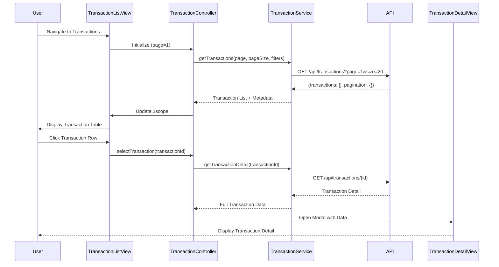

# Low-Level Design: Transaction Management and Viewing
**Epic ID:** QE-8581  
**Tech Stack:** AngularJS 1.x, JavaScript ES6, HTML5, CSS3, Bootstrap, REST APIs, MVC Architecture

---

## a. Architecture Mapping

- **Transaction Module** → AngularJS Module (`app.transactions`)
- **Transaction Controller** → AngularJS Controller (`TransactionController`)
- **Transaction Service** → AngularJS Service (`TransactionService`)
- **Pagination Directive** → AngularJS Directive (`pagination`)
- **Search Filter** → AngularJS Filter (`transactionSearch`)

**Folder Structure:**
```
/app
  /modules
    /transactions
      transaction.module.js
      transaction.controller.js
      transaction-list.html
      transaction-detail.html
  /services
    transaction.service.js
  /directives
    pagination.directive.js
  /filters
    transaction-search.filter.js
  /models
    transaction.model.js
```

---

## b. Component Specifications

| Name | Artifact Type | Responsibility | Key Dependencies |
|------|---------------|----------------|------------------|
| TransactionModule | Module | Register transaction feature module and configure routing | angular, ui-router |
| TransactionController | Controller | Manage transaction list state, handle pagination, search, and detail view navigation | TransactionService, $scope, $stateParams |
| TransactionService | Service | Retrieve paginated transaction data and detail via REST API | $http, AuthInterceptor |
| PaginationDirective | Directive | Render pagination controls and emit page change events | Bootstrap pagination CSS |
| TransactionSearchFilter | Filter | Filter transactions by amount, merchant, date, or category | None |
| TransactionListView | HTML Template | Display paginated transaction table with search and filter controls | Bootstrap table, pagination directive |
| TransactionDetailView | HTML Template | Display detailed transaction information in modal or separate view | Bootstrap modal |

---

## c. Data Model

**Transaction Model:**
```javascript
{
  transactionId: String,
  cardId: String,
  merchantName: String,
  amount: Number,
  currency: String,
  transactionDate: Date,
  category: String,
  status: String,
  description: String
}
```

**PaginationMeta Model:**
```javascript
{
  currentPage: Number,
  pageSize: Number,
  totalRecords: Number,
  totalPages: Number
}
```

---

## d. Data Flow

User navigates to transaction list → TransactionController calls TransactionService.getTransactions(page, pageSize, filters) → Service makes GET request to `/api/transactions?page=1&size=20&cardId=xyz` → Backend returns paginated transaction array with metadata → Controller updates $scope.transactions and $scope.pagination → View renders transaction table using Bootstrap responsive table and pagination directive → User clicks transaction row → Controller navigates to detail view using $state.go() with transactionId → Detail view fetches full transaction via TransactionService.getTransactionDetail(id) → Modal displays complete transaction information.

---

## e. Primary Sequence Diagram



---

## f. Implementation Notes

- Use AngularJS ui-router for state management between list and detail views
- Implement server-side pagination via query parameters; store current page state in controller scope
- Apply AngularJS ng-repeat with track by transactionId for efficient list rendering
- Use Bootstrap table-responsive class for mobile-friendly transaction table display
- Implement debounced search using $timeout to reduce API calls during user typing (300ms delay)

---

## g. Error Handling

HTTP interceptor captures API failures and displays Bootstrap alert; empty state handling in view when no transactions found.

---

## h. Security Notes

Requires token-based auth via existing SSO; API enforces user-level transaction access control.