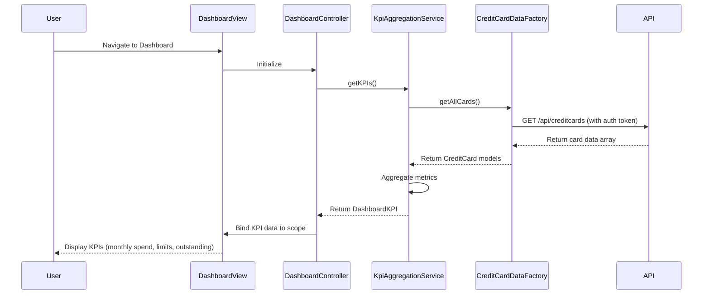

# Low-Level Design: QE-8582 - Credit Card Dashboard and KPI Management

## a. Architecture Mapping

**HLD Component → AngularJS Artifact Mapping:**

- Dashboard UI Component → AngularJS Module `creditCardDashboard` + Controller `DashboardController` + View Template `dashboard.html`
- KPI Aggregation Service → AngularJS Service `KpiAggregationService` (handles data aggregation logic)
- Credit Card Data Service → AngularJS Factory `CreditCardDataFactory` (REST API integration)
- User Authentication Service → AngularJS Service `AuthService` (session and token management)

**Recommended Folder Structure:**
```
app/
├── modules/
│   └── dashboard/
│       ├── dashboard.module.js
│       ├── dashboard.controller.js
│       ├── dashboard.html
│       └── dashboard.css
├── services/
│   ├── kpi-aggregation.service.js
│   ├── auth.service.js
│   └── creditcard-data.factory.js
├── models/
│   └── creditcard.model.js
└── app.js
```

## b. Component Specifications

| Component Name | Artifact Type | Responsibility | Key Dependencies |
|----------------|---------------|----------------|------------------|
| creditCardDashboard | Module | Root module for dashboard feature | angular, ui.router, ngAnimate |
| DashboardController | Controller | Manages dashboard view state, loads KPI data, handles user interactions | KpiAggregationService, CreditCardDataFactory, $scope |
| KpiAggregationService | Service | Aggregates KPI metrics (monthly spend, credit limit, available credit, outstanding) | CreditCardDataFactory, $q |
| CreditCardDataFactory | Factory | Fetches credit card data from REST API endpoints | $http, $q, AuthService |
| AuthService | Service | Validates user session, manages authentication tokens | $http, $window |
| dashboardKpiDirective | Directive | Reusable KPI card component for displaying individual metrics | None |

## c. Data Model

**CreditCard Model:**
```javascript
{
  cardId: String,
  cardNumber: String (masked),
  cardType: String,
  bankName: String,
  creditLimit: Number,
  availableCredit: Number,
  outstandingAmount: Number,
  monthlySpend: Number,
  status: String
}
```

**DashboardKPI Model:**
```javascript
{
  totalMonthlySpend: Number,
  totalCreditLimit: Number,
  totalAvailableCredit: Number,
  totalOutstanding: Number,
  cardCount: Number
}
```

## d. Data Flow

User navigates to the dashboard → `dashboard.html` view loads → `DashboardController` initializes and calls `KpiAggregationService.getKPIs()` → Service invokes `CreditCardDataFactory.getAllCards()` → Factory sends authenticated GET request to `/api/creditcards` REST endpoint → API returns credit card array → Factory transforms response into CreditCard model objects → KpiAggregationService aggregates metrics across all cards → Controller binds aggregated KPI data to `$scope` → View updates with KPI values displayed in responsive Bootstrap cards.

## e. Primary Sequence Diagram



## f. Implementation Notes

- Use AngularJS 1.x module pattern with dependency injection for all services and controllers.
- Implement HTTP interceptor in `AuthService` to attach JWT tokens to all outgoing API requests.
- Use `$q` promises for asynchronous data fetching and aggregation with proper error handling.
- Leverage Bootstrap 4 grid system (col-md-3, col-sm-6, col-xs-12) for responsive KPI card layout.
- Implement loading spinner directive to display during KPI data fetch (2-second load target).

## g. Error Handling

HTTP interceptor-based error handling with user-friendly toast notifications for API failures and session expiration.

## h. Security Notes

Requires token-based authentication via existing SSO; all API calls include JWT in Authorization header.