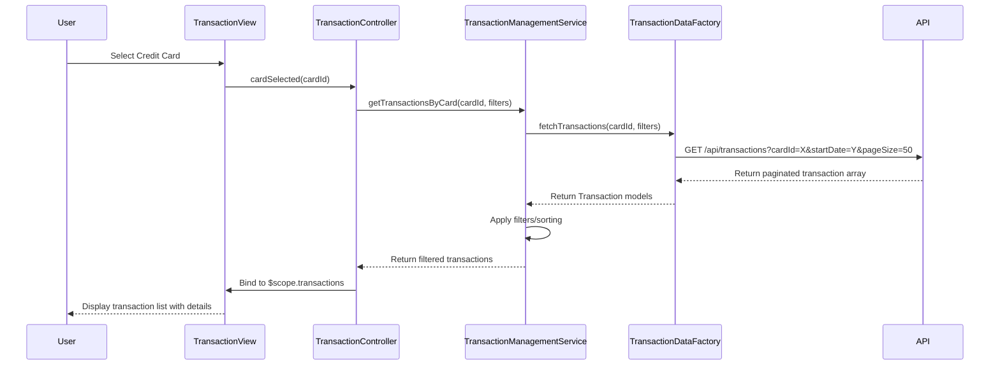

# Low-Level Design: QE-8583 - Transaction Management and Tracking

## a. Architecture Mapping

**HLD Component → AngularJS Artifact Mapping:**

- User Interface → AngularJS Module `transactionManagement` + Controller `TransactionController` + View Template `transactions.html`
- Transaction Management Module → AngularJS Service `TransactionManagementService` (business logic layer)
- Transaction Data Service → AngularJS Factory `TransactionDataFactory` (REST API integration)
- Credit Card Service → AngularJS Factory `CreditCardFactory` (card-transaction mapping)

**Recommended Folder Structure:**
```
app/
├── modules/
│   └── transactions/
│       ├── transactions.module.js
│       ├── transactions.controller.js
│       ├── transactions.html
│       ├── transaction-detail.component.js
│       └── transactions.css
├── services/
│   ├── transaction-management.service.js
│   └── transaction-data.factory.js
├── factories/
│   └── creditcard.factory.js
├── models/
│   └── transaction.model.js
└── filters/
    └── transaction-filter.js
```

## b. Component Specifications

| Component Name | Artifact Type | Responsibility | Key Dependencies |
|----------------|---------------|----------------|------------------|
| transactionManagement | Module | Root module for transaction features | angular, ui.router, ngTable |
| TransactionController | Controller | Manages transaction list view, filtering, pagination, card selection | TransactionManagementService, CreditCardFactory, $scope |
| TransactionManagementService | Service | Handles transaction filtering logic, sorting, and data transformation | TransactionDataFactory, $filter |
| TransactionDataFactory | Factory | Fetches transaction data from REST API with query parameters | $http, $q, AuthService |
| CreditCardFactory | Factory | Retrieves card list for card-wise transaction filtering | $http, $q |
| transactionDetailComponent | Component | Displays detailed view of a single transaction | None |
| transactionFilter | Filter | Custom filter for client-side transaction filtering by date, amount, category | None |

## c. Data Model

**Transaction Model:**
```javascript
{
  transactionId: String,
  cardId: String,
  merchantName: String,
  transactionDate: Date,
  transactionAmount: Number,
  transactionType: String,
  category: String,
  description: String,
  status: String
}
```

**TransactionFilter Model:**
```javascript
{
  cardId: String,
  startDate: Date,
  endDate: Date,
  minAmount: Number,
  maxAmount: Number,
  category: String,
  pageNumber: Number,
  pageSize: Number
}
```

## d. Data Flow

User selects a credit card from dropdown → `TransactionController` captures card selection → Controller calls `TransactionManagementService.getTransactionsByCard(cardId, filterParams)` → Service invokes `TransactionDataFactory.fetchTransactions(cardId, filterParams)` → Factory sends GET request to `/api/transactions?cardId={cardId}&startDate={date}&pageSize=50` → API returns paginated transaction array → Factory maps response to Transaction model objects → Service applies any client-side filtering/sorting → Controller binds transaction list to `$scope.transactions` → View renders transaction table with ng-repeat → User sees transaction history with details.

## e. Primary Sequence Diagram



## f. Implementation Notes

- Use AngularJS component architecture for transaction detail view to enable reusability.
- Implement server-side pagination with ng-table or custom pagination directive to handle large transaction datasets efficiently.
- Use $http interceptor to ensure all API calls include authentication tokens and handle 401 responses.
- Cache card list in CreditCardFactory using $cacheFactory to avoid redundant API calls during filtering.
- Implement debounce on filter inputs (300ms) to reduce API calls during user typing.

## g. Error Handling

Interceptor-based error handling with try/catch blocks in service layer; display user-friendly error messages via toast notifications.

## h. Security Notes

Requires token-based auth via existing SSO; API enforces user-level data access control to ensure users only see their own transactions.