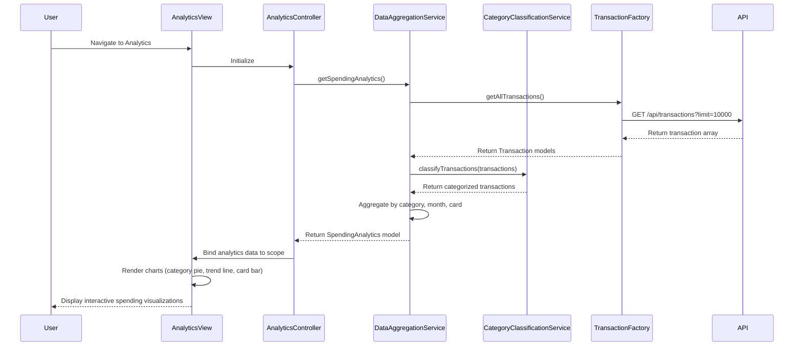

# Low-Level Design: QE-8584 - Spending Analytics and Insights

## a. Architecture Mapping

**HLD Component → AngularJS Artifact Mapping:**

- Analytics UI → AngularJS Module `spendingAnalytics` + Controller `AnalyticsController` + View Template `analytics.html`
- Visualization Engine → AngularJS Directive `chartDirective` (wraps Chart.js or D3.js for rendering)
- Data Aggregation Service → AngularJS Service `DataAggregationService` (computes spending metrics)
- Category Classification Engine → AngularJS Service `CategoryClassificationService` (maps transactions to categories)
- Transaction Service → AngularJS Factory `TransactionFactory` (fetches raw transaction data)

**Recommended Folder Structure:**
```
app/
├── modules/
│   └── analytics/
│       ├── analytics.module.js
│       ├── analytics.controller.js
│       ├── analytics.html
│       └── analytics.css
├── services/
│   ├── data-aggregation.service.js
│   ├── category-classification.service.js
│   └── transaction.factory.js
├── directives/
│   ├── chart.directive.js
│   ├── category-chart.directive.js
│   └── trend-chart.directive.js
├── models/
│   └── spending-analytics.model.js
└── constants/
    └── spending-categories.constant.js
```

## b. Component Specifications

| Component Name | Artifact Type | Responsibility | Key Dependencies |
|----------------|---------------|----------------|------------------|
| spendingAnalytics | Module | Root module for analytics and visualization features | angular, ui.router, chart.js |
| AnalyticsController | Controller | Manages analytics view state, loads spending data, handles chart interactions | DataAggregationService, TransactionFactory, $scope |
| DataAggregationService | Service | Aggregates transaction data by category, month, and card; computes spending totals | CategoryClassificationService, $filter |
| CategoryClassificationService | Service | Classifies transactions into 9 spending categories based on merchant/description | SPENDING_CATEGORIES constant |
| TransactionFactory | Factory | Fetches raw transaction data from REST API for analytics processing | $http, $q, AuthService |
| chartDirective | Directive | Generic reusable chart directive wrapping Chart.js for bar/pie/line charts | chart.js library |
| categoryChartDirective | Directive | Specialized directive for category-wise spending pie/donut chart | chartDirective |
| trendChartDirective | Directive | Specialized directive for monthly spend trend line chart | chartDirective |

## c. Data Model

**SpendingAnalytics Model:**
```javascript
{
  categorySpending: Array<{category: String, amount: Number, percentage: Number}>,
  monthlyTrend: Array<{month: String, totalSpend: Number}>,
  cardWiseSpending: Array<{cardId: String, cardName: String, totalSpend: Number}>,
  totalSpend: Number,
  transactionCount: Number
}
```

**SpendingCategory Constant:**
```javascript
[
  'Food & Dining',
  'Fuel',
  'Shopping',
  'Travel',
  'Entertainment',
  'Utilities',
  'Healthcare',
  'Education',
  'Miscellaneous'
]
```

## d. Data Flow

User navigates to analytics page → `analytics.html` view loads → `AnalyticsController` initializes and calls `DataAggregationService.getSpendingAnalytics()` → Service invokes `TransactionFactory.getAllTransactions()` → Factory sends GET request to `/api/transactions?limit=10000` → API returns transaction array → Factory returns Transaction models → `CategoryClassificationService.classifyTransactions(transactions)` maps each transaction to one of 9 categories → `DataAggregationService` computes category totals, monthly trends, and card-wise spending → Controller binds SpendingAnalytics model to `$scope` → Chart directives render interactive visualizations (pie chart for categories, line chart for trends) → User interacts with charts to drill down into spending insights.

## e. Primary Sequence Diagram



## f. Implementation Notes

- Use Chart.js library integrated via custom AngularJS directives for responsive, interactive charts.
- Implement in-memory caching in DataAggregationService to avoid re-computation on view refresh (cache invalidation on data change).
- Use AngularJS $filter service for date grouping (monthly) and sorting operations during aggregation.
- Leverage ES6 Array methods (map, reduce, filter) in CategoryClassificationService for efficient transaction categorization.
- Implement lazy loading for analytics module to reduce initial app load time.

## g. Error Handling

Interceptor-based error handling with try/catch in aggregation logic; display fallback message if chart rendering fails.

## h. Security Notes

Standard input validation and secure API calls assumed; transaction data access restricted to authenticated user's own records.