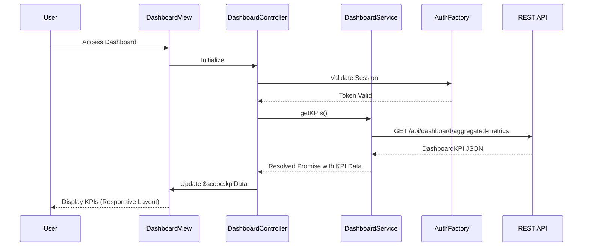

# Low-Level Design: Credit Card Dashboard and KPI Management
**Epic ID:** QE-8585

## a. Architecture Mapping

- **Responsive Web UI** → AngularJS Module (`app.dashboard`) + Controller (`DashboardController`) + HTML5 View with Bootstrap responsive grid
- **Dashboard Service** → AngularJS Service (`DashboardService`) using ES6 class with REST API integration
- **Financial Data Aggregation Service** → Backend REST API endpoint (`/api/dashboard/aggregated-metrics`)
- **Credit Card Data Service** → Backend REST API endpoint (`/api/cards`)
- **User Authentication Service** → AngularJS Factory (`AuthFactory`) with token-based authentication

**Recommended Folder Structure:**
```
/app
  /dashboard
    dashboard.module.js
    dashboard.controller.js
    dashboard.service.js
    dashboard.html
  /common
    auth.factory.js
  /assets
    /css
    /js
```

## b. Component Specifications

| Name | Artifact Type | Responsibility | Key Dependencies |
|------|---------------|----------------|------------------|
| app.dashboard | AngularJS Module | Root module for dashboard feature | ngRoute, app.common |
| DashboardController | Controller | Manages dashboard view state, fetches KPI data, handles user interactions | DashboardService, $scope |
| DashboardService | Service | Fetches aggregated financial metrics from REST API, caches data for performance | $http, $q, AuthFactory |
| AuthFactory | Factory | Manages user authentication tokens and session validation | $http, $window |
| dashboard.html | View | Displays KPIs (monthly spend, credit limit, available credit, outstanding) in responsive Bootstrap layout | Bootstrap CSS, AngularJS directives |

## c. Data Model

**DashboardKPI (JavaScript Object):**
```javascript
{
  userId: String,
  monthlySpend: Number,
  totalCreditLimit: Number,
  availableCredit: Number,
  outstandingAmount: Number,
  lastUpdated: Date
}
```

## d. Data Flow

User navigates to dashboard → DashboardController initializes and calls DashboardService.getKPIs() → DashboardService validates auth token via AuthFactory → Service makes GET request to `/api/dashboard/aggregated-metrics` → Backend aggregates data from Credit Card Data Service → Response returns DashboardKPI object → DashboardService caches data and resolves promise → DashboardController updates $scope.kpiData → View renders KPIs using Bootstrap responsive grid with data binding → UI adapts layout based on device (mobile/tablet/desktop).

## e. Primary Sequence Diagram



## f. Implementation Notes

- Use AngularJS 1.x with ES6 classes for services and controllers; transpile with Babel if needed
- Implement DI via `$inject` annotation to ensure minification safety
- Use `$http` service with interceptors for centralized token injection and error handling
- Cache KPI data in DashboardService using simple in-memory object; invalidate on page refresh
- Bootstrap responsive grid (col-xs/sm/md/lg) for mobile-first responsive layout

## g. Error Handling

HTTP interceptor captures API errors; display user-friendly notifications using Bootstrap alerts; retry logic not included in this epic.

## h. Security Notes

Requires token-based auth via existing SSO; tokens injected in Authorization header for all API calls.