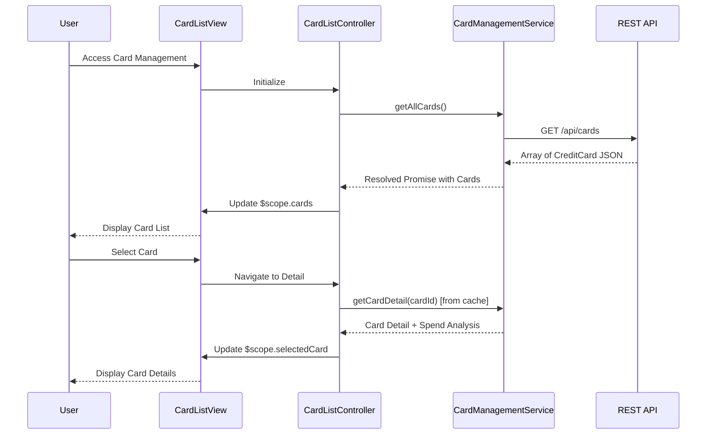

# Low-Level Design: Multiple Credit Card Management and Viewing
**Epic ID:** QE-8586

## a. Architecture Mapping

- **User Interface** → AngularJS Module (`app.cardManagement`) + Controller (`CardListController`, `CardDetailController`) + HTML5 Views
- **Card Management Service** → AngularJS Service (`CardManagementService`) using ES6 class with REST API integration
- **Credit Card Data Repository** → Backend REST API endpoint (`/api/cards`)
- **User Profile Service** → Backend REST API endpoint (`/api/user/profile`)
- **Card Issuer Data Feeds** → Backend integration (abstracted from frontend)

**Recommended Folder Structure:**
```
/app
  /card-management
    card-management.module.js
    card-list.controller.js
    card-detail.controller.js
    card-management.service.js
    card-list.html
    card-detail.html
  /common
    auth.factory.js
```

## b. Component Specifications

| Name | Artifact Type | Responsibility | Key Dependencies |
|------|---------------|----------------|------------------|
| app.cardManagement | AngularJS Module | Root module for card management feature | ngRoute, app.common |
| CardListController | Controller | Manages card list view, fetches all user cards, handles card selection | CardManagementService, $scope, $location |
| CardDetailController | Controller | Manages individual card detail view, displays card-specific data and spend analysis | CardManagementService, $scope, $routeParams |
| CardManagementService | Service | Fetches card list and individual card details from REST API, caches card data for instant switching | $http, $q, AuthFactory |
| card-list.html | View | Displays all user cards in a list with key attributes (masked number, credit limit, outstanding) | Bootstrap list-group, AngularJS ng-repeat |
| card-detail.html | View | Displays detailed card information and card-wise spend analysis | Bootstrap panels, AngularJS data binding |

## c. Data Model

**CreditCard (JavaScript Object):**
```javascript
{
  cardId: String,
  maskedCardNumber: String,
  cardHolderName: String,
  creditLimit: Number,
  outstandingBalance: Number,
  availableCredit: Number,
  issuer: String,
  expiryDate: String
}
```

**CardSpendAnalysis (JavaScript Object):**
```javascript
{
  cardId: String,
  monthlySpend: Number,
  categoryBreakdown: Array<{category: String, amount: Number}>
}
```

## d. Data Flow

User accesses card management interface → CardListController calls CardManagementService.getAllCards() → Service validates auth and makes GET request to `/api/cards` → Backend fetches cards from repository and validates ownership via User Profile Service → Response returns array of CreditCard objects → Service caches cards and resolves promise → CardListController updates $scope.cards → View renders card list using ng-repeat → User selects a card → $location navigates to card detail route → CardDetailController retrieves cardId from $routeParams → Calls CardManagementService.getCardDetail(cardId) from cache (instant) → Updates $scope.selectedCard and $scope.spendAnalysis → View displays detailed card info.

## e. Primary Sequence Diagram



## f. Implementation Notes

- Use AngularJS routing with ngRoute; define routes for `/cards` (list) and `/cards/:cardId` (detail)
- Implement CardManagementService with in-memory cache (Map/Object) indexed by cardId for instant card switching
- Use ES6 classes for services; inject dependencies via `$inject` for minification safety
- Bootstrap list-group for card list; Bootstrap panels/cards for detail view
- Masked card numbers display last 4 digits only (e.g., `**** **** **** 1234`)

## g. Error Handling

HTTP interceptor-based error handling; display Bootstrap alerts for API failures; graceful degradation if card data unavailable.

## h. Security Notes

Token-based auth via existing SSO; card numbers always masked on frontend; sensitive data never stored in browser storage.