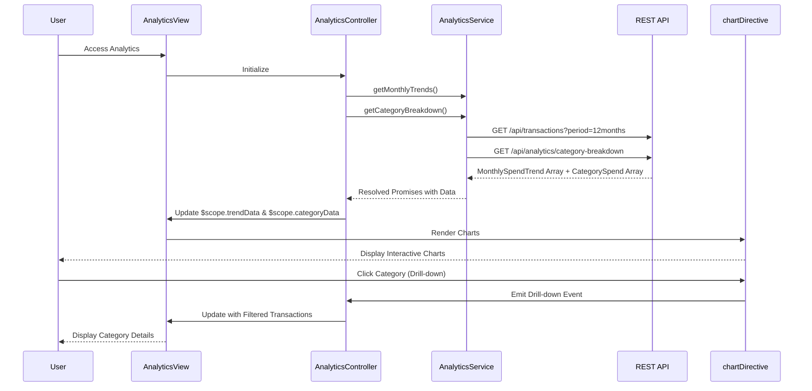

# Low-Level Design: Spending Analytics and Transaction Insights
**Epic ID:** QE-8587

## a. Architecture Mapping

- **User Interface Layer** → AngularJS Module (`app.analytics`) + Controller (`AnalyticsController`) + HTML5 View with chart directives
- **Analytics Service** → AngularJS Service (`AnalyticsService`) using ES6 class with REST API integration
- **Transaction Data Service** → Backend REST API endpoint (`/api/transactions`)
- **Category Classification Service** → Backend service (abstracted from frontend; categories pre-classified)
- **Data Visualization Engine** → AngularJS Directive (`chartDirective`) wrapping Chart.js or D3.js library

**Recommended Folder Structure:**
```
/app
  /analytics
    analytics.module.js
    analytics.controller.js
    analytics.service.js
    analytics.html
  /directives
    chart.directive.js
  /common
    auth.factory.js
```

## b. Component Specifications

| Name | Artifact Type | Responsibility | Key Dependencies |
|------|---------------|----------------|------------------|
| app.analytics | AngularJS Module | Root module for analytics feature | ngRoute, app.common, Chart.js |
| AnalyticsController | Controller | Manages analytics view, fetches transaction data, prepares chart data, handles drill-down interactions | AnalyticsService, $scope |
| AnalyticsService | Service | Fetches transaction data and aggregated analytics from REST API, processes data for visualization | $http, $q, AuthFactory |
| chartDirective | Directive | Wraps Chart.js library to render interactive charts (line for trends, pie/bar for categories) | Chart.js library |
| analytics.html | View | Displays monthly spend trend chart and category-wise spending breakdown with interactive drill-down | Bootstrap grid, chartDirective |

## c. Data Model

**Transaction (JavaScript Object):**
```javascript
{
  transactionId: String,
  cardId: String,
  amount: Number,
  category: String, // One of 9 predefined categories
  merchantName: String,
  transactionDate: Date,
  description: String
}
```

**MonthlySpendTrend (JavaScript Object):**
```javascript
{
  month: String, // Format: YYYY-MM
  totalSpend: Number
}
```

**CategorySpend (JavaScript Object):**
```javascript
{
  category: String, // Food & Dining, Fuel, Shopping, Travel, Entertainment, Utilities, Healthcare, Education, Miscellaneous
  amount: Number
}
```

## d. Data Flow

User navigates to analytics page → AnalyticsController initializes and calls AnalyticsService.getMonthlyTrends() and AnalyticsService.getCategoryBreakdown() → AnalyticsService makes GET requests to `/api/transactions?period=12months` and `/api/analytics/category-breakdown` → Backend fetches transactions from Transaction Database, applies category classification, aggregates by month and category → Response returns arrays of MonthlySpendTrend and CategorySpend objects → AnalyticsService processes data and resolves promises → AnalyticsController updates $scope.trendData and $scope.categoryData → chartDirective renders line chart for monthly trends and pie/bar chart for category breakdown → User interacts with chart (drill-down) → Controller updates view to show filtered transaction details.

## e. Primary Sequence Diagram



## f. Implementation Notes

- Use Chart.js library wrapped in AngularJS directive for reusable chart components; directive accepts data and config via isolated scope
- Implement AnalyticsService with ES6 class; use `$q.all()` to fetch multiple API endpoints in parallel for faster load
- Category calculations performed on backend; frontend displays pre-aggregated data with 2-decimal precision using `toFixed(2)`
- Drill-down implemented via chart click events; directive emits custom event to controller which filters and displays transaction details
- Use AngularJS filters for date formatting and currency display

## g. Error Handling

HTTP interceptor captures API errors; display user-friendly error messages using Bootstrap alerts; try/catch in data processing functions.

## h. Security Notes

Token-based auth via existing SSO; transaction data filtered by authenticated user; no sensitive merchant data exposed beyond transaction details.