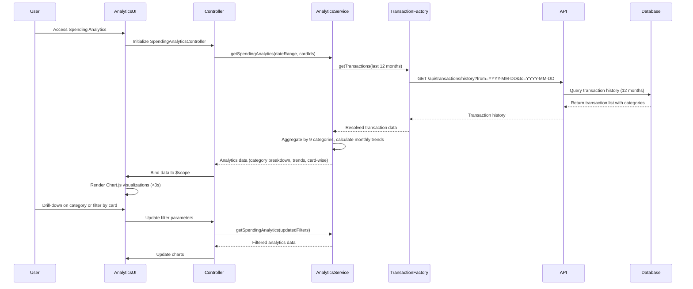

# Low-Level Design: Spending Analytics and Category Insights
**Epic ID:** QE-8588

## a. Architecture Mapping

- **Analytics Dashboard UI** → AngularJS Module: `app.spendingAnalytics`, Controller: `SpendingAnalyticsController`, View: `spending-analytics.html`
- **Analytics Service** → AngularJS Service: `AnalyticsService` (handles data aggregation and trend calculation)
- **Transaction Service** → AngularJS Factory: `TransactionFactory` (REST API integration for transaction history)
- **Categorization Engine** → AngularJS Service: `CategorizationService` (manages category assignment and metadata)
- **Visualization Directive** → AngularJS Directive: `categoryChartDirective` (renders category-wise spending charts)

**Recommended Folder Structure:**
```
app/
├── modules/
│   └── spending-analytics/
│       ├── controllers/
│       │   └── spending-analytics.controller.js
│       ├── services/
│       │   ├── analytics.service.js
│       │   ├── transaction.factory.js
│       │   └── categorization.service.js
│       ├── directives/
│       │   └── category-chart.directive.js
│       ├── views/
│       │   └── spending-analytics.html
│       └── spending-analytics.module.js
└── app.js
```

## b. Component Specifications

| Component Name | Artifact Type | Responsibility | Key Dependencies |
|----------------|---------------|----------------|------------------|
| SpendingAnalyticsController | Controller | Manages analytics view, handles filter/drill-down interactions, coordinates data fetching | AnalyticsService, TransactionFactory, $scope |
| AnalyticsService | Service | Aggregates transaction data by category, time period, and card; calculates monthly trends | CategorizationService, $q |
| TransactionFactory | Factory | Provides REST API integration for fetching transaction history (12 months) | $http, $q |
| CategorizationService | Service | Provides category metadata for 9 categories; ensures consistent category assignment | None |
| categoryChartDirective | Directive | Renders interactive pie/bar charts using Chart.js with drill-down and filtering | Chart.js, $timeout |

## c. Data Model

**SpendingCategory Model:**
```javascript
{
  categoryId: String,
  categoryName: String, // Food & Dining, Fuel, Shopping, Travel, Entertainment, Utilities, Healthcare, Education, Miscellaneous
  totalAmount: Number,
  transactionCount: Number,
  percentageOfTotal: Number,
  monthlyBreakdown: Array<{month: String, amount: Number}>
}
```

**MonthlySpendTrend Model:**
```javascript
{
  month: String, // YYYY-MM format
  totalSpend: Number,
  categoryBreakdown: Array<{categoryName: String, amount: Number}>
}
```

**CardWiseAnalytics Model:**
```javascript
{
  cardId: String,
  cardName: String,
  totalSpend: Number,
  categoryBreakdown: Array<SpendingCategory>
}
```

## d. Data Flow

User navigates to spending analytics view → SpendingAnalyticsController initializes and calls AnalyticsService.getSpendingAnalytics(dateRange, cardIds) → Service requests transaction history via TransactionFactory.getTransactions() for 12 months → Factory makes REST API call to /api/transactions/history with date range filter → API returns transaction list → CategorizationService ensures each transaction is assigned to one of 9 categories → AnalyticsService aggregates data by category, calculates monthly trends, and generates card-wise breakdowns → Controller receives analytics data and binds to $scope → categoryChartDirective renders interactive Chart.js visualizations (pie chart for category breakdown, line chart for monthly trends) within 3-second load time with filtering and drill-down capabilities.

## e. Primary Sequence Diagram



## f. Implementation Notes

- Use AngularJS Dependency Injection for all components; register module using `angular.module('app.spendingAnalytics', ['chart.js'])`.
- Integrate Chart.js via angular-chart.js for responsive pie, bar, and line charts; implement drill-down using chart click events with $scope.$apply().
- Implement category filter using ng-repeat with checkboxes; use ng-change to trigger analytics refresh on filter updates.
- Use $q.all() to fetch category-wise, monthly trend, and card-wise analytics in parallel for optimal performance under 3-second load time.
- Cache analytics data in AnalyticsService using simple object cache with 5-minute TTL to reduce redundant API calls.

## g. Error Handling

HTTP interceptor-based error handling with fallback to cached data if available; display user-friendly error notifications via Angular Toastr.

## h. Security Notes

Standard input validation and secure API calls assumed; all API requests include authentication token via HTTP interceptor.