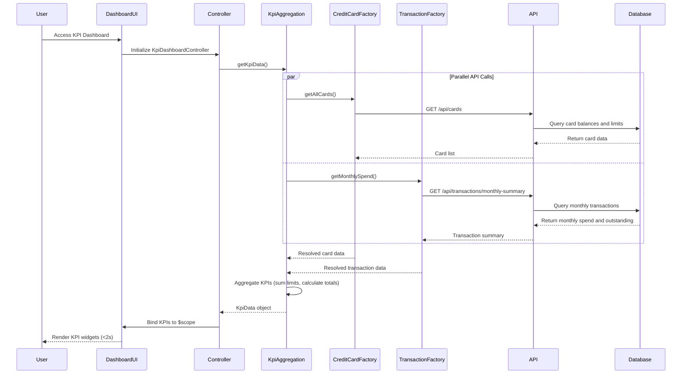

# Low-Level Design: Dashboard and KPI Management
**Epic ID:** QE-8589

## a. Architecture Mapping

- **User Dashboard UI** → AngularJS Module: `app.kpiDashboard`, Controller: `KpiDashboardController`, View: `kpi-dashboard.html`
- **KPI Aggregation Service** → AngularJS Service: `KpiAggregationService` (handles KPI calculation and aggregation)
- **Credit Card Data Service** → AngularJS Factory: `CreditCardDataFactory` (REST API integration for card data)
- **Transaction Service** → AngularJS Factory: `TransactionFactory` (REST API integration for transaction data)
- **KPI Widget Directive** → AngularJS Directive: `kpiWidgetDirective` (renders individual KPI cards with real-time updates)

**Recommended Folder Structure:**
```
app/
├── modules/
│   └── kpi-dashboard/
│       ├── controllers/
│       │   └── kpi-dashboard.controller.js
│       ├── services/
│       │   ├── kpi-aggregation.service.js
│       │   ├── credit-card-data.factory.js
│       │   └── transaction.factory.js
│       ├── directives/
│       │   └── kpi-widget.directive.js
│       ├── views/
│       │   └── kpi-dashboard.html
│       └── kpi-dashboard.module.js
└── app.js
```

## b. Component Specifications

| Component Name | Artifact Type | Responsibility | Key Dependencies |
|----------------|---------------|----------------|------------------|
| KpiDashboardController | Controller | Orchestrates dashboard view, fetches KPIs, handles real-time refresh | KpiAggregationService, $scope, $interval |
| KpiAggregationService | Service | Aggregates and calculates KPIs (monthly spend, total credit limit, available credit, outstanding amounts) | CreditCardDataFactory, TransactionFactory, $q |
| CreditCardDataFactory | Factory | Provides REST API integration for retrieving card balances and limits | $http, $q |
| TransactionFactory | Factory | Provides REST API integration for calculating monthly spend and outstanding amounts | $http, $q |
| kpiWidgetDirective | Directive | Renders individual KPI card with icon, value, and trend indicator | None |

## c. Data Model

**CreditCard Model:**
```javascript
{
  cardId: String,
  cardNumber: String (masked),
  creditLimit: Number,
  availableCredit: Number,
  outstandingAmount: Number
}
```

**KpiData Model:**
```javascript
{
  monthlySpend: Number,
  totalCreditLimit: Number,
  totalAvailableCredit: Number,
  totalOutstanding: Number,
  cardCount: Number,
  lastUpdated: Date
}
```

## d. Data Flow

User accesses dashboard → KpiDashboardController initializes and calls KpiAggregationService.getKpiData() → Service makes parallel API calls using $q.all() to CreditCardDataFactory.getAllCards() and TransactionFactory.getMonthlySpend() → CreditCardDataFactory calls GET /api/cards to retrieve card balances and limits → TransactionFactory calls GET /api/transactions/monthly-summary to retrieve current month spend and outstanding amounts → API queries database for current data → Services resolve with card list and transaction summary → KpiAggregationService aggregates metrics (sum total credit limit, available credit, outstanding amounts, monthly spend) → Controller receives KpiData object and binds to $scope → kpiWidgetDirective renders KPI cards in responsive Bootstrap grid → Dashboard loads within 2-second constraint with real-time refresh via $interval every 30 seconds.

## e. Primary Sequence Diagram



## f. Implementation Notes

- Use AngularJS Dependency Injection for all components; register module using `angular.module('app.kpiDashboard', [])`.
- Implement parallel API calls using $q.all([CreditCardDataFactory.getAllCards(), TransactionFactory.getMonthlySpend()]) for optimal performance under 2-second load time.
- Apply Bootstrap grid system (col-md-3, col-sm-6, col-xs-12) for responsive KPI card layout across desktop, tablet, and mobile devices.
- Use $interval service for real-time dashboard refresh (every 30 seconds) with automatic cleanup on $scope.$destroy to prevent memory leaks.
- Implement kpiWidgetDirective with isolated scope and one-way data binding for reusable KPI card components with icon, value, and optional trend indicator.

## g. Error Handling

HTTP interceptor-based error handling with global error service; display user-friendly notifications via Angular Toastr for API failures with retry option.

## h. Security Notes

Requires token-based auth via existing SSO; all API calls include Authorization header with JWT token validated by backend.