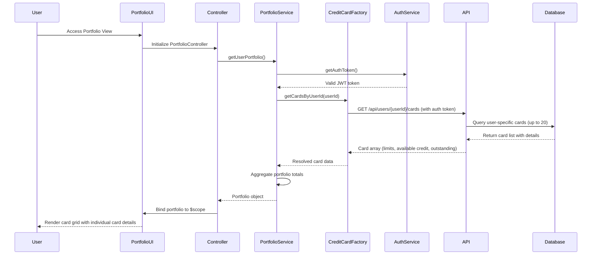

# Low-Level Design: Multiple Credit Card Portfolio Management
**Epic ID:** QE-8590

## a. Architecture Mapping

- **User Interface** → AngularJS Module: `app.portfolio`, Controller: `PortfolioController`, View: `portfolio.html`
- **Credit Card Portfolio Service** → AngularJS Service: `PortfolioService` (orchestrates portfolio retrieval and management)
- **Credit Card Data Service** → AngularJS Factory: `CreditCardDataFactory` (REST API integration for card information)
- **User Authentication Service** → AngularJS Service: `AuthService` (manages authentication and user-specific access)
- **Card Display Directive** → AngularJS Directive: `creditCardDirective` (renders individual card details)

**Recommended Folder Structure:**
```
app/
├── modules/
│   └── portfolio/
│       ├── controllers/
│       │   └── portfolio.controller.js
│       ├── services/
│       │   ├── portfolio.service.js
│       │   ├── credit-card-data.factory.js
│       │   └── auth.service.js
│       ├── directives/
│       │   └── credit-card.directive.js
│       ├── views/
│       │   └── portfolio.html
│       └── portfolio.module.js
└── app.js
```

## b. Component Specifications

| Component Name | Artifact Type | Responsibility | Key Dependencies |
|----------------|---------------|----------------|------------------|
| PortfolioController | Controller | Manages portfolio view, fetches card list for authenticated user, handles card selection | PortfolioService, AuthService, $scope |
| PortfolioService | Service | Orchestrates portfolio retrieval, aggregates card-specific data (limits, available credit, outstanding) | CreditCardDataFactory, $q |
| CreditCardDataFactory | Factory | Provides REST API integration for retrieving individual card information (up to 20 cards) | $http, $q, AuthService |
| AuthService | Service | Manages user authentication, validates tokens, provides user-specific access control | $http, $window.localStorage |
| creditCardDirective | Directive | Renders individual credit card with card-specific details (limit, available credit, outstanding balance) | None |

## c. Data Model

**CreditCard Model:**
```javascript
{
  cardId: String,
  cardNumber: String (masked, e.g., "**** **** **** 1234"),
  cardType: String, // Visa, MasterCard, Amex
  cardName: String,
  creditLimit: Number,
  availableCredit: Number,
  outstandingBalance: Number,
  expiryDate: String, // MM/YY format
  status: String // Active, Blocked
}
```

**Portfolio Model:**
```javascript
{
  userId: String,
  cards: Array<CreditCard>,
  totalCards: Number,
  totalCreditLimit: Number,
  totalAvailableCredit: Number,
  totalOutstanding: Number
}
```

## d. Data Flow

User authenticates and navigates to portfolio view → PortfolioController initializes and calls PortfolioService.getUserPortfolio() → Service validates user authentication via AuthService.getAuthToken() → PortfolioService requests card list via CreditCardDataFactory.getCardsByUserId(userId) → Factory makes REST API call to /api/users/{userId}/cards with auth token → API queries database for user-specific card list (up to 20 cards) → Database returns card details including limits, available credit, and outstanding balances → Factory resolves with card array → PortfolioService aggregates portfolio-level totals → Controller receives Portfolio object and binds to $scope → creditCardDirective renders each card in responsive Bootstrap grid layout with consistent performance regardless of card count.

## e. Primary Sequence Diagram



## f. Implementation Notes

- Use AngularJS Dependency Injection for all components; register module using `angular.module('app.portfolio', [])`.
- Implement creditCardDirective with isolated scope for reusable card display; use ng-repeat in portfolio.html to render up to 20 cards efficiently.
- Apply Bootstrap grid system (col-md-4, col-sm-6, col-xs-12) for responsive card layout across desktop, tablet, and mobile devices.
- Use $q service for promise-based API calls; handle errors gracefully with fallback UI for failed card data retrieval.
- Implement card selection using ng-click to navigate to card-specific detail view or trigger card-specific actions.

## g. Error Handling

HTTP interceptor-based error handling with user-friendly notifications via Angular Toastr; retry failed card data requests with exponential backoff.

## h. Security Notes

Requires token-based auth via existing SSO; API enforces user-specific card access control based on JWT claims to prevent unauthorized access.