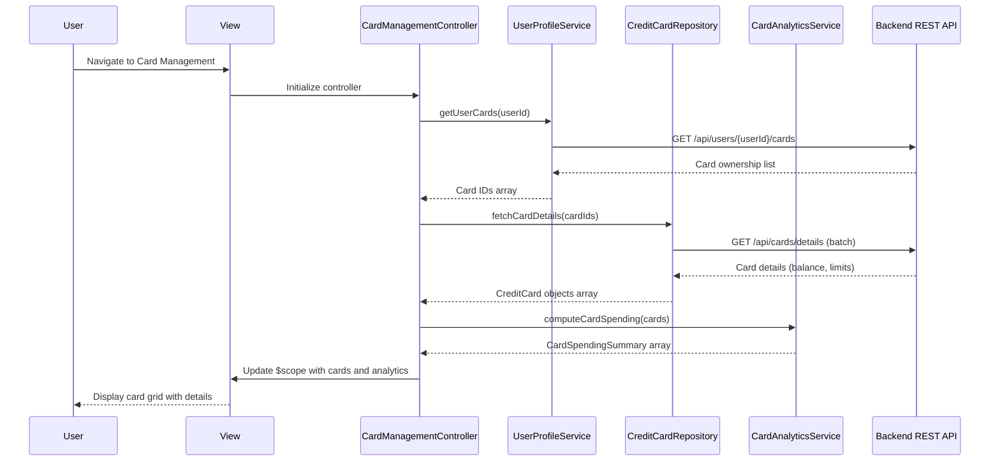

# Low-Level Design: Credit Card Management
**Epic ID:** QE-8591  
**Epic Title:** PERFTEST20261109190039-Credit Card Management

---

## a. Architecture Mapping

- **User Interface** → AngularJS View Template (`card-management.html`) with Bootstrap grid for responsive card display
- **Card Management Controller** → AngularJS Controller (`CardManagementController`) managing card list state and user interactions
- **User Profile Service** → AngularJS Service (`UserProfileService`) for card ownership validation via REST API
- **Credit Card Data Repository** → AngularJS Factory (`CreditCardRepository`) for CRUD operations on card data
- **Card-Wise Analytics Engine** → AngularJS Service (`CardAnalyticsService`) for computing card-specific spending metrics
- **Data Isolation Layer** → Implemented via HTTP interceptor and service-level user context filtering

**Recommended Folder Structure:**
```
app/
├── modules/
│   └── card-management/
│       ├── controllers/
│       │   └── CardManagementController.js
│       ├── services/
│       │   ├── UserProfileService.js
│       │   └── CardAnalyticsService.js
│       ├── factories/
│       │   └── CreditCardRepository.js
│       └── views/
│           └── card-management.html
```

---

## b. Component Specifications

| Component Name | Artifact Type | Responsibility | Key Dependencies |
|----------------|---------------|----------------|------------------|
| CardManagementController | Controller | Manages card list display, selection, filtering, and coordinates data retrieval for up to 10 cards per user | UserProfileService, CreditCardRepository, CardAnalyticsService, $scope |
| UserProfileService | Service | Validates card ownership and retrieves user-card associations via REST API | $http, $q, AuthTokenService |
| CreditCardRepository | Factory | Performs CRUD operations on credit card data with sub-1-second retrieval guarantee | $http, $q, API_CONFIG |
| CardAnalyticsService | Service | Computes card-wise spending metrics, balances, and utilization percentages | CreditCardRepository, $q |
| card-management.html | View | Displays card grid with individual card details, filters, and selection controls using Bootstrap responsive layout | CardManagementController, ng-repeat, ng-click |
| DataIsolationInterceptor | HTTP Interceptor | Ensures user context is attached to all API requests and validates data isolation | $httpProvider, AuthTokenService |

---

## c. Data Model

**CreditCard Object:**
```javascript
{
  cardId: String,           // Unique card identifier
  userId: String,           // Owner user ID
  cardNumber: String,       // Masked card number (e.g., "**** **** **** 1234")
  cardType: String,         // "Visa", "MasterCard", "Amex", etc.
  cardName: String,         // User-defined card nickname
  creditLimit: Number,      // Total credit limit
  availableCredit: Number,  // Available credit balance
  outstandingAmount: Number,// Current outstanding balance
  lastUpdated: Date         // Timestamp of last data sync
}
```

**CardSpendingSummary Object:**
```javascript
{
  cardId: String,
  monthlySpend: Number,
  categoryBreakdown: Object // { "Food": 1200, "Fuel": 800, ... }
}
```

---

## d. Data Flow

User accesses the card management view, triggering CardManagementController initialization. The controller calls UserProfileService to validate card ownership and retrieve the user's card list (up to 10 cards). CreditCardRepository fetches detailed card data (balance, limits, outstanding) from the backend REST API with sub-1-second response time. CardAnalyticsService processes the card data to compute card-wise spending summaries. The controller updates $scope with the card list and analytics, and the view renders individual card tiles using ng-repeat with Bootstrap grid layout. User interactions (card selection, filtering) update the controller state, which re-queries services as needed and updates the UI reactively.

---

## e. Primary Sequence Diagram



---

## f. Implementation Notes

- Use AngularJS 1.x module pattern with dependency injection for all controllers, services, and factories; define module as `angular.module('cardManagement', [])`.
- Implement HTTP interceptor (`DataIsolationInterceptor`) to attach user context token to all API requests and enforce data isolation at the client layer.
- Use `$q` promises for asynchronous service calls; chain promises in controller to ensure sequential data loading (profile → cards → analytics).
- Leverage Bootstrap responsive grid (`col-xs-12 col-sm-6 col-md-4`) for card tiles to support mobile and desktop layouts.
- Cache card data in service layer using `$cacheFactory` to avoid redundant API calls within the same session; invalidate cache on user-triggered refresh.

---

## g. Error Handling

HTTP interceptor captures API errors (4xx/5xx) and displays user-friendly notifications via a global alert service; controllers use try/catch with promise rejection handling.

---

## h. Security Notes

Requires token-based authentication via existing SSO; all API calls include Authorization header with JWT token validated by backend.

---