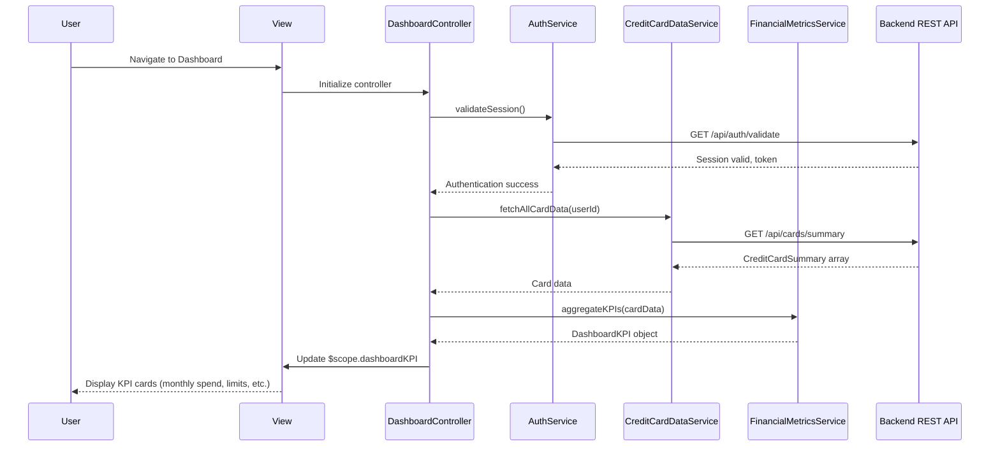

# Low-Level Design: Dashboard and Financial Overview
**Epic ID:** QE-8592  
**Epic Title:** PERFTEST20261109190039-Dashboard and Financial Overview

---

## a. Architecture Mapping

- **User Web/Mobile Client** → AngularJS SPA with responsive Bootstrap layout for cross-device compatibility
- **Dashboard Controller** → AngularJS Controller (`DashboardController`) orchestrating dashboard data retrieval and KPI display
- **User Authentication Service** → AngularJS Service (`AuthService`) managing SSO token validation and session state
- **Credit Card Data Source** → AngularJS Service (`CreditCardDataService`) fetching real-time card balances and transactions via REST API
- **Financial Metrics Aggregator** → AngularJS Service (`FinancialMetricsService`) computing consolidated KPIs (monthly spend, total limit, available credit, outstanding)
- **Responsive UI Layer** → AngularJS View (`dashboard.html`) with Bootstrap grid and CSS3 media queries

**Recommended Folder Structure:**
```
app/
├── modules/
│   └── dashboard/
│       ├── controllers/
│       │   └── DashboardController.js
│       ├── services/
│       │   ├── AuthService.js
│       │   ├── CreditCardDataService.js
│       │   └── FinancialMetricsService.js
│       └── views/
│           └── dashboard.html
```

---

## b. Component Specifications

| Component Name | Artifact Type | Responsibility | Key Dependencies |
|----------------|---------------|----------------|------------------|
| DashboardController | Controller | Initializes dashboard, loads financial KPIs, and manages real-time data refresh within 2-second load time | AuthService, CreditCardDataService, FinancialMetricsService, $scope, $interval |
| AuthService | Service | Validates user authentication via SSO token and manages session lifecycle | $http, $window, $q |
| CreditCardDataService | Service | Retrieves real-time credit card balances, transactions, and limits from backend REST API | $http, $q, API_CONFIG |
| FinancialMetricsService | Service | Aggregates data across all user cards to compute monthly spend, total credit limit, available credit, and outstanding amount | CreditCardDataService, $q |
| dashboard.html | View | Displays KPI cards (monthly spend, credit limit, available credit, outstanding) in responsive Bootstrap grid layout | DashboardController, ng-bind, ng-repeat |
| RefreshDirective | Directive | Provides pull-to-refresh or auto-refresh functionality for real-time data updates | DashboardController, $interval |

---

## c. Data Model

**DashboardKPI Object:**
```javascript
{
  monthlySpend: Number,       // Total spend across all cards this month
  totalCreditLimit: Number,   // Sum of credit limits across all cards
  availableCredit: Number,    // Sum of available credit across all cards
  outstandingAmount: Number,  // Sum of outstanding balances across all cards
  lastUpdated: Date           // Timestamp of last data refresh
}
```

**CreditCardSummary Object:**
```javascript
{
  cardId: String,
  balance: Number,
  creditLimit: Number,
  outstandingAmount: Number
}
```

---

## d. Data Flow

User navigates to the dashboard view, triggering DashboardController initialization. The controller first calls AuthService to validate the user session and retrieve the authentication token. Upon successful authentication, the controller invokes CreditCardDataService to fetch real-time credit card data (balances, limits, transactions) for all user cards via REST API. CreditCardDataService returns an array of CreditCardSummary objects. The controller then calls FinancialMetricsService, which aggregates the card summaries to compute consolidated KPIs (monthly spend, total credit limit, available credit, outstanding amount). The controller updates $scope.dashboardKPI with the computed metrics, and the view renders KPI cards using Bootstrap grid layout. An $interval-based auto-refresh mechanism periodically re-fetches data to maintain real-time updates, ensuring the entire load completes within 2 seconds.

---

## e. Primary Sequence Diagram



---

## f. Implementation Notes

- Define AngularJS module as `angular.module('dashboard', [])` with dependency injection for all services and controllers.
- Use `$http` with timeout configuration (2 seconds max) to enforce NFR; implement retry logic with exponential backoff for transient API failures.
- Leverage `$interval` service to auto-refresh dashboard data every 30 seconds; cancel interval on scope destruction to prevent memory leaks.
- Apply Bootstrap responsive classes (`col-xs-12 col-md-6 col-lg-3`) to KPI cards for mobile-first design; use CSS3 flexbox for vertical alignment.
- Implement loading spinner directive to indicate data fetch in progress; hide spinner once all KPIs are rendered.

---

## g. Error Handling

HTTP interceptor captures API errors and displays toast notifications; controller implements try/catch with promise rejection to handle service failures gracefully.

---

## h. Security Notes

Requires token-based auth via existing SSO; all API requests include Authorization header with JWT token validated server-side.

---