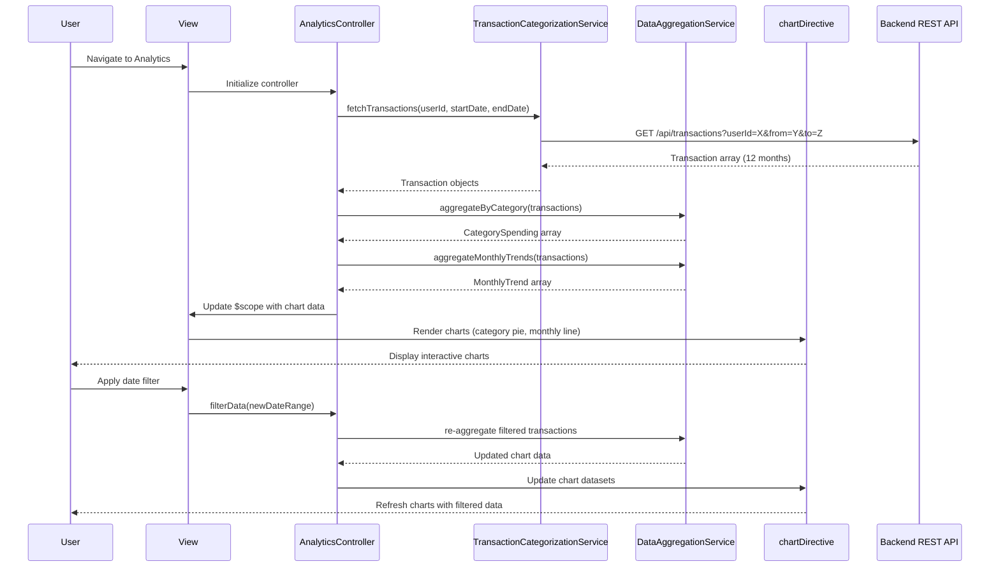

# Low-Level Design: Analytics and Spending Insights
**Epic ID:** QE-8593  
**Epic Title:** PERFTEST20261109190039-Analytics and Spending Insights

---

## a. Architecture Mapping

- **User Interface** → AngularJS View Template (`analytics.html`) with interactive chart containers using Bootstrap layout
- **Analytics Controller** → AngularJS Controller (`AnalyticsController`) managing chart data preparation and user interactions (filtering, drill-down)
- **Transaction Categorization Service** → AngularJS Service (`TransactionCategorizationService`) fetching pre-categorized transaction data via REST API
- **Data Aggregation Service** → AngularJS Service (`DataAggregationService`) computing category-wise spending summaries and monthly trends
- **Visualization Library** → Integration with Chart.js or D3.js via AngularJS Directive (`chartDirective`) for rendering interactive charts
- **Transaction Data Store** → Backend REST API providing historical transaction data (12+ months)

**Recommended Folder Structure:**
```
app/
├── modules/
│   └── analytics/
│       ├── controllers/
│       │   └── AnalyticsController.js
│       ├── services/
│       │   ├── TransactionCategorizationService.js
│       │   └── DataAggregationService.js
│       ├── directives/
│       │   └── chartDirective.js
│       └── views/
│           └── analytics.html
```

---

## b. Component Specifications

| Component Name | Artifact Type | Responsibility | Key Dependencies |
|----------------|---------------|----------------|------------------|
| AnalyticsController | Controller | Loads transaction data, prepares chart datasets, manages filtering (date range, category), and coordinates visualization rendering within 3 seconds | TransactionCategorizationService, DataAggregationService, $scope, $filter |
| TransactionCategorizationService | Service | Retrieves pre-categorized transactions from backend REST API for the specified time period (default 12 months) | $http, $q, API_CONFIG |
| DataAggregationService | Service | Aggregates transactions by category (Food & Dining, Fuel, Shopping, Travel, Entertainment, Utilities, Healthcare, Education, Miscellaneous) and computes monthly spend trends | $filter, $q |
| chartDirective | Directive | Wraps Chart.js or D3.js library to render interactive bar/pie/line charts with drill-down and filtering capabilities | Chart.js or D3.js, $timeout |
| analytics.html | View | Displays category-wise spending charts, monthly trend line chart, and filter controls in responsive Bootstrap grid | AnalyticsController, chartDirective, ng-repeat |

---

## c. Data Model

**Transaction Object:**
```javascript
{
  transactionId: String,
  cardId: String,
  amount: Number,
  category: String,  // One of: "Food & Dining", "Fuel", "Shopping", "Travel", "Entertainment", "Utilities", "Healthcare", "Education", "Miscellaneous"
  transactionDate: Date,
  description: String
}
```

**CategorySpending Object:**
```javascript
{
  category: String,
  totalSpend: Number,
  transactionCount: Number
}
```

**MonthlyTrend Object:**
```javascript
{
  month: String,      // "YYYY-MM" format
  totalSpend: Number
}
```

---

## d. Data Flow

User navigates to the analytics view, triggering AnalyticsController initialization. The controller calls TransactionCategorizationService to fetch pre-categorized transaction data for the past 12 months from the backend REST API. The service returns an array of Transaction objects. The controller then invokes DataAggregationService, which processes the transactions to compute category-wise spending summaries (CategorySpending array) and monthly spend trends (MonthlyTrend array). The controller updates $scope with the aggregated data and passes it to chartDirective instances embedded in the view. The directive renders interactive charts (pie chart for category breakdown, line chart for monthly trends) using Chart.js within 3 seconds. User interactions (date range filter, category drill-down) trigger controller methods that re-aggregate data and update chart datasets reactively.

---

## e. Primary Sequence Diagram



---

## f. Implementation Notes

- Define AngularJS module as `angular.module('analytics', [])` with dependency injection; use Chart.js library integrated via custom directive for declarative chart rendering.
- Implement chartDirective with isolated scope and two-way data binding (`scope: { chartData: '=', chartType: '@' }`) to support dynamic chart updates on filter changes.
- Use AngularJS `$filter` service in DataAggregationService to group transactions by category and month; leverage `reduce` and `map` ES6 array methods for efficient aggregation.
- Apply lazy loading for transaction data: fetch only the selected date range on user filter interaction to optimize API response time and meet 3-second rendering NFR.
- Implement drill-down functionality using Chart.js `onClick` event handler; pass selected category to controller method to filter and re-render detail view.

---

## g. Error Handling

HTTP interceptor captures API failures and displays user-friendly error messages; controller uses try/catch with promise rejection to handle aggregation errors and fallback to empty chart state.

---

## h. Security Notes

Standard input validation and secure API calls assumed; all API requests include Authorization header with JWT token for user authentication.

---