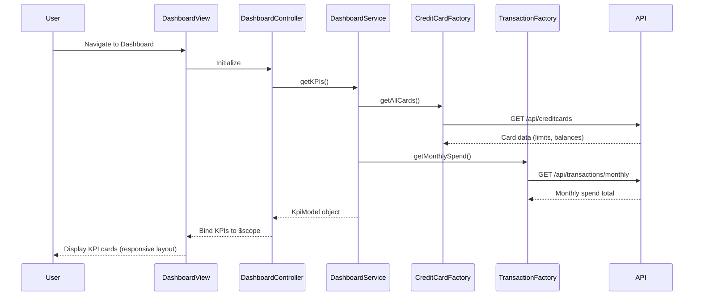

# Low-Level Design: Dashboard and KPI Management
**Epic ID:** QE-8594  
**Tech Stack:** AngularJS 1.x, JavaScript ES6, HTML5, CSS3, Bootstrap, REST APIs, MVC

---

## a. Architecture Mapping

- **Dashboard Module** → AngularJS Module (`app.dashboard`)
- **Dashboard UI Layer** → AngularJS Controller (`DashboardController`) + HTML5 View with Bootstrap
- **Dashboard Service** → AngularJS Service (`DashboardService`) for orchestrating KPI data retrieval
- **Credit Card Data Service** → AngularJS Factory (`CreditCardFactory`) for REST API calls
- **Transaction Service** → AngularJS Factory (`TransactionFactory`) for REST API calls

**Folder Structure:**
```
/app
  /dashboard
    dashboard.module.js
    dashboard.controller.js
    dashboard.html
  /services
    dashboard.service.js
  /factories
    creditcard.factory.js
    transaction.factory.js
  /models
    kpi.model.js
```

---

## b. Component Specifications

| Component Name | Artifact Type | Responsibility | Key Dependencies |
|----------------|---------------|----------------|------------------|
| DashboardModule | Module | Registers dashboard feature module | angular, ui.router |
| DashboardController | Controller | Manages dashboard view state and KPI display logic | DashboardService, $scope |
| DashboardService | Service | Orchestrates KPI data aggregation from multiple sources | CreditCardFactory, TransactionFactory, $q |
| CreditCardFactory | Factory | Fetches credit card balances, limits, outstanding amounts via REST | $http, API_CONFIG |
| TransactionFactory | Factory | Retrieves monthly transaction totals via REST | $http, API_CONFIG |
| KpiModel | Model | Defines KPI data structure (monthlySpend, totalLimit, availableCredit, outstanding) | None |
| DashboardDirective | Directive | Encapsulates KPI card UI components for reusability | None |

---

## c. Data Model

**KpiModel (JavaScript ES6 Class/Object):**
```javascript
{
  monthlySpend: Number,        // Total spend for current calendar month
  totalCreditLimit: Number,    // Sum of all card credit limits
  availableCredit: Number,     // Total limit - outstanding
  outstandingAmount: Number,   // Sum of all card outstanding balances
  lastUpdated: Date            // Timestamp of data refresh
}
```

**CreditCardSummary:**
```javascript
{
  cardId: String,
  creditLimit: Number,
  currentBalance: Number,
  outstandingAmount: Number
}
```

---

## d. Data Flow

User navigates to the dashboard view, triggering DashboardController initialization. The controller calls DashboardService.getKPIs(), which uses $q.all() to parallelize REST calls via CreditCardFactory.getAllCards() and TransactionFactory.getMonthlySpend(). CreditCardFactory aggregates credit limits and outstanding amounts; TransactionFactory calculates monthly spend for the current month. DashboardService merges responses into a KpiModel object and returns it to the controller. The controller binds the KPI data to $scope, and the view renders KPI cards using Bootstrap grid layout with responsive classes, completing within the 2-second load target.

---

## e. Primary Sequence Diagram



---

## f. Implementation Notes

- Use AngularJS Dependency Injection for all services and factories; register via module.service() and module.factory()
- Implement $q.all() in DashboardService to parallelize API calls and meet 2-second load requirement
- Use $http interceptors for adding auth tokens and handling API errors globally
- Apply Bootstrap responsive grid (col-xs-*, col-md-*) for KPI card layout across devices
- Use ES6 classes for model definitions; transpile with Babel if needed for browser compatibility

---

## g. Error Handling

HTTP interceptor-based error handling with user-friendly toast notifications for API failures; $q rejection propagated to controller for graceful degradation.

---

## h. Security Notes

Requires token-based auth via existing SSO; API calls include Authorization header via $http interceptor.