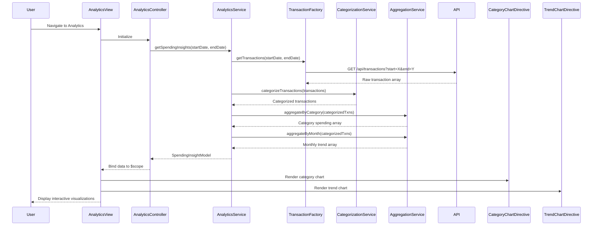

# Low-Level Design: Analytics and Spending Insights
**Epic ID:** QE-8595  
**Tech Stack:** AngularJS 1.x, JavaScript ES6, HTML5, CSS3, Bootstrap, REST APIs, MVC

---

## a. Architecture Mapping

- **Analytics Module** → AngularJS Module (`app.analytics`)
- **Analytics UI** → AngularJS Controller (`AnalyticsController`) + HTML5 View with Chart.js/D3.js integration
- **Analytics Service** → AngularJS Service (`AnalyticsService`) for data aggregation and trend calculation
- **Transaction Service** → AngularJS Factory (`TransactionFactory`) for REST API calls
- **Categorization Engine** → AngularJS Service (`CategorizationService`) for client-side or API-based categorization
- **Data Aggregation Service** → AngularJS Service (`AggregationService`) for monthly trend computation

**Folder Structure:**
```
/app
  /analytics
    analytics.module.js
    analytics.controller.js
    analytics.html
  /services
    analytics.service.js
    categorization.service.js
    aggregation.service.js
  /factories
    transaction.factory.js
  /models
    spending-insight.model.js
  /directives
    category-chart.directive.js
    trend-chart.directive.js
```

---

## b. Component Specifications

| Component Name | Artifact Type | Responsibility | Key Dependencies |
|----------------|---------------|----------------|------------------|
| AnalyticsModule | Module | Registers analytics feature module | angular, ui.router, chart.js |
| AnalyticsController | Controller | Manages analytics view state, filters, and chart data binding | AnalyticsService, $scope, $filter |
| AnalyticsService | Service | Orchestrates transaction retrieval, categorization, and aggregation | TransactionFactory, CategorizationService, AggregationService, $q |
| TransactionFactory | Factory | Fetches raw transaction data via REST API | $http, API_CONFIG |
| CategorizationService | Service | Classifies transactions into 9 predefined categories based on merchant/MCC | None |
| AggregationService | Service | Computes monthly trends and category-wise totals from transaction arrays | None |
| CategoryChartDirective | Directive | Renders category-wise spending pie/bar chart using Chart.js | None |
| TrendChartDirective | Directive | Renders monthly spend trend line chart using Chart.js | None |
| SpendingInsightModel | Model | Defines structure for category spending and monthly trends | None |

---

## c. Data Model

**SpendingInsightModel:**
```javascript
{
  categorySpending: Array<CategorySpend>,  // Array of 9 category objects
  monthlyTrends: Array<MonthlySpend>,      // Array of monthly aggregates (12 months)
  totalSpend: Number,
  period: String                            // e.g., "Last 12 Months"
}
```

**CategorySpend:**
```javascript
{
  categoryName: String,  // One of 9 predefined categories
  amount: Number,
  percentage: Number,
  transactionCount: Number
}
```

**MonthlySpend:**
```javascript
{
  month: String,         // e.g., "2024-01"
  amount: Number
}
```

---

## d. Data Flow

User navigates to the analytics view, triggering AnalyticsController initialization. The controller calls AnalyticsService.getSpendingInsights(startDate, endDate), which retrieves raw transactions via TransactionFactory.getTransactions(). CategorizationService processes each transaction, assigning it to one of nine predefined categories using merchant name or MCC code mapping. AggregationService then computes category-wise totals and monthly trend arrays. AnalyticsService returns a SpendingInsightModel to the controller, which binds it to $scope. CategoryChartDirective and TrendChartDirective consume the model data to render interactive Chart.js visualizations, completing within the 3-second rendering target.

---

## e. Primary Sequence Diagram



---

## f. Implementation Notes

- Use AngularJS DI to inject AnalyticsService, CategorizationService, and AggregationService into controllers and each other
- Implement CategorizationService with a predefined category mapping object (merchant keywords or MCC codes to category names)
- Use Chart.js library integrated via custom AngularJS directives for responsive, interactive charts
- Cache categorized transaction data in AnalyticsService using a simple in-memory object to avoid re-categorization on view refresh
- Use $filter for date range filtering if user selects custom periods

---

## g. Error Handling

HTTP interceptor handles API errors; CategorizationService defaults to "Miscellaneous" category for unclassified transactions; user notified via toast on data retrieval failure.

---

## h. Security Notes

Standard input validation and secure API calls assumed; token-based auth via $http interceptor.