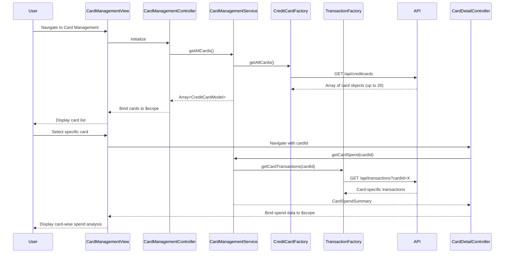

# Low-Level Design: Multiple Credit Card Management
**Epic ID:** QE-8596  
**Tech Stack:** AngularJS 1.x, JavaScript ES6, HTML5, CSS3, Bootstrap, REST APIs, MVC

---

## a. Architecture Mapping

- **Card Management Module** → AngularJS Module (`app.cardManagement`)
- **Card Management UI** → AngularJS Controller (`CardManagementController`) + HTML5 View with Bootstrap cards/list
- **Card Management Service** → AngularJS Service (`CardManagementService`) for orchestrating card and transaction data
- **Credit Card Data Service** → AngularJS Factory (`CreditCardFactory`) for REST API calls
- **Transaction Service** → AngularJS Factory (`TransactionFactory`) for card-specific transaction REST calls
- **Card Filter** → AngularJS Filter (`cardFilter`) for client-side card filtering/search

**Folder Structure:**
```
/app
  /card-management
    card-management.module.js
    card-management.controller.js
    card-management.html
    card-detail.html
  /services
    card-management.service.js
  /factories
    creditcard.factory.js
    transaction.factory.js
  /models
    credit-card.model.js
  /filters
    card.filter.js
  /directives
    card-list-item.directive.js
```

---

## b. Component Specifications

| Component Name | Artifact Type | Responsibility | Key Dependencies |
|----------------|---------------|----------------|------------------|
| CardManagementModule | Module | Registers card management feature module | angular, ui.router |
| CardManagementController | Controller | Manages card list view, selection, and filtering logic | CardManagementService, $scope, $state |
| CardDetailController | Controller | Manages individual card detail view and card-wise spend display | CardManagementService, $scope, $stateParams |
| CardManagementService | Service | Orchestrates retrieval of card list and card-specific transaction data | CreditCardFactory, TransactionFactory, $q |
| CreditCardFactory | Factory | Fetches all user cards and individual card details via REST | $http, API_CONFIG |
| TransactionFactory | Factory | Retrieves card-specific transaction history via REST | $http, API_CONFIG |
| CreditCardModel | Model | Defines card data structure (cardId, cardName, limit, balance, outstanding) | None |
| CardListItemDirective | Directive | Encapsulates individual card display component for list view | None |
| CardFilter | Filter | Filters card list by card name or last 4 digits | None |

---

## c. Data Model

**CreditCardModel:**
```javascript
{
  cardId: String,              // Unique card identifier
  cardName: String,            // e.g., "Visa Platinum"
  last4Digits: String,         // Last 4 digits of card number
  creditLimit: Number,
  currentBalance: Number,
  outstandingAmount: Number,
  availableCredit: Number,     // Calculated: limit - outstanding
  cardType: String,            // e.g., "Visa", "Mastercard"
  expiryDate: String           // MM/YY format
}
```

**CardSpendSummary:**
```javascript
{
  cardId: String,
  totalSpend: Number,          // Total spend for selected period
  transactionCount: Number,
  categoryBreakdown: Array<CategorySpend>
}
```

---

## d. Data Flow

User navigates to the card management view, triggering CardManagementController initialization. The controller calls CardManagementService.getAllCards(), which invokes CreditCardFactory.getAllCards() to retrieve the list of up to 20 credit cards via REST API. The service returns an array of CreditCardModel objects, which the controller binds to $scope for display in a Bootstrap card grid or list. When the user selects a specific card, the view transitions to card detail state, passing cardId via $stateParams. CardDetailController calls CardManagementService.getCardSpend(cardId), which uses TransactionFactory.getCardTransactions(cardId) to fetch card-specific transactions and compute spend summary. The card detail view renders the card's spend analysis, completing within the 1-second retrieval SLA.

---

## e. Primary Sequence Diagram



---

## f. Implementation Notes

- Use AngularJS DI to inject CardManagementService into both CardManagementController and CardDetailController
- Implement ui-router states for card list view and card detail view with cardId as a state parameter
- Use ng-repeat with track by cardId for efficient rendering of up to 20 cards in the list view
- Apply Bootstrap card component (card, card-body) for responsive card display; use col-md-4 for grid layout
- Cache card list in CardManagementService using a simple object to avoid redundant API calls on navigation back from detail view

---

## g. Error Handling

HTTP interceptor handles API errors; controller displays user-friendly message if card retrieval fails; card detail view shows error state if transaction data unavailable.

---

## h. Security Notes

Requires token-based auth via existing SSO; sensitive card data (full card number) never transmitted or displayed; only last 4 digits and tokenized cardId used.