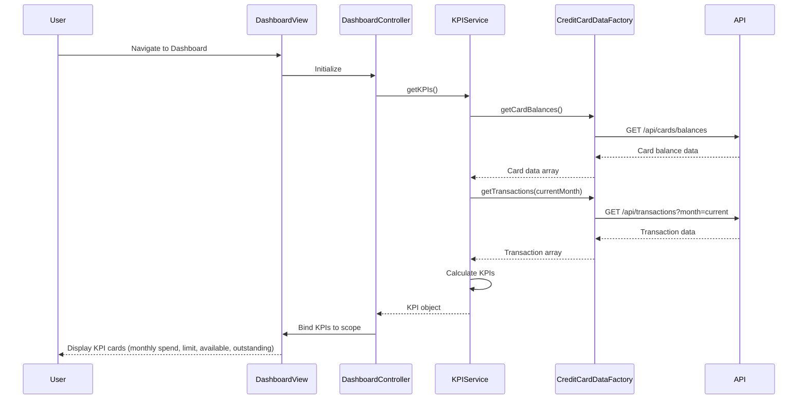

# Low-Level Design: Dashboard and KPI Management
**Epic ID:** QE-8597

## a. Architecture Mapping

**AngularJS Artifacts:**
- **Module:** `creditCard.dashboard` - Root module for dashboard feature
- **Controller:** `DashboardController` - Manages dashboard state and KPI data binding
- **Service:** `KPIService` - Handles KPI calculation and data retrieval from REST API
- **Service:** `AuthService` - Manages user authentication and session
- **Directive:** `kpiCard` - Reusable component for rendering individual KPI metrics
- **Factory:** `CreditCardDataFactory` - Encapsulates REST API calls to credit card data source

**Folder Structure:**
```
app/
├── modules/
│   └── dashboard/
│       ├── dashboard.module.js
│       ├── controllers/
│       │   └── dashboard.controller.js
│       ├── services/
│       │   ├── kpi.service.js
│       │   └── auth.service.js
│       ├── directives/
│       │   └── kpi-card.directive.js
│       ├── factories/
│       │   └── credit-card-data.factory.js
│       └── views/
│           └── dashboard.html
├── assets/
│   └── css/
│       └── dashboard.css
```

## b. Component Specifications

| Name | Artifact Type | Responsibility | Key Dependencies |
|------|---------------|----------------|------------------|
| creditCard.dashboard | Module | Declares dashboard feature module and dependencies | ngRoute, ngResource |
| DashboardController | Controller | Binds KPI data to view, handles refresh logic | KPIService, $scope, $interval |
| KPIService | Service | Fetches and calculates KPIs (monthly spend, credit limit, available credit, outstanding) | CreditCardDataFactory, $q |
| AuthService | Service | Validates user credentials and manages session tokens | $http, $window |
| kpiCard | Directive | Renders individual KPI with title, value, and icon | None |
| CreditCardDataFactory | Factory | Provides REST API methods for card balances and transactions | $resource |

## c. Data Model

**KPI Model (kpiModel.js):**
```javascript
const KPI = {
  monthlySpend: Number,        // Total spend in current month
  totalCreditLimit: Number,    // Sum of all card limits
  availableCredit: Number,     // Total limit - outstanding
  outstandingAmount: Number,   // Total unpaid balance
  lastUpdated: Date            // Timestamp of last data refresh
};
```

**Card Data Model:**
```javascript
const CardData = {
  cardId: String,
  balance: Number,
  creditLimit: Number,
  transactions: Array          // Array of transaction objects
};
```

## d. Data Flow

User navigates to dashboard → `DashboardController` initializes and calls `KPIService.getKPIs()` → `KPIService` invokes `CreditCardDataFactory.getCardBalances()` and `CreditCardDataFactory.getTransactions()` via REST API → Factory returns card data → Service calculates KPIs (aggregates balances, sums limits, computes monthly spend from transactions) → Controller receives KPI object and binds to `$scope.kpis` → View renders four `kpi-card` directives with data-bound values → `$interval` triggers periodic refresh every 30 seconds, repeating the flow to update KPIs in real-time.

## e. Primary Sequence Diagram



## f. Implementation Notes

- Use AngularJS `$resource` for REST API integration with base URL configured in module constant
- Implement dependency injection pattern for all services and factories using explicit array annotation for minification safety
- Use `$interval` service for 30-second auto-refresh with cleanup in controller `$destroy` event
- Apply Bootstrap grid system (col-md-3) for responsive KPI card layout with CSS media queries for mobile breakpoints
- Use ES6 arrow functions and const/let in services; transpile with Babel if targeting older browsers

## g. Error Handling

HTTP interceptor captures API errors (4xx/5xx), logs to console, and displays user-friendly notification via Bootstrap alert directive with retry option.

## h. Security Notes

Requires token-based authentication via existing SSO; AuthService injects JWT token in HTTP headers for all API calls.