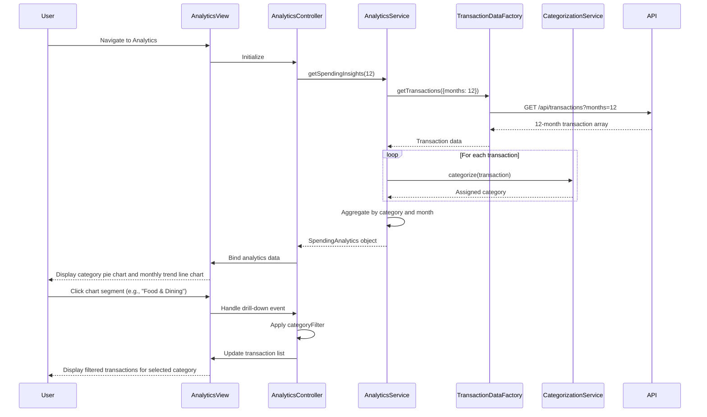

# Low-Level Design: Analytics and Spending Insights
**Epic ID:** QE-8598

## a. Architecture Mapping

**AngularJS Artifacts:**
- **Module:** `creditCard.analytics` - Root module for analytics feature
- **Controller:** `AnalyticsController` - Manages analytics view state and user interactions
- **Service:** `AnalyticsService` - Orchestrates data retrieval, categorization, and aggregation
- **Service:** `CategorizationService` - Classifies transactions into 9 predefined spending categories
- **Factory:** `TransactionDataFactory` - Encapsulates REST API calls for transaction history
- **Directive:** `spendingChart` - Renders interactive charts using Chart.js or D3.js wrapper
- **Filter:** `categoryFilter` - Filters transactions by selected category

**Folder Structure:**
```
app/
├── modules/
│   └── analytics/
│       ├── analytics.module.js
│       ├── controllers/
│       │   └── analytics.controller.js
│       ├── services/
│       │   ├── analytics.service.js
│       │   └── categorization.service.js
│       ├── factories/
│       │   └── transaction-data.factory.js
│       ├── directives/
│       │   └── spending-chart.directive.js
│       ├── filters/
│       │   └── category.filter.js
│       └── views/
│           └── analytics.html
├── assets/
│   └── css/
│       └── analytics.css
```

## b. Component Specifications

| Name | Artifact Type | Responsibility | Key Dependencies |
|------|---------------|----------------|------------------|
| creditCard.analytics | Module | Declares analytics feature module and chart library dependencies | ngRoute, chart.js |
| AnalyticsController | Controller | Manages filter state, chart data binding, and drill-down interactions | AnalyticsService, $scope, $filter |
| AnalyticsService | Service | Retrieves transactions, invokes categorization, aggregates spending by category and month | TransactionDataFactory, CategorizationService, $q |
| CategorizationService | Service | Classifies each transaction into one of 9 categories based on merchant/MCC code | None |
| TransactionDataFactory | Factory | Provides REST API methods for fetching 12-month transaction history | $resource |
| spendingChart | Directive | Renders interactive pie/bar charts with click handlers for drill-down | Chart.js library |
| categoryFilter | Filter | Filters transaction array by selected category name | None |

## c. Data Model

**Transaction Model (transactionModel.js):**
```javascript
const Transaction = {
  transactionId: String,
  cardId: String,
  amount: Number,
  merchantName: String,
  mccCode: String,             // Merchant Category Code
  transactionDate: Date,
  category: String,            // Assigned by CategorizationService
  description: String
};
```

**Spending Analytics Model:**
```javascript
const SpendingAnalytics = {
  categorySpending: Object,    // { "Food & Dining": 1500, "Fuel": 800, ... }
  monthlyTrend: Array,         // [{ month: "Jan", total: 5000 }, ...]
  categories: Array            // ["Food & Dining", "Fuel", "Shopping", "Travel", "Entertainment", "Utilities", "Healthcare", "Education", "Miscellaneous"]
};
```

## d. Data Flow

User navigates to analytics view → `AnalyticsController` calls `AnalyticsService.getSpendingInsights(12)` → Service invokes `TransactionDataFactory.getTransactions({ months: 12 })` via REST API → Factory returns 12-month transaction array → Service passes each transaction to `CategorizationService.categorize(transaction)` which assigns category based on MCC code/merchant name → Service aggregates categorized transactions by category and by month → Returns `SpendingAnalytics` object to controller → Controller binds data to `$scope.analytics` → View renders `spending-chart` directive with category data (pie chart) and monthly trend data (line chart) → User clicks chart segment → Directive emits event → Controller applies `categoryFilter` to display filtered transaction list.

## e. Primary Sequence Diagram



## f. Implementation Notes

- Use Chart.js via angular-chart.js directive wrapper for declarative chart rendering with two-way data binding
- Implement CategorizationService with MCC code mapping object (e.g., `{ "5411": "Food & Dining", "5542": "Fuel" }`) and fallback to keyword matching on merchant name
- Cache categorized transactions in AnalyticsService using `$cacheFactory` to avoid re-categorization on filter changes
- Use ES6 `Array.reduce()` for aggregating spending by category and `Array.map()` for monthly trend calculation
- Apply lazy loading for analytics module using `$ocLazyLoad` if not accessed frequently

## g. Error Handling

Try/catch blocks in CategorizationService with fallback to "Miscellaneous" category; HTTP errors caught by interceptor with user notification and retry button.

## h. Security Notes

Standard input validation and secure API calls assumed; transaction data retrieved via authenticated endpoints with user-scoped access control.