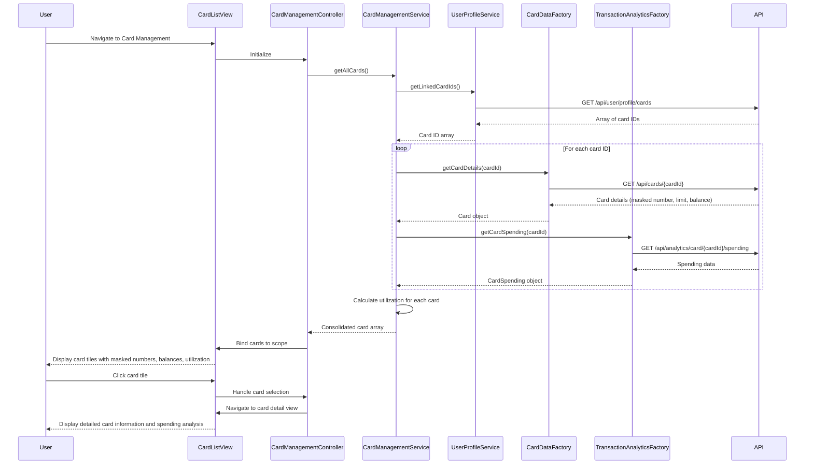

# Low-Level Design: Multi-Card Management and Tracking
**Epic ID:** QE-8599

## a. Architecture Mapping

**AngularJS Artifacts:**
- **Module:** `creditCard.management` - Root module for multi-card management feature
- **Controller:** `CardManagementController` - Manages card list state, selection, and filtering
- **Service:** `CardManagementService` - Orchestrates card data retrieval and spend analysis
- **Service:** `UserProfileService` - Retrieves user-linked card IDs
- **Factory:** `CardDataFactory` - Encapsulates REST API calls for card details and balances
- **Factory:** `TransactionAnalyticsFactory` - Provides card-specific spending data via REST API
- **Directive:** `cardTile` - Reusable component for displaying individual card summary with masked number
- **Filter:** `cardFilter` - Filters card list by card type or issuer

**Folder Structure:**
```
app/
├── modules/
│   └── card-management/
│       ├── card-management.module.js
│       ├── controllers/
│       │   └── card-management.controller.js
│       ├── services/
│       │   ├── card-management.service.js
│       │   └── user-profile.service.js
│       ├── factories/
│       │   ├── card-data.factory.js
│       │   └── transaction-analytics.factory.js
│       ├── directives/
│       │   └── card-tile.directive.js
│       ├── filters/
│       │   └── card.filter.js
│       └── views/
│           ├── card-list.html
│           └── card-detail.html
├── assets/
│   └── css/
│       └── card-management.css
```

## b. Component Specifications

| Name | Artifact Type | Responsibility | Key Dependencies |
|------|---------------|----------------|------------------|
| creditCard.management | Module | Declares card management feature module and routing | ngRoute, ngResource |
| CardManagementController | Controller | Manages card list display, selection, and detail view navigation | CardManagementService, $scope, $location |
| CardManagementService | Service | Retrieves all user cards, aggregates card-wise spending, calculates utilization | UserProfileService, CardDataFactory, TransactionAnalyticsFactory, $q |
| UserProfileService | Service | Fetches user profile with linked card IDs | $http |
| CardDataFactory | Factory | Provides REST API methods for card details (limit, balance, masked number) | $resource |
| TransactionAnalyticsFactory | Factory | Provides REST API methods for card-specific transaction aggregation | $resource |
| cardTile | Directive | Renders card summary tile with masked number, balance, limit, and utilization bar | None |
| cardFilter | Filter | Filters cards by issuer, type, or status | None |

## c. Data Model

**Card Model (cardModel.js):**
```javascript
const Card = {
  cardId: String,
  maskedNumber: String,        // e.g., "**** **** **** 1234"
  cardType: String,            // e.g., "Visa", "Mastercard"
  issuer: String,
  creditLimit: Number,
  currentBalance: Number,
  availableCredit: Number,
  utilization: Number,         // Percentage: (balance / limit) * 100
  status: String               // "Active", "Inactive"
};
```

**Card Spending Model:**
```javascript
const CardSpending = {
  cardId: String,
  monthlySpend: Number,
  spendingTrend: Array,        // [{ month: "Jan", amount: 1200 }, ...]
  topCategories: Array         // [{ category: "Food & Dining", amount: 500 }, ...]
};
```

## d. Data Flow

User navigates to card management view → `CardManagementController` initializes and calls `CardManagementService.getAllCards()` → Service invokes `UserProfileService.getLinkedCardIds()` via REST API → Service receives array of card IDs → Service calls `CardDataFactory.getCardDetails(cardId)` for each card ID in parallel using `$q.all()` → Factory returns card details with masked numbers → Service calls `TransactionAnalyticsFactory.getCardSpending(cardId)` for each card → Factory returns spending data → Service calculates utilization percentage for each card → Service returns consolidated array of Card objects with spending data → Controller binds to `$scope.cards` → View renders grid of `card-tile` directives → User clicks card tile → Controller navigates to card detail view with selected card data.

## e. Primary Sequence Diagram



## f. Implementation Notes

- Use `$q.all()` to parallelize card detail and spending API calls for performance (must complete within 3-second NFR)
- Implement cardTile directive with isolated scope and two-way binding for card object; use Bootstrap progress bar for utilization visualization
- Store card data in CardManagementService as singleton to avoid redundant API calls on view re-entry; invalidate cache on explicit refresh
- Use ES6 template literals for masked card number formatting and `Array.filter()` for cardFilter implementation
- Apply CSS Grid or Bootstrap card deck for responsive multi-card layout supporting up to 10 cards

## g. Error Handling

HTTP interceptor handles API failures; partial success scenario (some cards load, others fail) displays loaded cards with error badge on failed tiles and retry option.

## h. Security Notes

Requires token-based auth via existing SSO; all card numbers must be masked (only last 4 digits visible) in UI and API responses; no full card numbers transmitted or stored client-side.