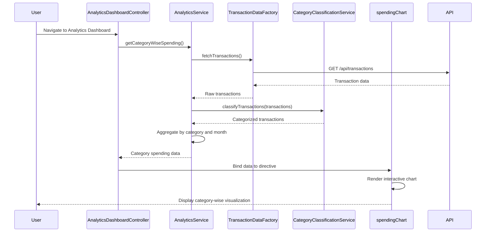

# Low-Level Design: Transaction Analytics and Category-wise Spending Insights
**Epic ID:** QE-8600  
**Branch:** PERFTEST20261109190052

---

## a. Architecture Mapping

- **Analytics Dashboard UI** → AngularJS Module (`app.analytics`) + Controller (`AnalyticsDashboardController`)
- **Analytics Processing Module** → Service (`AnalyticsService`) for aggregation and computation logic
- **Transaction Data Service** → Factory (`TransactionDataFactory`) for REST API integration
- **Category Classification Engine** → Service (`CategoryClassificationService`) for categorization logic
- **Visualization Engine** → Directive (`spendingChart`) for rendering interactive charts
- **Dashboard Service** → Factory (`DashboardIntegrationFactory`) for consolidated view integration

**Recommended Folder Structure:**
```
app/
├── modules/analytics/
│   ├── controllers/analyticsDashboard.controller.js
│   ├── services/analytics.service.js
│   ├── services/categoryClassification.service.js
│   ├── directives/spendingChart.directive.js
│   ├── factories/transactionData.factory.js
│   ├── factories/dashboardIntegration.factory.js
│   └── views/analytics-dashboard.html
```

---

## b. Component Specifications

| Component Name | Artifact Type | Responsibility | Key Dependencies |
|----------------|---------------|----------------|------------------|
| AnalyticsDashboardController | Controller | Orchestrates analytics dashboard view, handles user interactions, binds data to view | AnalyticsService, TransactionDataFactory, $scope |
| AnalyticsService | Service | Aggregates transaction data by category and month, computes spending patterns | CategoryClassificationService, TransactionDataFactory |
| CategoryClassificationService | Service | Assigns transactions to one of nine predefined categories using classification rules | None |
| TransactionDataFactory | Factory | Fetches transaction records from REST API, caches results | $http, $q |
| spendingChart | Directive | Renders interactive category-wise and monthly trend charts using D3.js or Chart.js | AnalyticsService |
| DashboardIntegrationFactory | Factory | Provides consolidated analytics data to main dashboard module | AnalyticsService |

---

## c. Data Model

**Transaction Model:**
```javascript
{
  transactionId: String,
  cardId: String,
  amount: Number,
  category: String, // One of: Food & Dining, Fuel, Shopping, Travel, Entertainment, Utilities, Healthcare, Education, Miscellaneous
  date: Date,
  description: String,
  merchantName: String
}
```

**CategorySpending Model:**
```javascript
{
  category: String,
  totalSpend: Number,
  transactionCount: Number,
  percentageOfTotal: Number
}
```

**MonthlyTrend Model:**
```javascript
{
  month: String, // YYYY-MM format
  categoryBreakdown: Array<CategorySpending>,
  totalSpend: Number
}
```

---

## d. Data Flow

User navigates to analytics dashboard → AnalyticsDashboardController initializes and calls AnalyticsService → AnalyticsService requests transaction data via TransactionDataFactory (REST API call) → CategoryClassificationService assigns categories to transactions → AnalyticsService aggregates data by category and month → spendingChart directive receives aggregated data and renders interactive visualizations → User interacts with charts (filter, drill-down) → Controller updates view based on user selections.

---

## e. Primary Sequence Diagram



---

## f. Implementation Notes

- Use AngularJS Dependency Injection for all services, factories, and controllers to ensure testability and modularity.
- Implement CategoryClassificationService with rule-based logic; consider strategy pattern for future ML-based classification.
- Use Chart.js or D3.js within spendingChart directive for responsive, interactive visualizations with event binding.
- TransactionDataFactory should implement caching ($cacheFactory) to minimize redundant API calls during user interactions.
- Apply ES6 arrow functions and const/let for cleaner, modern JavaScript code within services and controllers.

---

## g. Error Handling

HTTP interceptor captures API failures; AnalyticsService wraps promises with try/catch; user notified via toast notification service for data load errors.

---

## h. Security Notes

Requires token-based authentication via existing SSO; transaction data API calls include auth headers; standard input validation applied.

---

**End of LLD for QE-8600**