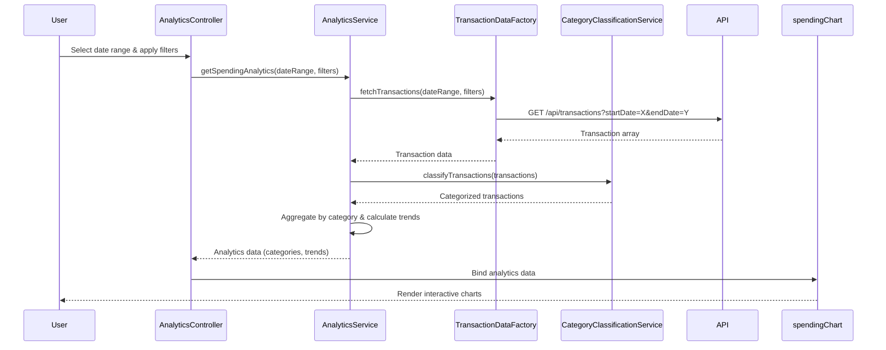

# Low-Level Design: Transaction Analytics and Category-wise Spending Insights
**Epic ID:** QE-8600

## a. Architecture Mapping

- **Analytics UI** → AngularJS Module (`analyticsModule`) + Controller (`AnalyticsController`)
- **Analytics Engine** → AngularJS Service (`AnalyticsService`) for business logic and calculations
- **Transaction Data Service** → AngularJS Factory (`TransactionDataFactory`) for REST API integration
- **Category Classification Engine** → AngularJS Service (`CategoryClassificationService`) for categorization logic
- **Visualization Service** → AngularJS Directive (`spendingChart`) wrapping charting library (Chart.js/D3.js)
- **Dashboard Service** → AngularJS Service (`DashboardIntegrationService`) for cross-module communication

**Recommended Folder Structure:**
```
app/
├── modules/
│   └── analytics/
│       ├── controllers/
│       ├── services/
│       ├── directives/
│       ├── views/
│       └── analytics.module.js
├── shared/
│   ├── factories/
│   └── services/
└── assets/
    └── css/
```

## b. Component Specifications

| Component Name | Artifact Type | Responsibility | Key Dependencies |
|----------------|---------------|----------------|------------------|
| AnalyticsController | Controller | Manages analytics view state, user interactions, and coordinates data flow between services and view | AnalyticsService, TransactionDataFactory, $scope |
| AnalyticsService | Service | Performs spending calculations, aggregates category-wise data, generates monthly trends | CategoryClassificationService, $q |
| TransactionDataFactory | Factory | Fetches transaction records from REST API with filtering and date range support | $http, $q |
| CategoryClassificationService | Service | Classifies transactions into nine predefined categories using rule-based logic | None |
| spendingChart | Directive | Renders interactive charts (pie, bar, line) for category and trend visualization | Chart.js/D3.js library |
| DashboardIntegrationService | Service | Broadcasts analytics summary data to dashboard module via $rootScope events | $rootScope |

## c. Data Model

**Transaction Model:**
```javascript
{
  id: String,
  cardId: String,
  amount: Number,
  category: String, // One of 9 categories
  date: Date,
  description: String,
  merchantName: String
}
```

**CategorySpending Model:**
```javascript
{
  category: String,
  totalAmount: Number,
  transactionCount: Number,
  percentage: Number
}
```

**MonthlyTrend Model:**
```javascript
{
  month: String, // YYYY-MM format
  totalSpend: Number,
  categoryBreakdown: Array<CategorySpending>
}
```

## d. Data Flow

User selects date range and filters in Analytics View → AnalyticsController captures input and calls AnalyticsService.getSpendingAnalytics() → AnalyticsService invokes TransactionDataFactory.fetchTransactions() to retrieve data via REST API → Transactions are passed to CategoryClassificationService for categorization → AnalyticsService aggregates data into category-wise spending and monthly trends → Processed data is returned to Controller → Controller binds data to $scope → spendingChart directive renders interactive visualizations → User interactions (hover, click) update view via two-way binding.

## e. Primary Sequence Diagram



## f. Implementation Notes

- Use AngularJS dependency injection to inject services into controllers and other services for testability and modularity
- Implement promise-based async handling with $q for all API calls in TransactionDataFactory
- Apply ES6 arrow functions and const/let for cleaner service and controller code
- Use directive's link function to initialize Chart.js with scope-watched data for reactive chart updates
- Cache categorization rules in CategoryClassificationService using a constant or config block to avoid repeated lookups

## g. Error Handling

HTTP interceptor captures API errors; services reject promises with error objects; controller displays user-friendly error messages via Bootstrap alerts.

## h. Security Notes

Requires token-based auth via existing SSO; API calls include Authorization header with JWT token.