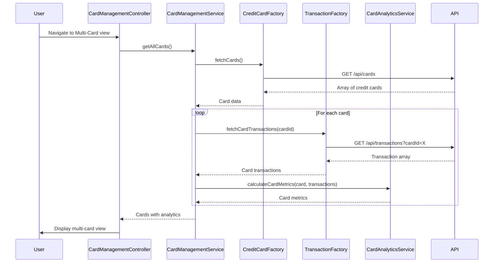

# Low-Level Design: Multi-Card Management and Tracking
**Epic ID:** QE-8601

## a. Architecture Mapping

- **Multi-Card UI** → AngularJS Module (`cardManagementModule`) + Controller (`CardManagementController`)
- **Card Management Service** → AngularJS Service (`CardManagementService`) for card operations and state management
- **Credit Card Repository** → AngularJS Factory (`CreditCardFactory`) for REST API integration
- **Transaction Processing System** → AngularJS Factory (`TransactionFactory`) for transaction data retrieval
- **Analytics Component** → AngularJS Service (`CardAnalyticsService`) for card comparison and trend analysis

**Recommended Folder Structure:**
```
app/
├── modules/
│   └── card-management/
│       ├── controllers/
│       ├── services/
│       ├── views/
│       └── card-management.module.js
├── shared/
│   ├── factories/
│   └── components/
└── assets/
```

## b. Component Specifications

| Component Name | Artifact Type | Responsibility | Key Dependencies |
|----------------|---------------|----------------|------------------|
| CardManagementController | Controller | Manages multi-card view state, handles user interactions for card selection and comparison | CardManagementService, CardAnalyticsService, $scope |
| CardManagementService | Service | Orchestrates card data retrieval, maintains card list state, coordinates with analytics | CreditCardFactory, TransactionFactory, $q |
| CreditCardFactory | Factory | Fetches credit card details and balances from REST API | $http, $q |
| TransactionFactory | Factory | Retrieves card-specific transaction data for spending analysis | $http, $q |
| CardAnalyticsService | Service | Calculates card utilization rates, spending patterns, and generates comparison metrics | None |
| cardSummary | Directive | Renders individual card summary widget with key metrics and visual indicators | None |

## c. Data Model

**CreditCard Model:**
```javascript
{
  cardId: String,
  cardNumber: String, // Masked
  cardType: String, // Visa, Mastercard, etc.
  creditLimit: Number,
  availableCredit: Number,
  outstandingBalance: Number,
  expiryDate: String,
  cardholderName: String
}
```

**CardSpending Model:**
```javascript
{
  cardId: String,
  monthlySpend: Number,
  utilizationRate: Number, // Percentage
  topCategories: Array<{category: String, amount: Number}>
}
```

**CardComparison Model:**
```javascript
{
  cardId: String,
  totalSpend: Number,
  utilizationRate: Number,
  transactionCount: Number
}
```

## d. Data Flow

User navigates to Multi-Card Management view → CardManagementController initializes and calls CardManagementService.getAllCards() → Service invokes CreditCardFactory.fetchCards() to retrieve card list via REST API → For each card, TransactionFactory.fetchCardTransactions(cardId) retrieves spending data → CardAnalyticsService processes transaction data to calculate utilization and spending patterns → Aggregated card data with analytics is returned to Controller → Controller binds data to $scope → View renders card list using ng-repeat with cardSummary directive → User selects cards for comparison triggering CardAnalyticsService.compareCards().

## e. Primary Sequence Diagram



## f. Implementation Notes

- Use AngularJS $q.all() to fetch all card transactions in parallel for improved performance
- Implement CardManagementService as singleton to maintain card state across view transitions
- Apply ES6 template literals for dynamic API endpoint construction in factories
- Use ng-repeat with track by cardId for efficient DOM updates when card data changes
- Cache card data in CardManagementService with configurable TTL to reduce API calls

## g. Error Handling

HTTP interceptor handles API failures; factories return rejected promises; controller displays error notification using Bootstrap toast component.

## h. Security Notes

Card numbers are masked on client-side; API endpoints require JWT authentication; sensitive card data transmitted over HTTPS only.