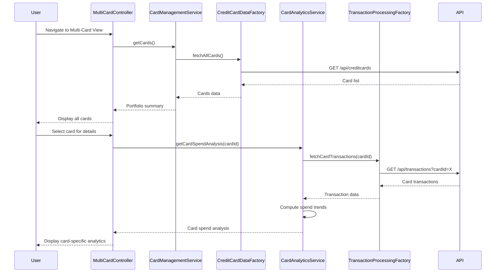

# Low-Level Design: Multi-Card Management and Tracking
**Epic ID:** QE-8601  
**Branch:** PERFTEST20261109190052

---

## a. Architecture Mapping

- **Multi-Card UI** → AngularJS Module (`app.multiCard`) + Controller (`MultiCardController`)
- **Card Management Module** → Service (`CardManagementService`) for card operations and state management
- **Credit Card Data Repository** → Factory (`CreditCardDataFactory`) for REST API integration
- **Transaction Processing System** → Factory (`TransactionProcessingFactory`) for card-specific transaction data
- **Card Analytics Engine** → Service (`CardAnalyticsService`) for card-wise spend analysis and comparison

**Recommended Folder Structure:**
```
app/
├── modules/multiCard/
│   ├── controllers/multiCard.controller.js
│   ├── services/cardManagement.service.js
│   ├── services/cardAnalytics.service.js
│   ├── factories/creditCardData.factory.js
│   ├── factories/transactionProcessing.factory.js
│   └── views/multi-card.html
```

---

## b. Component Specifications

| Component Name | Artifact Type | Responsibility | Key Dependencies |
|----------------|---------------|----------------|------------------|
| MultiCardController | Controller | Manages multi-card view, handles card selection, displays card details and comparisons | CardManagementService, CardAnalyticsService, $scope |
| CardManagementService | Service | Maintains card list state, provides card CRUD operations, handles card selection logic | CreditCardDataFactory |
| CardAnalyticsService | Service | Computes card-wise spending, monthly trends per card, and portfolio-level aggregations | TransactionProcessingFactory, CreditCardDataFactory |
| CreditCardDataFactory | Factory | Fetches credit card details, balances, and metadata from REST API | $http, $q |
| TransactionProcessingFactory | Factory | Retrieves card-specific transaction history and spending data from API | $http, $q |

---

## c. Data Model

**CreditCard Model:**
```javascript
{
  cardId: String,
  cardNumber: String, // Masked (e.g., ****1234)
  cardType: String, // Visa, MasterCard, Amex, etc.
  cardHolderName: String,
  creditLimit: Number,
  availableCredit: Number,
  outstandingAmount: Number,
  expiryDate: String, // MM/YY
  issuer: String
}
```

**CardSpendAnalysis Model:**
```javascript
{
  cardId: String,
  monthlySpend: Number,
  categoryBreakdown: Array<{category: String, amount: Number}>,
  trendData: Array<{month: String, spend: Number}>
}
```

**PortfolioSummary Model:**
```javascript
{
  totalCards: Number,
  totalCreditLimit: Number,
  totalAvailableCredit: Number,
  totalOutstanding: Number,
  cards: Array<CreditCard>
}
```

---

## d. Data Flow

User navigates to multi-card view → MultiCardController initializes and calls CardManagementService.getCards() → CreditCardDataFactory fetches card list via REST API → CardManagementService populates card list in scope → User selects a card → Controller calls CardAnalyticsService.getCardSpendAnalysis(cardId) → TransactionProcessingFactory retrieves card-specific transactions → CardAnalyticsService computes spend trends and category breakdown → Controller updates view with card details and analytics → User can compare cards or view portfolio summary.

---

## e. Primary Sequence Diagram



---

## f. Implementation Notes

- Use AngularJS $scope inheritance for card selection state management across nested views.
- CardManagementService should maintain a singleton card list to avoid redundant API calls; use service pattern for shared state.
- Implement card comparison using normalized metrics (utilization %, spend per category) for fair evaluation across different credit limits.
- TransactionProcessingFactory should support query parameters (cardId, dateRange) for efficient card-specific data retrieval.
- Apply ES6 template literals for dynamic card display formatting and masked card number rendering.

---

## g. Error Handling

HTTP interceptor handles API errors; CardManagementService uses promise rejection with user-friendly messages; toast notifications for card load failures.

---

## h. Security Notes

Card numbers are masked on client-side; API returns only last 4 digits; token-based auth required for all card data endpoints.

---

**End of LLD for QE-8601**