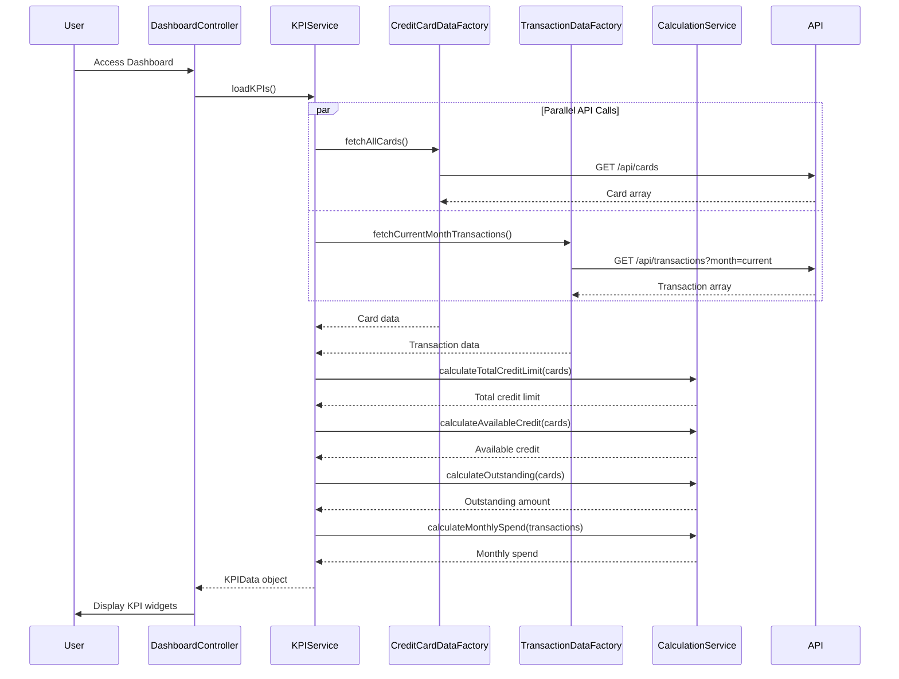

# Low-Level Design: Credit Card Dashboard and KPI Management
**Epic ID:** QE-8602

## a. Architecture Mapping

- **Dashboard UI** → AngularJS Module (`dashboardModule`) + Controller (`DashboardController`)
- **KPI Management Service** → AngularJS Service (`KPIService`) for KPI calculation and aggregation
- **Credit Card Data Service** → AngularJS Factory (`CreditCardDataFactory`) for card data API integration
- **Transaction Data Service** → AngularJS Factory (`TransactionDataFactory`) for transaction API integration
- **Calculation Engine** → AngularJS Service (`CalculationService`) for real-time financial calculations

**Recommended Folder Structure:**
```
app/
├── modules/
│   └── dashboard/
│       ├── controllers/
│       ├── services/
│       ├── directives/
│       ├── views/
│       └── dashboard.module.js
├── shared/
│   └── factories/
└── assets/
```

## b. Component Specifications

| Component Name | Artifact Type | Responsibility | Key Dependencies |
|----------------|---------------|----------------|------------------|
| DashboardController | Controller | Manages dashboard state, coordinates KPI data loading, handles user refresh actions | KPIService, $scope, $interval |
| KPIService | Service | Orchestrates KPI data retrieval and aggregation across all user credit cards | CreditCardDataFactory, TransactionDataFactory, CalculationService, $q |
| CreditCardDataFactory | Factory | Fetches credit card details including limits and balances from REST API | $http, $q |
| TransactionDataFactory | Factory | Retrieves transaction data for monthly spend calculations | $http, $q |
| CalculationService | Service | Performs financial calculations for total credit limit, available credit, outstanding amounts | None |
| kpiWidget | Directive | Renders individual KPI card with value, label, and visual indicator (icon/color) | None |

## c. Data Model

**KPIData Model:**
```javascript
{
  monthlySpend: Number,
  totalCreditLimit: Number,
  availableCredit: Number,
  outstandingAmount: Number,
  lastUpdated: Date
}
```

**CreditCardSummary Model:**
```javascript
{
  cardId: String,
  creditLimit: Number,
  availableCredit: Number,
  currentBalance: Number
}
```

**MonthlySpendSummary Model:**
```javascript
{
  currentMonth: String,
  totalSpend: Number,
  transactionCount: Number
}
```

## d. Data Flow

User accesses Dashboard → DashboardController initializes and calls KPIService.loadKPIs() → KPIService invokes CreditCardDataFactory.fetchAllCards() and TransactionDataFactory.fetchCurrentMonthTransactions() in parallel using $q.all() → Credit card data and transaction data are retrieved via REST APIs → CalculationService aggregates total credit limit, available credit, and outstanding amounts from card data → CalculationService calculates monthly spend from transaction data → KPIService returns consolidated KPIData object to Controller → Controller binds KPIs to $scope → View renders four KPI widgets using kpiWidget directive with two-way data binding.

## e. Primary Sequence Diagram



## f. Implementation Notes

- Use $q.all() in KPIService to fetch card and transaction data concurrently for optimized load time
- Implement CalculationService as stateless utility service with pure functions for testability
- Apply ES6 reduce() and map() for aggregating card limits and calculating totals
- Use $interval in DashboardController for auto-refresh of KPIs every 5 minutes with configurable interval
- Implement kpiWidget directive with isolated scope for reusability across different KPI types

## g. Error Handling

API errors caught by HTTP interceptor; KPIService returns partial data with error flags; controller displays warning banner for failed KPIs.

## h. Security Notes

Requires token-based auth via existing SSO; all API endpoints validate JWT token before returning financial data.