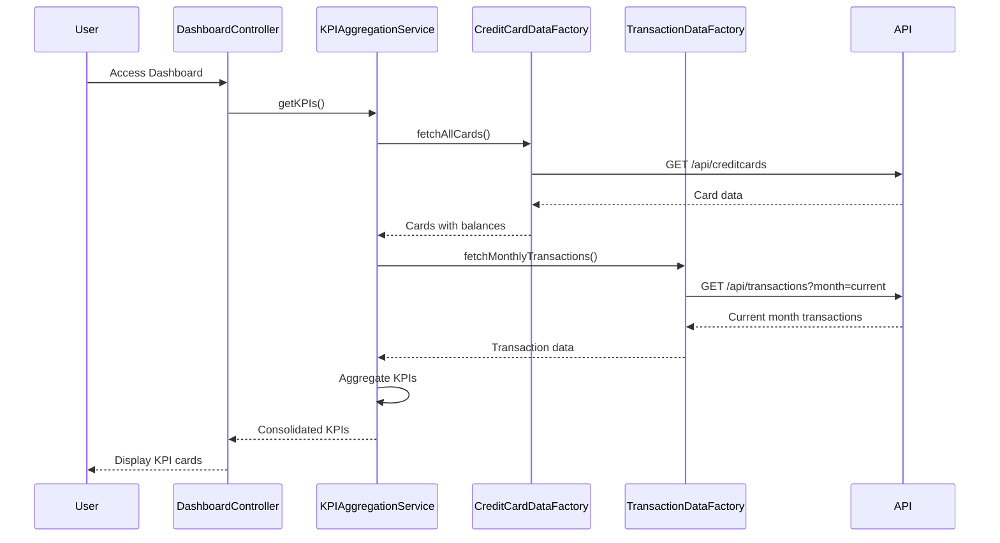

# Low-Level Design: Credit Card Dashboard and KPI Management
**Epic ID:** QE-8602  
**Branch:** PERFTEST20261109190052

---

## a. Architecture Mapping

- **User Web/Mobile Client** → AngularJS Module (`app.dashboard`) with responsive views
- **Dashboard Controller** → Controller (`DashboardController`) orchestrating KPI display
- **KPI Aggregation Service** → Service (`KPIAggregationService`) for computing consolidated metrics
- **Credit Card Data Service** → Factory (`CreditCardDataFactory`) for card details and balances
- **Transaction Data Service** → Factory (`TransactionDataFactory`) for monthly spend calculations

**Recommended Folder Structure:**
```
app/
├── modules/dashboard/
│   ├── controllers/dashboard.controller.js
│   ├── services/kpiAggregation.service.js
│   ├── factories/creditCardData.factory.js
│   ├── factories/transactionData.factory.js
│   └── views/dashboard.html
```

---

## b. Component Specifications

| Component Name | Artifact Type | Responsibility | Key Dependencies |
|----------------|---------------|----------------|------------------|
| DashboardController | Controller | Initializes dashboard, fetches KPIs, binds data to view, handles user interactions | KPIAggregationService, $scope, $timeout |
| KPIAggregationService | Service | Aggregates KPIs (monthly spend, total credit limit, available credit, outstanding) across all cards | CreditCardDataFactory, TransactionDataFactory |
| CreditCardDataFactory | Factory | Fetches credit card details, balances, and limits from REST API | $http, $q |
| TransactionDataFactory | Factory | Retrieves transaction data for monthly spend calculation | $http, $q |

---

## c. Data Model

**DashboardKPI Model:**
```javascript
{
  monthlySpend: Number,
  totalCreditLimit: Number,
  availableCredit: Number,
  outstandingAmount: Number,
  lastUpdated: Date
}
```

**CreditCard Model:**
```javascript
{
  cardId: String,
  cardNumber: String, // Masked
  creditLimit: Number,
  availableCredit: Number,
  outstandingAmount: Number
}
```

**Transaction Model:**
```javascript
{
  transactionId: String,
  cardId: String,
  amount: Number,
  date: Date,
  category: String
}
```

---

## d. Data Flow

User accesses dashboard → DashboardController initializes and calls KPIAggregationService.getKPIs() → KPIAggregationService requests card data via CreditCardDataFactory (REST API) and transaction data via TransactionDataFactory (REST API) → Service aggregates total credit limit, available credit, and outstanding amount from card data; computes monthly spend from current month transactions → KPIAggregationService returns consolidated KPI object → DashboardController binds KPIs to view → UI displays four KPI cards with responsive layout.

---

## e. Primary Sequence Diagram



---

## f. Implementation Notes

- Use AngularJS $q.all() in KPIAggregationService to parallelize API calls to CreditCardDataFactory and TransactionDataFactory for optimized load time.
- Implement responsive layout using Bootstrap grid system (col-md-3 for desktop, col-xs-12 for mobile) for KPI cards.
- Apply AngularJS filters for currency formatting (| currency) and number formatting in view templates.
- Use $timeout for periodic KPI refresh (optional) to simulate near-real-time updates without WebSocket overhead.
- Leverage ES6 array methods (reduce, map) in KPIAggregationService for clean aggregation logic across multiple cards.

---

## g. Error Handling

HTTP interceptor captures API failures; KPIAggregationService returns partial KPIs if one API call fails; user notified via inline error message on dashboard.

---

## h. Security Notes

Requires token-based auth via existing SSO; all API calls include authorization headers; card data is masked on client-side.

---

**End of LLD for QE-8602**