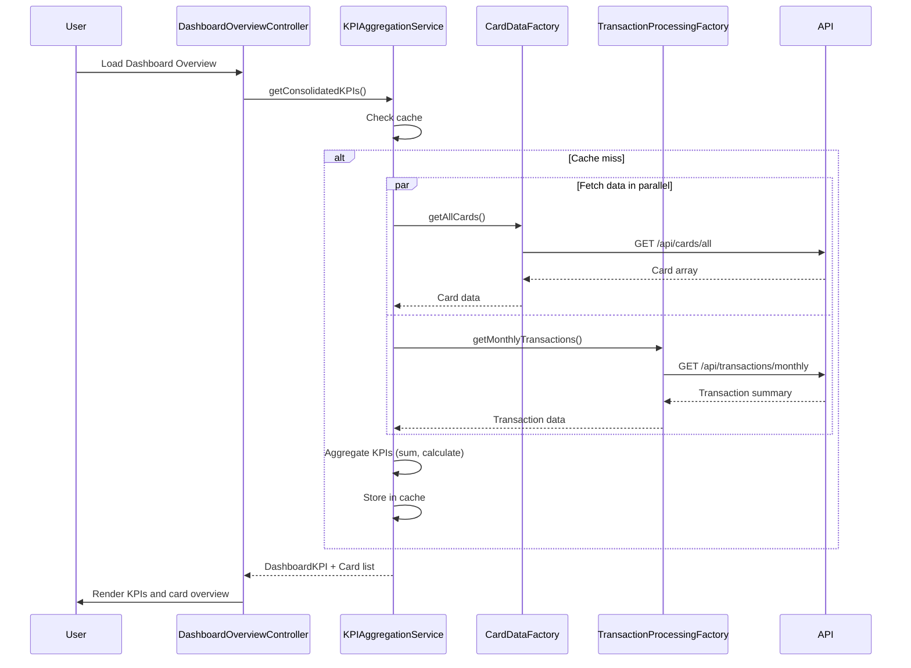

# Low-Level Design: Dashboard KPIs and Credit Card Overview
**Epic ID:** QE-8603

## a. Architecture Mapping

- **User Dashboard** → AngularJS Module (`dashboardOverviewModule`) + Controller (`DashboardOverviewController`)
- **KPI Aggregation Service** → AngularJS Service (`KPIAggregationService`) for KPI computation and caching
- **Credit Card Data Service** → AngularJS Factory (`CardDataFactory`) for card information API calls
- **Transaction Processing Service** → AngularJS Factory (`TransactionProcessingFactory`) for transaction data API calls

**Recommended Folder Structure:**
```
app/
├── modules/
│   └── dashboard-overview/
│       ├── controllers/
│       ├── services/
│       ├── views/
│       └── dashboard-overview.module.js
├── shared/
│   ├── factories/
│   └── directives/
└── assets/
```

## b. Component Specifications

| Component Name | Artifact Type | Responsibility | Key Dependencies |
|----------------|---------------|----------------|------------------|
| DashboardOverviewController | Controller | Manages dashboard overview state, initiates KPI loading, handles multi-card display logic | KPIAggregationService, $scope |
| KPIAggregationService | Service | Aggregates KPI data across multiple cards, caches results, performs financial calculations | CardDataFactory, TransactionProcessingFactory, $q, $cacheFactory |
| CardDataFactory | Factory | Retrieves credit card details and balances from REST API | $http, $q |
| TransactionProcessingFactory | Factory | Fetches transaction data for monthly spend and outstanding calculations | $http, $q |
| kpiCard | Directive | Renders individual KPI display card with formatted value and responsive layout | $filter |
| creditCardList | Directive | Displays list of credit cards with summary information in responsive grid | None |

## c. Data Model

**DashboardKPI Model:**
```javascript
{
  monthlySpend: Number,
  totalCreditLimit: Number,
  availableCredit: Number,
  outstandingAmount: Number,
  cardCount: Number
}
```

**CreditCard Model:**
```javascript
{
  cardId: String,
  cardName: String,
  maskedNumber: String,
  creditLimit: Number,
  availableCredit: Number,
  currentBalance: Number,
  cardType: String
}
```

**TransactionSummary Model:**
```javascript
{
  totalAmount: Number,
  transactionCount: Number,
  period: String // Current month
}
```

## d. Data Flow

User lands on Dashboard Overview → DashboardOverviewController calls KPIAggregationService.getConsolidatedKPIs() → Service checks $cacheFactory for cached KPI data → If cache miss, service invokes CardDataFactory.getAllCards() and TransactionProcessingFactory.getMonthlyTransactions() in parallel → API responses return card details and transaction summaries → KPIAggregationService aggregates monthly spend, sums total credit limits, calculates available credit, and computes outstanding amounts → Aggregated KPIs are cached and returned to Controller → Controller binds KPIs and card list to $scope → View renders KPI cards and credit card list using directives with responsive Bootstrap grid.

## e. Primary Sequence Diagram



## f. Implementation Notes

- Use $cacheFactory in KPIAggregationService with 5-minute TTL to reduce redundant API calls for KPI data
- Implement parallel API calls with $q.all() for optimal dashboard load performance
- Apply ES6 destructuring and spread operator for cleaner data aggregation in service methods
- Use Bootstrap responsive grid classes (col-xs, col-sm, col-md) in view templates for multi-device support
- Implement $filter('currency') in kpiCard directive for consistent financial value formatting

## g. Error Handling

HTTP interceptor captures API errors; services return partial data with error indicators; controller shows Bootstrap alert for missing data.

## h. Security Notes

Requires token-based auth via existing SSO; sensitive financial data masked appropriately in UI.